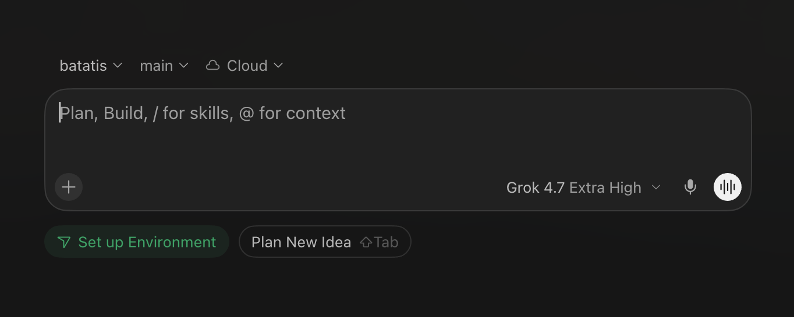

# Minimal UI

These are the user's rules for every interface they make. They say what a screen must have and must not have, not how many pixels anything takes. A project's own design system still decides the look (fonts, tokens, light or dark). This skill decides what goes on screen, how much of it, and what stands out.

The rules work together. Most mistakes come from applying one rule and breaking another, so read the whole page before designing anything.

## The rules

### 1. One major thing at a time

Every screen does one job. One thing holds the eye: a form, a document, a list, a composer, a question. Minor things may support it (a breadcrumb, a status, a suggestion row), but they stay visibly smaller and quieter than the major thing.

Two major things on one screen is always wrong: a chat beside a form, a dashboard of equal tiles, an editor and a preview that compete for attention, a page that tells two stories. If a second job is needed, it goes on the next screen, in a drawer that replaces focus, or behind a control.

### 2. As much capability as possible, shown only when needed

Minimal never means fewer features. The user wants the app to do a lot. Every capability stays one step away (a menu, a `+`, a picker, the next screen) and appears when the person reaches for it. Hover and keyboard shortcuts are extra ways in, never the only way: touch screens have no hover. What is needed now is visible. What is needed sometimes is one step away. What is never needed is deleted.

A capability that was cut to make the screen simpler is a bug. A capability that is always on screen but rarely used is also a bug.

### 3. If it can be removed and the app still works, remove it

For every word, line, icon, border, box and colour, ask: if this were gone, could the person still use the screen? If yes, remove it. Do the same for whole sections, headers, subtitles, dividers and wrappers. What is left should be the smallest set that still works.

This test applies to presentation and duplicates, never to capabilities. A capability that fails the test is moved one step away (rule 2), not deleted. Two things always pass the test: a short way to tell where you are (a screen or page name, the app's mark), and visible labels on form fields. A placeholder disappears when you type, so it replaces a label only when the control is the one obvious input on the screen, as in the reference example.

### 4. Icons, shape and colour speak; text does not explain

No text that explains how the UI works: no "here's how this works", no subtitle that restates the label, no "click here to…", no instructions under a field, no onboarding paragraph. A label is a few words. A familiar icon beats a word. A selected value shown in its control ("main ⌄") beats a sentence that describes the setting. When the person needs a hint, put it where they already look, such as one short placeholder line inside the input.

Text stays only when it does a job no icon can do: short labels and action names, content (the person's own, or content others wrote for them, such as a reviewer's note or quoted source text), an error and how to fix it, why something is blocked, a legal or safety boundary. Everything except content is short.

**Nothing sits above a title.** No eyebrow, kicker, overline, category, section letter, step number, stage name or tag goes over a heading or a question. The navigation already shows where the person is, so say it there, once. If the title needs that context, rewrite the title. Agents repeat this mistake more than any other, so check every screen for it.

### 5. Colour is for finding what matters

The screen is neutral by default. Colour is used only so the person finds the important thing faster: the one action they should take, where they are, something that needs attention, an error, telling crowded items apart. Each colour on screen must answer "what does this help the person find?" If there is no answer, the colour goes.

Do not use colour for decoration, variety, branding flourishes, "making it pop", a different colour per section, coloured icons, gradients, or a coloured fill on every button. When everything has colour, nothing stands out. That is the reason for the rule.

The app's own mark may keep its colour if it is small. Brand colour does not spread to anything else. When an error or blocking problem shows, it wins the eye over the primary action until it is resolved.

### 6. Unified, not scattered

All the controls that belong to the major thing live together in one component. They are not a card per button, a box per field and a panel per setting. A screen built from 20 separate boxes is wrong when those boxes could be one component. A button can still have its own shape. What is wrong is wrapping each control, field or group in its own card when they all serve the same thing.

**Unified does not mean putting more on screen.** This is the rule agents most often get wrong. "Unify it" does not mean "merge two jobs into one page" or "show everything at once". It means the one major thing gathers all its own controls into one coherent piece, and everything else is either a quiet minor support or hidden until needed. Rules 1 and 6 are the same rule seen from two sides. One major thing, built as one unified component.

**Few surfaces, no box per item.** A surface is anything with its own border, fill or shadow. Most screens need only the page, the one primary button, and a menu or drawer while it is open. Items inside the major thing (places, tokens, options, suggestions, list rows) are plain text with an icon at most. Do not give each item a pill, tile, card or border, and never put a box inside a box. Mark the selected or active item with ink, weight or a check mark, not a filled box. An input is a line of text with one hairline under it, or nothing.

### 7. Size and placement show what matters

The most important and most used things are the largest and sit inside the major component. The primary action has the strongest contrast on the screen. Things used less often are smaller, quieter and sit outside or at the edge. Settings that are chosen once and rarely changed sit furthest out. The person's eye should land first on the major thing, then on its primary action, then on nothing else.

## The reference example

This screenshot shows all seven rules working together. Use it as the pattern to follow, not as styling to copy.

- **One major thing:** the whole page is one composer for prompting an agent.
- **Lots of capability, little showing:** repo, branch, environment, attachments and more (`+`), model and effort, voice, and send (the white circle). Each is a small control that shows only its current value. The full options open on click.
- **Unified:** the input, the `+`, the model picker, the mic and send are all in one box. There is no card per control.
- **Hierarchy by size and placement:** the text area is the largest element. Send is the only high-contrast element. The model picker and voice are inside because they are used per prompt. Repo, branch and environment are outside, above and quieter, because they are set once and rarely changed.
- **No explanatory text:** the input is the one obvious control, so one placeholder line ("Plan, Build, / for skills, @ for context") teaches the shortcuts in the place the person is already looking.
- **Colour finds what matters:** the only coloured element is the one suggestion that needs action (the environment is not set up). Everything else is neutral.
- **Minor supports stay minor:** the suggestion chips under the box are small and quiet and lead back into the major thing.

## Must have

- One major thing per screen, which you can name in a short phrase without "and".
- One primary action, the most visually prominent control on the screen.
- Every capability of the app reachable within a step or two, from the screen where it is relevant.
- Controls that show their current value (the chosen model, the chosen branch), not a label plus a separate readout.
- Hierarchy by size, contrast and position that matches how important and how frequent each thing is.
- Errors, blocked states and their reasons visible when they happen. Minimal moves information. It never hides a problem.
- An accessible name and a hover or focus label for every icon-only control. When colour or an icon carries a status, the same status also exists as text for screen readers.
- Familiar icons only. If an icon could be misread, give it one word.

## Must not have

- A second major thing competing with the first.
- Sentences that explain how the UI works, subtitles that restate a label, or instructions that a control already makes obvious.
- The same action offered twice on one screen.
- A card, box or border around each control or small group that could be part of one component.
- Anything above a title or question: an eyebrow, kicker, overline, category, section letter, step or stage label, or tag.
- A pill, tile, card or bordered box around each item of a list, choice set, token field or menu; a box inside a box; a filled box marking the active item.
- Dividers, frames, badges and wrappers that exist only to separate or decorate.
- Colour without a job: decorative, per-section, gradient, coloured icons, coloured fills on secondary buttons.
- More than one thing competing for "most important" through size or colour.
- Rarely used settings permanently on display.
- Counts, badges or labels for zero or empty states ("0 messages").
- A capability removed to make the screen look simpler.

## When rules pull against each other

1. The screen must stay usable. Never remove something the person needs to finish the task.
2. One major thing. This beats "unified" and beats "show the capability".
3. Every capability stays reachable, one step away.
4. Remove everything else, and hide what is needed only sometimes.
5. Colour and size go to the most important remaining thing.

The user's newest explicit decision about a specific screen wins over this page, and so does a project design contract the user wrote or approved. A project's design contract decides the styling. If it conflicts with these rules about how much is on screen or what colour is for, these rules win unless the user said otherwise.

## Verify a screen

Run this on the real rendered UI (screenshots of the running app, at desktop and phone widths), not on the code alone. Check every state the person can reach: empty, filled, loading, error, menus and pickers open.

1. **Name the major thing.** Write it in one short phrase. If you need "and", or two areas pull the eye equally, it fails rule 1.
2. **List every visible element.** Mark each one as major, minor support, should be one step away, or remove. Apply the removal test (rule 3) to each. Anything marked "one step away" or "remove" is a finding.
3. **Read every word on screen.** Start above each title and question: anything printed there is a finding. Then flag any sentence that explains how to use the UI, restates a label, or could be an icon or a value shown in a control. Allowed text is the list in rule 4: short labels and action names, content, errors, blocked reasons, boundaries.
4. **List every colour that is not neutral.** For each, write what important thing it helps the person find. No answer means a finding. Too many coloured things also means a finding, because then nothing stands out.
5. **Count the containers.** List every border, fill and shadow. A box around a single item, a box inside a box, or more surfaces than the major thing needs is a finding. List the boxes, cards and panels. Two containers that serve the same major thing and are used together should be one component. Also check the opposite mistake: unification that pulled a second job onto the screen.
6. **Squint.** Blur your view of the screenshot, or look at it small. The first thing the eye lands on must be the major thing, the second must be its primary action. Rarely used controls should barely register.
7. **Check capability.** List what the person could do before the change. If there is no before-state, list what this screen should let the person do (from the feature list, the routes, or the code). Each item must be reachable, by touch too, not only by hover or shortcut. A missing capability is a finding, even if the screen looks better.

Report each finding as: the rule, the element, what is wrong, and the smallest fix (usually a removal or a move). Note which states and widths you looked at. A screenshot you did not open and look at is not evidence.
