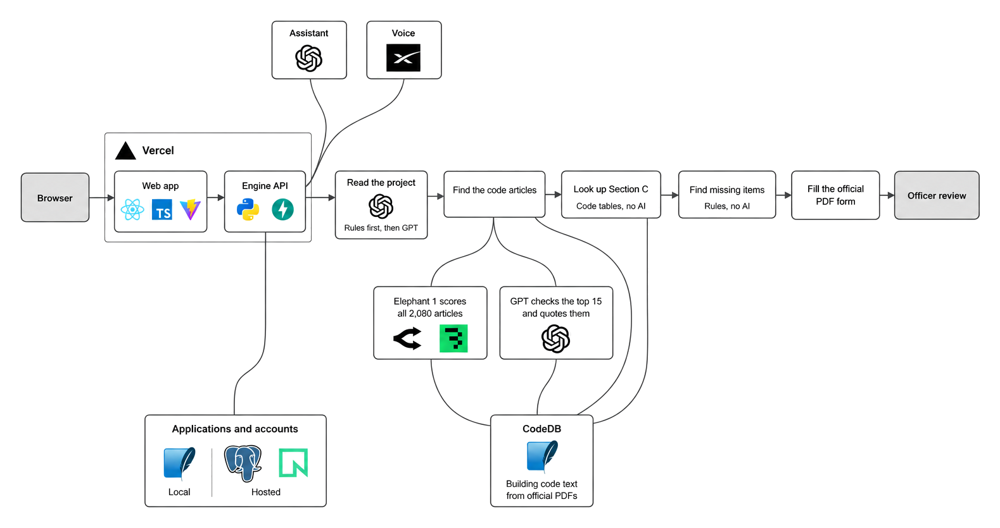
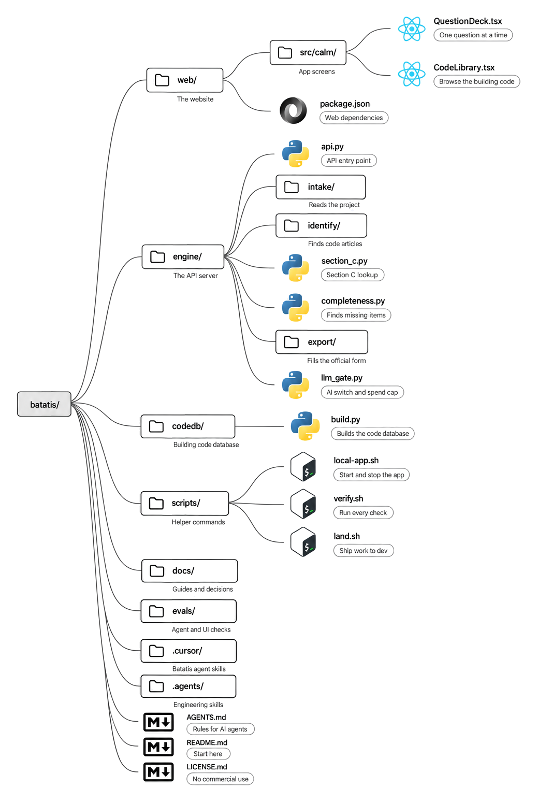

# Batatis

Batatis helps builders in Alberta prepare a complete building-code variance application. It also shows Safety Codes Officers what an application is missing.

[Open the app](https://batatis-vert.vercel.app) · [License](LICENSE.md)

## The problem

The building code describes a standard way to build each part of a building. A builder who wants to use a new product or method applies for a variance. The application must show, with code references and evidence, that the design performs at least as well as the standard way.

According to the challenge organizers, most first submissions fail because they are incomplete. The officer sends the application back, the builder fixes it, and each round adds weeks.

| Figure | What it counts | Source |
| --- | --- | --- |
| 3,088 | Building-code articles varied in Alberta, January to June 2026 | [Safety Codes Council Data Hub](https://www.safetycodes.ab.ca/data-hub/variance-data/) |
| 433 | Organizations that enforce safety codes in Alberta | [Council Annual Report 2025](https://ebs.safetycodes.ab.ca/documents/webdocs/SR/Annual%20Report%202025%20Final.pdf) |
| 2,317 | Certified Safety Codes Officers in Alberta | [Council Annual Report 2025](https://ebs.safetycodes.ab.ca/documents/webdocs/SR/Annual%20Report%202025%20Final.pdf) |
| 2 to 4 months | Time to allow for comments on an alternative solution | CWC and WoodWorks BC, *Alternative Solutions Guide* |
| Hundreds to tens of thousands of dollars | Cost of rework and delay on one application | Building Codes Challenge scope |

Nobody publishes how often applications come back incomplete, because the Council does not collect the documents. From December 1, 2026, officers must also register every variance in the Council's portal, with the documents they used ([IB-2026-10-01](https://ebs.safetycodes.ab.ca/documents/webdocs/SR/IB-2026-10-01%20Orders%20and%20Variances%20Registration%20Changes.pdf)).

## How variances work today


When a design doesn't follow the code as written, the builder prepares the variance application alone. They find the code articles, look up what each one is meant to achieve, explain the risks and safeguards, and choose the evidence. An officer then checks the package by hand. If anything is missing, the application goes back and the loop starts again. The delay comes from the red steps.

## Our solution


Batatis turns the variance form into a guided flow for the applicant and a checklist for the officer. It checks that an application is complete. It never says that a design is safe or meets the code. Engineers and the officer make those decisions.

### For applicants

Manufacturers, homebuilders, and general contractors use Batatis to prepare the application.

1. Describe the project in your own words, or drop in PDFs.
2. Answer the questions that Batatis still needs, one at a time.
3. Confirm the code articles that Batatis found. Each one quotes the code.
4. Section C of the form fills in from the code's own tables.
5. Plan your evidence. Batatis flags when an engineer or another professional is required.
6. Fix anything the checklist marks as missing. Then download the official form, or submit it to Edmonton or Calgary.

### For Safety Codes Officers

Officers use Batatis to see what an application is missing.

1. Pick up a new or resubmitted application from the review queue.
2. Read it on the official form, with its missing items and code checks beside it.
3. Accept it as administratively complete, return it with a message, or refuse it.
4. Close out the application after the decision.

## Features

For applicants:

- Sign up with email. The server can also offer Google and Microsoft sign-in.
- Describe a project in text or PDFs. Batatis reads the facts and asks only for what is missing.
- Answer Sections A to D one question at a time, including the rationale, risk assessment, mitigating measures, and assumptions that an alternative solution needs.
- Confirm the code articles that apply, each with a quote from the code.
- Get Section C filled in from the code's tables.
- Get a Section D evidence plan that flags when a professional is required.
- For the articles varied most often, enter your numbers and see whether the design departs from the code's standard way.
- Learn when your city has a pre-reviewed path for your situation.
- Search and read the building code in the code library.
- See a checklist of missing items.
- Download the Council's variance form as a PDF. A draft works at any time, and the final form unlocks when nothing required is missing.
- Submit to the City of Edmonton or the City of Calgary, and resubmit after a return.
- Read messages from the officer.
- Ask the assistant about your application, by text or by voice.
- See which facts AI suggested and which still need your check.
- Rename, pin, archive, or delete applications.

For Safety Codes Officers:

- Sign up with your authority's access code.
- Find applications in a queue with tabs for new, resubmitted, mine, returned, accepted, and refused.
- Claim an application so that no one else reviews it at the same time.
- Review it on the official form, with missing items, code checks, and what changed since the last submission.
- Send an information request, return the application with a message, refuse it, or accept it as administratively complete.
- Record when an engineer or another professional is required.
- Review PDF packages that were made outside Batatis.
- Close out a decision and keep its record package.
- See every submission in the application's history.

For both:

- Get notified when an application changes status or a message arrives.
- Applications and their files are deleted 7 days after they are created.

## What's next

- Export Calgary's own Request for Specific Variance form next to the Council's form.
- Register decided variances in the Council's Orders and Variances Portal, which becomes mandatory on December 1, 2026.
- Add authorities beyond Edmonton and Calgary, then other provinces.
- Draft the officer's Part 2 decision page from the review findings.
- Search the CCMC product evaluation registry from inside the app.
- Measure the code check on applications that experts have reviewed, and calibrate its relevance scores.
- Test the full workflow with real applicants and officers.

---

## How Batatis works



The web app is React and TypeScript, built with Vite. It calls the engine, a Python API built with FastAPI. Vercel hosts both.

1. **Read the project.** Rules pull facts, such as the owner and the address, from the description and the PDFs. If AI is on, GPT points at more facts, and each one must quote the applicant's own words.
2. **Find the code articles.** Elephant 1 scores all 2,080 articles in Division B of the code and reranks the top 60. Elephant 1 is a model hosted on Baseten, and Batatis reaches it through OpenRouter. GPT then reads the top 15 in full and quotes the sentences that apply. The applicant confirms each article. With AI off, a keyword search suggests articles instead.
3. **Look up Section C.** The objectives, functions, and intent of each confirmed article come from the code's own tables in CodeDB. No AI is involved.
4. **Find missing items.** Rules check every required part of the form and build the Section D evidence plan. No AI is involved.
5. **Fill the official PDF form.** The engine fills in the Council's variance form and adds an appendix with the full code text.
6. **Officer review.** Officers claim, review, and decide on applications in the same app.

CodeDB is a SQLite database of the building code. You build it on your computer from the official PDFs of the National Building Code, 2023 Alberta Edition, second printing. Applications and accounts live in SQLite on your computer, or in PostgreSQL on Neon when the app is hosted. The assistant answers with GPT. Voice uses Grok from xAI.

Before any text goes to an AI service, Batatis removes the names, contact details, and addresses that it recognizes. A daily spend cap, US$5 by default, stops AI calls when it is reached.

<details>
<summary>Measured accuracy of the engineer-needed flag</summary>

At measured source `d479e82`, the shipped facts-only `rules_plus_unknown` agreed with model gold on 50/60 text-only dev cases (0 no outputs, 27 unknowns) and 8/11 model-constructed cases without ground truth. Unshipped `rules_only` had 55/60 dev agreement and 1 under-flag. These were in-sample, model-checked labels, not expert validation or a measurement of the current build. Zero under-flags on the dev set was partly by design, because the flag never answered no. See the [API contract](docs/api-contract.md) for the receipt and its limits.

</details>

## Folder structure



The diagram shows the main folders and files, not every one.

## Get started

### 1. Clone the repository

If you plan to contribute, fork the repository on GitHub first and clone your fork instead.

```bash
git clone --branch dev https://github.com/simplythatguy/batatis.git
```

```bash
cd batatis
```

Install the Git hook. It blocks pushes to every branch except `dev`.

```bash
scripts/install-git-hooks.sh
```

### 2. Install the tools

You need Git, Python 3.12, and Node.js 22.12 or newer. Node.js comes with npm. React, TypeScript, and Vite install with the project in step 3.

Skip any tool you already have. These commands use [Homebrew](https://brew.sh) on macOS. On Windows or Linux, use the installers from [git-scm.com](https://git-scm.com/downloads), [python.org](https://www.python.org/downloads/), and [nodejs.org](https://nodejs.org/en/download).

Install Homebrew:

```bash
/bin/bash -c "$(curl -fsSL https://raw.githubusercontent.com/Homebrew/install/HEAD/install.sh)"
```

Install Git:

```bash
brew install git
```

Install Python 3.12:

```bash
brew install python@3.12
```

Install Node.js and npm:

```bash
brew install node
```

### 3. Install the project

Create a Python environment:

```bash
python3.12 -m venv .venv
```

Install the engine's packages:

```bash
.venv/bin/pip install -r engine/requirements.txt
```

Install the code database's packages:

```bash
.venv/bin/pip install -r codedb/requirements.txt
```

Install the packages that the tests need:

```bash
.venv/bin/pip install -r research/precedents/requirements.txt
```

Install the web app's packages, including React, TypeScript, and Vite:

```bash
npm ci --prefix web
```

### 4. Build the code database

Code search, Section C, and the PDF export need CodeDB. The app starts without it, but those parts show as unavailable. The download step fetches the official code PDFs, checks their hashes, and takes several minutes.

```bash
.venv/bin/pip install 'fonttools>=4.39'
```

```bash
.venv/bin/python scripts/fetch_sources.py
```

```bash
.venv/bin/python -m codedb build
```

### 5. Add your settings

The app runs without any API key. Keys turn on the AI steps. Copy the example settings file:

```bash
cp .env.example .env
```

`.env.example` holds two API keys and three switches:

```dotenv
OPENAI_API_KEY=
OPENROUTER_API_KEY=
BATATIS_LIVE=0
BATATIS_LIVE_ELEPHANT=0
BATATIS_DAILY_SPEND_CAP_USD=5
```

#### `OPENAI_API_KEY`

The OpenAI API runs GPT models. Batatis uses GPT to read more facts from descriptions and PDFs, and to check and quote the top code articles. The assistant also answers with GPT. Set `BATATIS_LIVE=1` to turn it on.

Files that use it:

- [`engine/llm_gate.py`](engine/llm_gate.py)
- [`engine/intake/model.py`](engine/intake/model.py)
- [`engine/identify/providers.py`](engine/identify/providers.py)
- [`engine/routes_assist.py`](engine/routes_assist.py)

Get a key at [platform.openai.com/api-keys](https://platform.openai.com/api-keys).

#### `OPENROUTER_API_KEY`

OpenRouter is one API that reaches many AI models. Batatis uses it to call Elephant 1, a model hosted on Baseten that scores how relevant each code article is to the project. Set `BATATIS_LIVE_ELEPHANT=1` to turn on only this model.

The route that Batatis uses is free, but OpenRouter limits free requests per day, and one full scoring run takes about 135 requests. See the [Elephant guide](docs/elephant-provider.md).

Files that use it:

- [`engine/llm_gate.py`](engine/llm_gate.py)
- [`engine/identify/elephant_runtime.py`](engine/identify/elephant_runtime.py)
- [`engine/identify/providers.py`](engine/identify/providers.py)
- [`engine/identify/jevkit/keystore.py`](engine/identify/jevkit/keystore.py)

Get a key at [openrouter.ai/settings/keys](https://openrouter.ai/settings/keys).

#### Switches

[`engine/llm_gate.py`](engine/llm_gate.py) reads all three switches.

| Switch | What it does |
| --- | --- |
| `BATATIS_LIVE` | `1` turns on every AI step that has a key. `0` keeps the app offline. |
| `BATATIS_LIVE_ELEPHANT` | `1` turns on only Elephant 1. `0` turns it off, even when `BATATIS_LIVE` is `1`. |
| `BATATIS_DAILY_SPEND_CAP_USD` | Stops AI calls for the day after this many US dollars. |

Voice needs an xAI key, `XAI_API_KEY`, which is not in the example file. See the [voice notes](docs/api/voice.md).

#### Officer access

To sign in as a Safety Codes Officer, add an access code for an authority to `.env`. Pick any code:

```dotenv
BATATIS_REVIEWER_CODES='{"edmonton":"pick-any-code"}'
```

### 6. Run the app

```bash
scripts/local-app.sh start
```

Open http://localhost:3000. The engine runs on port 8000, and its API docs are at http://127.0.0.1:8000/docs.

To try the officer side, sign up, choose **I review applications for an authority**, pick **Edmonton**, and enter your code.

To stop the app:

```bash
scripts/local-app.sh stop
```

### Make a pull request

Pull requests go to the `dev` branch, never to `main`. The project owner releases by merging `dev` into `main`.

Work on `dev` in your fork. When your change is ready, run every check:

```bash
scripts/verify.sh
```

Push to your fork:

```bash
git push origin dev
```

Open a pull request into our `dev` branch. Replace `YOUR-USERNAME` with your GitHub username:

```bash
gh pr create --repo simplythatguy/batatis --base dev --head YOUR-USERNAME:dev
```

On GitHub, you can instead click **Contribute**, then **Open pull request**, and check that the base branch is `dev`.

### Test a pull request

To test a pull request on your computer, check it out into its own branch. Replace `123` with the pull request number.

```bash
gh pr checkout 123 --repo simplythatguy/batatis --branch pr-123
```

Without the GitHub CLI, fetch it with Git and switch to it:

```bash
git fetch https://github.com/simplythatguy/batatis.git pull/123/head:pr-123
```

```bash
git switch pr-123
```

If the pull request changes `engine/requirements.txt` or `web/package.json`, repeat step 3. Then run the app:

```bash
scripts/local-app.sh start
```

To go back to your own work:

```bash
git switch dev
```

## For AI agents

Read [`AGENTS.md`](AGENTS.md) and the skills it names before you write any code. Read them again when the task moves to a new area, such as from the engine to the screens.

| Before you | Read |
| --- | --- |
| Start any task | [`AGENTS.md`](AGENTS.md) and [`batatis-hackathon`](.cursor/skills/batatis-hackathon/SKILL.md) |
| Change the application flow or the engine | [`batatis-variance-workflow`](.cursor/skills/batatis-variance-workflow/SKILL.md) |
| Change anything on screen | [`batatis-ui-linear`](.cursor/skills/batatis-ui-linear/SKILL.md), [`batatis-ui-opus`](.cursor/skills/batatis-ui-opus/SKILL.md), [`batatis-ui-minimalist`](.cursor/skills/batatis-ui-minimalist/SKILL.md), and [`docs/design-system-calm.md`](docs/design-system-calm.md) |
| Change a skill or a rule | [`evals/fixtures/understanding-checklist.md`](evals/fixtures/understanding-checklist.md) |
| Plan, build, debug, or review code | The engineering skills in [`.agents/skills/`](.agents/skills/) and [pstack](docs/pstack.md) |

These rules always apply:

- Never say that a design complies with the code or is safe. Batatis checks administrative completeness only.
- Never invent a code article number. Ask a question instead.
- Section C comes from lookup, never from a model.
- Never write Section D professional evidence. Say what the evidence must cover and when an engineer is required.
- On the alternative-solution path, keep the risk assessment, mitigating measures, and assumptions.
- Cite the National Building Code, 2023 Alberta Edition, second printing, first.
- Keep AI provider names out of everything the app shows. Tests enforce this.
- Run `scripts/verify.sh` before work lands. Only `scripts/land.sh` pushes, and only to `dev`. Never push to `main`.
- Run the app with `scripts/local-app.sh`, on ports 3000 and 8000 only.
- Subagents report only in their own task output. They never message other threads or agents.

## License

Copyright (c) 2026 the Batatis team. You may read and run this code for personal, educational, and evaluation use. Commercial use is not allowed without written permission. See [`LICENSE.md`](LICENSE.md).
