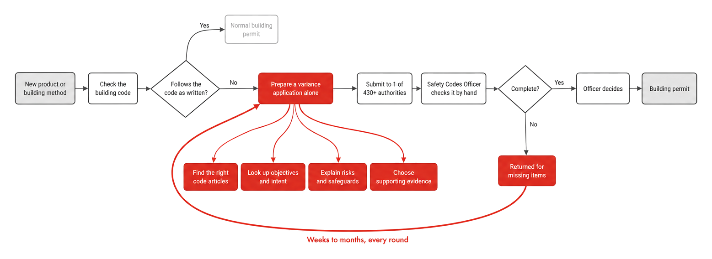
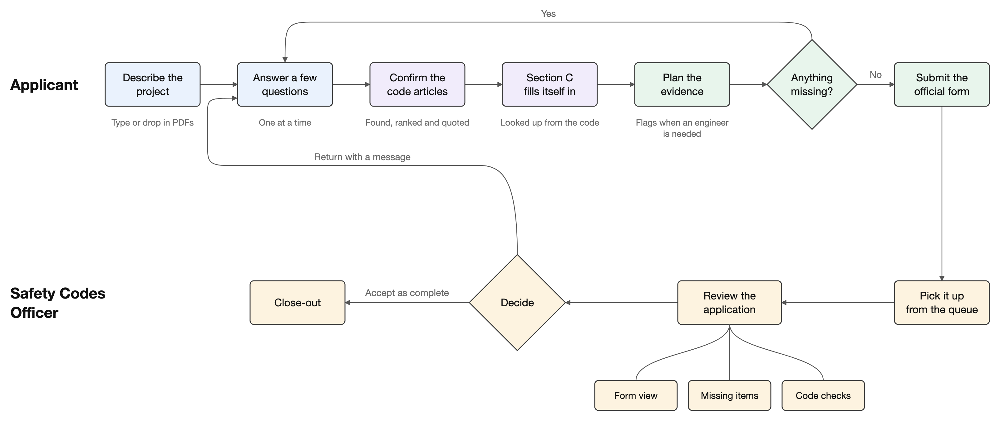
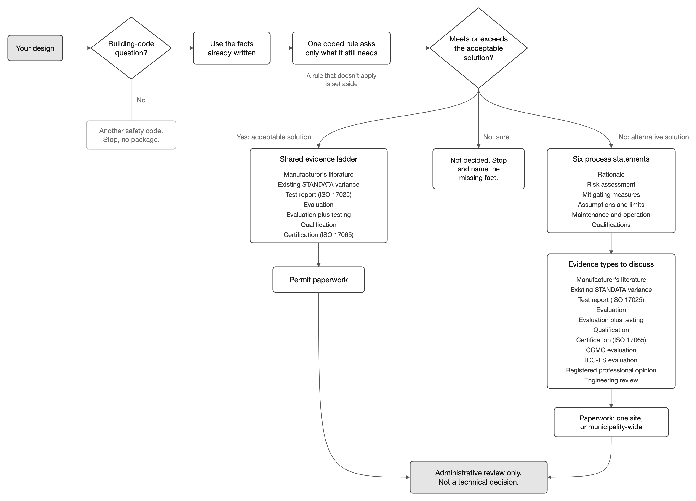
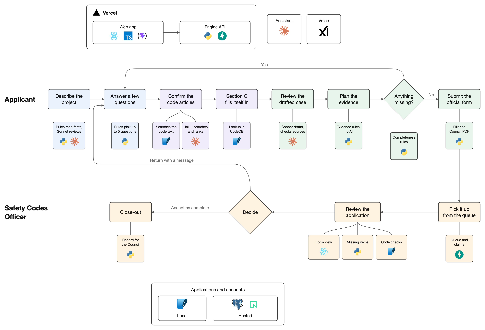
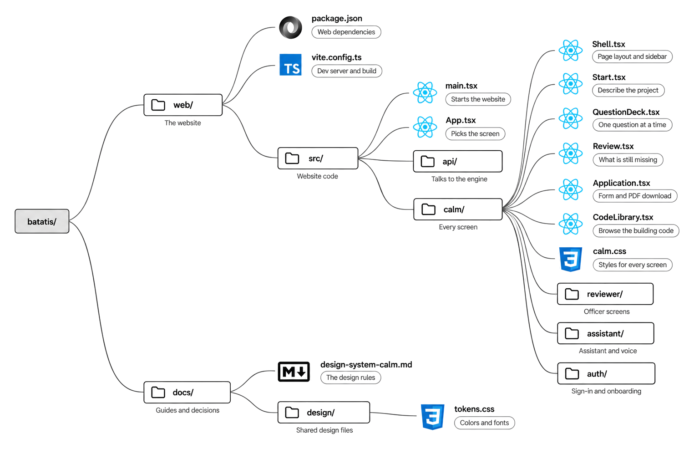

# Batatis

Batatis helps builders in Alberta prepare a complete building-code variance application. It also shows Safety Codes Officers what an application is missing.

[Open the app](https://batatis-vert.vercel.app) · [License](LICENSE.md)

## See it work

PENDING_VIDEO_URL

Alex Builder sends a soffit variance for a house in Edmonton on the live site. You see the application, the questions, and settings. Jordan Officer reviews it for Edmonton, opens it from the queue, and writes to Alex. Alex opens that message. The words in the application are a sample.

## The problem

Every new building in Alberta has to follow the building code. The code is a set of safety rules that tell builders how to build, so that buildings don't collapse, catch fire easily, or trap people inside.

Sometimes a builder wants to build something the rules don't describe, such as a new product or a different design. They can still ask to build it, but first they must apply for a variance. A variance is permission to meet a rule's purpose in a different way, and the builder has to prove that the different way is at least as safe.

Here is an example. The code requires at least two exits from every floor of a larger building, so people can still get out if fire or smoke blocks one staircase. Say you design a four-storey apartment building with only one staircase. To build it, you file a variance application. It has to show six things:

| The application shows | In the staircase example |
| --- | --- |
| Which rule you aren't following, and what the rule is for (code analysis) | Sentence 3.4.2.1.(1) of the National Building Code, 2023 Alberta Edition, requires two exits so that people can escape, and firefighters can get in, when one exit is blocked |
| Why you want a different design (rationale) | One staircase leaves room for more homes on a small lot |
| What could go wrong (risk assessment) | Smoke fills the only staircase |
| What you add to keep people as safe (mitigating measures) | Sprinklers throughout, and a staircase built to keep smoke out |
| What your plan depends on (assumptions and limits) | The sprinklers are maintained and always working |
| Proof (supporting evidence) | A fire engineer's report showing that everyone can get out in time |

A Safety Codes Officer then reviews the application and decides.

According to the challenge organizers, most first submissions fail because they are incomplete. The officer sends the application back, the builder fixes it, and each round adds weeks.

| Figure | What it counts | Source |
| --- | --- | --- |
| 3,088 | Building-code articles varied in Alberta, January to June 2026 | [Safety Codes Council Data Hub](https://www.safetycodes.ab.ca/data-hub/variance-data/) |
| 433 | Organizations that enforce safety codes in Alberta | [Council Annual Report 2025](https://ebs.safetycodes.ab.ca/documents/webdocs/SR/Annual%20Report%202025%20Final.pdf) |
| 2,317 | Certified Safety Codes Officers in Alberta | [Council Annual Report 2025](https://ebs.safetycodes.ab.ca/documents/webdocs/SR/Annual%20Report%202025%20Final.pdf) |
| 2 to 4 months | Time to allow for comments on an alternative solution | CWC and WoodWorks BC, *Alternative Solutions Guide* |
| Hundreds to tens of thousands of dollars | Cost of rework and delay on one application | Building Codes Challenge scope |

Nobody publishes how often applications come back incomplete, because the Council does not collect the documents. From December 1, 2026, officers must also register every variance in the Council's portal, with the documents they used ([IB-2026-10-01](https://ebs.safetycodes.ab.ca/documents/webdocs/SR/IB-2026-10-01%20Orders%20and%20Variances%20Registration%20Changes.pdf)).

## How variances work today



When a design doesn't follow the code as written, the builder prepares the variance application alone. They find the code articles, look up what each one is meant to achieve, explain the risks and safeguards, and choose the evidence. An officer then checks the package by hand. If anything is missing, the application goes back and the loop starts again. The delay comes from the red steps.

## Our solution



Batatis guides the application that matches the project, then gives the officer a checklist. A design that follows the code's standard way stays on that path. A design that departs becomes a variance. Batatis checks that an application is complete. It never says that a design is safe or meets the code. Engineers and the officer make those decisions.

### Which application you prepare



The picture in [Our solution](#our-solution) is the whole product, from the first description through the officer's decision. This picture is the package that path opens. It keeps every stop, the shared evidence ladder, the six process statements, and the paperwork.

Batatis starts from the design you describe.

1. **Is this a National Building Code, Alberta Edition question?** If it belongs to another safety code, Batatis stops. No package opens.
2. **Use facts already written.** Batatis reads the description and the files before it asks anything.
3. **One coded rule.** Batatis asks only for the inputs that rule still needs.
4. **Does the design meet or exceed the acceptable solution?** A firm coded check decides this. A labeled assumption is not firm. When the check is not firm, a path you already confirmed is next, and then the words you wrote. A confirmed request for a variance counts as a chosen path. A firm result from the numbers still wins over it.
   - **Acceptable solution.** The shared evidence ladder, then the permit paperwork. No process fields on this path. The ladder is the manufacturer's technical literature, an existing STANDATA variance, a test report, an evaluation, a qualification, and a certification.
   - **Not decided.** Batatis stops and names the missing fact. No package opens. A rule that does not apply stops the same way.
   - **Alternative solution.** Six process statements, then the evidence types to discuss, then paperwork that asks whether the request covers one site or the whole municipality.

The six statements are rationale, risk assessment, mitigating measures, assumptions and limits, maintenance and operation, and qualifications. The picture marks them as process fields, not evidence. They are why you want the change, what could go wrong, what you add, what the plan depends on, how it will be maintained, and who is responsible. The variance path discusses the same ladder, and also a CCMC evaluation, an ICC-ES evaluation, a registered professional opinion, and an engineering review.

Both packages end at an administrative review. That review checks the paperwork. It is not a technical decision.

Batatis does not ask you for the rule's purpose, the job the rule does, or the intent behind it. Once an article is named, that part of the form comes from the code's own tables.

### For applicants

Manufacturers, homebuilders, and general contractors use Batatis to prepare the application.

1. Describe the project in your own words, or drop in PDFs.
2. Answer the questions that Batatis still needs, one at a time. The checks above choose the package before the form opens.
3. Confirm the code articles that Batatis found. Each one quotes the code.
4. Section C of the form fills in from the code's own tables.
5. Plan the evidence for the package you are on. A variance also asks for the six statements. Batatis flags when an engineer or another professional is required.
6. Fix anything the checklist marks as missing. Then download the official form, or submit it to Edmonton or Calgary.

### For Safety Codes Officers

Officers use Batatis to see what an application is missing.

1. Pick up a new or resubmitted application from the review queue.
2. Read it on the official form, with its missing items and code checks beside it.
3. Accept it as administratively complete, return it with a message, or refuse it.
4. Close out the application after the decision.

## Features

For applicants:

- On the hosted website, sign in with an access code and your name. The same code and name open the same account.
- On your own computer, sign up with email. The server can also offer Google and Microsoft sign-in.
- Describe a project in text or PDFs. Batatis reads the facts and asks only for what is missing.
- See which package you are preparing. If Batatis cannot tell, it stops and names the missing fact.
- Answer the open items one at a time. A variance asks for six statements: why you want the change, what could go wrong, what you add, what the plan depends on, how it will be maintained, and who is responsible. A design that follows the standard way does not ask for those.
- Confirm the code articles that apply, each with a quote from the code.
- Get Section C filled in from the code's tables.
- Get a Section D evidence plan that flags when a professional is required.
- For the articles varied most often, enter your numbers and see whether the design departs from the code's standard way.
- Learn when your city has a pre-reviewed path for your situation.
- Search and read the building code in the code library.
- See a checklist of missing items.
- Download the Council's variance form as a PDF. A draft works at any time, and the final form unlocks when nothing required is missing.
- Submit to the City of Edmonton or the City of Calgary, and resubmit after a return.
- Read messages from the officer.
- Ask the assistant about your application, by text or by voice.
- On the hosted website, the sign-in code turns the AI features on.
- See which facts AI suggested and which still need your check.
- Rename, pin, archive, or delete applications.

For Safety Codes Officers:

- Choose to review applications, then enter your authority's access code.
- Find applications in a queue with tabs for new, resubmitted, mine, returned, accepted, and refused.
- Claim an application so that no one else reviews it at the same time.
- Review it on the official form, with missing items, code checks, and what changed since the last submission.
- Send an information request, return the application with a message, refuse it, or accept it as administratively complete.
- Record when an engineer or another professional is required.
- Review PDF packages that were made outside Batatis.
- Close out a decision and keep its record package.
- See every submission in the application's history.

For both:

- The person who signs in with the admin code manages access codes in Settings.
- Get notified when an application changes status or a message arrives.
- Applications and their files are deleted 7 days after they are created.

## Practice cases

This repository includes 653 practice cases for testing how well Batatis reads real documents. Each case pairs a request, written the way an applicant might ask, with published documents to attach, such as feasibility studies, issued variances, and appeal decisions. No document in them was made up.

| Where the cases come from | Cases |
| --- | ---: |
| Calgary and Edmonton | 38 |
| The rest of Alberta | 121 |
| Product and research evidence from across Canada | 73 |
| Outside Alberta, used only to compare documents | 421 |

For example, one Calgary case hands Batatis the city's zero-lot-line variance. Page 4 limits a footing to 0.3 m into the easement, while page 5 says 0.6 m across the property line may be allowed. Batatis should flag the difference and ask, not pick one.

Many published decisions state their outcome, so the cases test reading and paperwork, not whether a design should be approved. To try one, open a case folder, paste its `prompt.txt` into Batatis, and attach the documents it lists. The [practice cases guide](Data%20Prompts/README.md) explains how to restore the original documents, which Git doesn't store, and how to check the results. The Calgary example is case [L04-001](Data%20Prompts/Canada/Alberta/Calgary/Prompts/L04-001-calgary-spv-001-zero-lot-line-revision-5-with-revision-4-history/prompt.txt).

## What we measured

These checks record what Batatis did on public city documents and on practice text. They do not say an officer approved a design. Batatis never makes that decision.

| What | Result | Where it came from |
| --- | --- | --- |
| Calgary and Edmonton writeups where it showed a code section the writeup actually cites | 17 of 17 | Real public Calgary and Edmonton documents, shortened into text |
| Made-up code quotes the user saw | 0. It wrote 3 and threw them away before they appeared | Same 17 documents. The 3 quotes were written by the app during the test |
| Blanks it filled that matched the description | 159 of 159 | Made up. 60 practice descriptions written from the code book |
| Mistakes we hid in sample forms that it caught | 18 of 18 | Made up. We planted the mistakes in sample forms |
| Cases where an engineer was needed and it said so | 33 of 33 | Made up. Same 60 practice descriptions. The engineer labels were written with the cases |
| Real applications an officer has tested | 0. No one has tested this | No officer has used the app |

The 17 of 17 is the row to say out loud. Those writeups are real public documents from Calgary and Edmonton, shortened into text. The shortened text left the article numbers out. No made-up quote reached the screen.

In the app, article search starts from the code's own requirement rules. Jev, a search model, can rerank that list. This run asked Jev 1.13.0 to rank the articles from the start. Claude Haiku 5.5, at medium effort, then checked that each quote was word for word. Nine of the writeups are houses under Part 9, the part of the code for houses and small buildings. Those counted when the first section shown was one the document cites. The other eight counted when a cited section was among the three shown. In one of those eight, the first section was a different article, and a cited section was still among the three.

The 159, the 18, and the 33 look perfect because we wrote the practice cases and the answer key. A judge who asks where the data came from should treat those rows as a demo. On those 60 descriptions the engineer check said yes or not sure, so it caught every case where an engineer was needed. The receipt scores a match against every label at 50 of 60. This table counts the 33 cases where an engineer was needed.

The last row stays at 0. No officer has tried a real application.

The saved rows are in the [city-document run](evals_dev/judge_bench_results.json). The documents are listed in the [Alberta cases](docs/research/2026-10-23-elephant/cases-alberta.md). The blanks are in the [accuracy report](docs/accuracy/report.md). The planted mistakes are in the [form-check test](engine/tests/test_package_review_planted.py). The engineer labels are in the [Section D receipt](evals_dev/section_d_flag/RESULTS.md).

## What's next

- Offer the website as a paid service, with AI included.
- Export Calgary's own Request for Specific Variance form next to the Council's form.
- Register decided variances in the Council's Orders and Variances Portal, which becomes mandatory on December 1, 2026.
- Add authorities beyond Edmonton and Calgary, then other provinces.
- Draft the officer's Part 2 decision page from the review findings.
- Search the CCMC product evaluation registry from inside the app.
- Measure how accurate the whole workflow is on applications that experts have reviewed, and calibrate its relevance scores.
- Test the full workflow with real applicants and officers.

---

## How Batatis works



This diagram shows the hosted website. It has the same steps as the one in [Our solution](#our-solution), with the technology that runs each step. The colors mark the same four stages in both diagrams. The website is React and TypeScript, built with Vite. It calls the engine, a Python API built with FastAPI. Vercel hosts the website and its engine.

### How the path is chosen

The picture in [Which application you prepare](#which-application-you-prepare) is this decision, and it shows the package each result opens. `decide_path` in [`engine/path_decision.py`](engine/path_decision.py) runs the checks. `decidePath` in [`web/src/pathDecision.ts`](web/src/pathDecision.ts) repeats them on the screen, so the questions match the package the engine will build.

The checks run in order. The first one that settles the project wins.

1. A different safety code is first. The picture labels that result "Other regime. Stop. No package." [`engine/intake/scope.py`](engine/intake/scope.py) classifies the text. A redirect stops the question list.
2. A firm coded check is next. A labeled assumption is not firm. "Follows" opens the standard package. "Departs" opens the variance package. "Does not apply" stops. The check can name one Division B sentence. Section C for that sentence is a lookup in CodeDB, the SQLite copy of the code. A miss says the lookup missed that sentence.
3. When the check is not firm, a recorded pathway or route is used. A confirmed request for a variance counts too, even when the description is empty. A firm check still wins over that request.
4. Then the words. [`engine/intake/fork.py`](engine/intake/fork.py) reads them. If they do not decide, the picture says "Not decided. Stop. No package." The variance package stays closed.

`alternative_path` in [`engine/process_fields.py`](engine/process_fields.py) is true only when the path is alternative. Only then does the question list open the six process fields. Both the acceptable path and the alternative path use the shared evidence ladder. The question about one site or a whole municipality appears only on the alternative path. `CONFIDENCE_LADDER` and `ALTERNATIVE_EVIDENCE_TYPES` in [`engine/section_d.py`](engine/section_d.py) are those evidence types. The code ladder also includes evaluation plus testing, between evaluation and qualification.

The applicant is not asked for objectives, functional statements, or intent.

<details>
<summary>How this path compared with the old rule and with the flowchart</summary>

On 27 October 2026 the team ran 152 frozen prompts through four ways of choosing the package. The prompts, the rubric, and the saved rows are in [`experiments/workflow-bakeoff/`](experiments/workflow-bakeoff/). The write-up is [`PROOF.md`](experiments/workflow-bakeoff/PROOF.md). No model was called. The judge is a fixed set of ten paperwork checks. It is not a safety result, and it does not say a design complies.

Balanced quality gives equal weight to 63 application prompts and 89 rule prompts. The same weights apply to the question counts. The comparison used `origin/main` at `e34b4e4`. The access-code sign-in that landed after that commit does not change this decision.

| Way of choosing | Balanced quality | Balanced questions | Path match |
| --- | ---: | ---: | ---: |
| The previous rule | 8.513 | 20.53 | 84 of 152 |
| The official flowchart, asked in order | 7.709 | 14.72 | 61 of 152 |
| That flowchart, with the code database in place of the purpose questions | 8.709 | 10.98 | 61 of 152 |
| The path above | 9.739 | 13.02 | 140 of 152 |

The path above is 1.226 balanced points higher than the previous rule, and it asks 7.51 fewer balanced questions. It is 2.030 points higher than the flowchart asked in order. The flowchart with the database lookup asks fewer questions because it stops early. Its path match stays 61 of 152. The rubric keeps the higher quality when the gap is larger than 0.25.

Twelve prompts still miss. Eight unresolved prompts were called a variance because of the wording. Three variance prompts stayed unresolved, with no coded rule and no departure cue. One standard-way prompt stayed unresolved because a labeled assumption kept the check from being firm. The flowchart, asked as a list of questions, never chose the standard package on this set. A missing answer was treated as not sure, and that did not count as yes.

</details>

For applicants:

1. **Describe the project.** Rules read facts, such as the owner and the address, from the description and from the text and fields of any PDFs. If AI is on, GPT-6 Luna, an OpenAI model, points at more facts, and each one must quote the text it came from. When you attach files, Luna also reviews them page by page, and the questions screen lists what it found.
2. **Answer a few questions.** A rule-based planner picks up to five questions. It starts with conflicts in what you wrote, then facts that narrow down the code articles. The website then shows one card for each item that is still open. No AI writes the questions. This step is also where the path is chosen. See [How the path is chosen](#how-the-path-is-chosen).
3. **Confirm the code articles.** Jev 1.13.0, a TypeSafe model that answers with a probability, scores all 2,080 articles in Division B of the code and reranks the top 60. Luna then reads the top 15 in full and quotes the sentences that apply. Batatis shows up to 10 articles, and you confirm each one. With AI off, or if scoring fails, a keyword search over CodeDB suggests articles instead.
4. **Section C fills itself in.** The objectives, functions, and intent of each confirmed article come from the code's own tables in CodeDB. No AI is involved.
5. **Plan the evidence.** Rules match each article to the kinds of evidence it needs, and flag when an engineer or another professional is required. No AI is involved. The six process fields are added only when the path is alternative.
6. **Anything missing?** Completeness rules check every required part of Sections A to D. Anything missing sends you back to the questions.
7. **Submit the official form.** The engine fills in the Council's variance form, adds an appendix with the full code text, and saves the exact version you sent.

For Safety Codes Officers:

8. **Pick it up from the queue.** The queue lists submitted applications. Claiming one stops two officers from reviewing it at the same time.
9. **Review the application.** The officer sees the filled form, the same completeness checks, and the code citations checked against CodeDB.
10. **Decide.** Returning the application sends the applicant a message, and they fix it and resubmit. Accepting it marks it as administratively complete.
11. **Close-out.** The engine builds the decision's record package for the Council.

Batatis checks what Luna writes before it keeps anything. The document review proposes facts, conflicts, the code provisions the files cite, what is still missing, and questions to ask next. Batatis drops a fact, conflict, or provision unless its excerpt appears in the request or the file it names. When a restated fact adds a number that its excerpt lacks, Batatis shows the excerpt instead. A wording filter removes Batatis's own sentences that say a design complies, is safe, or is approved, or that cite an article number CodeDB doesn't have.

The filter catches common phrasings, not every one. The questions screen shows the document review as advice. Each finding shows whether the files state, propose, or recommend it, and the excerpt and page it came from. The review never confirms a fact for you or changes the list of missing items. If you edit the description or the files, Batatis labels the old review as belonging to the earlier input until it reads them again. Step 3 doesn't use the review to find articles yet.

CodeDB is a SQLite database of the building code. You build it on your computer from the official PDFs of the National Building Code, 2023 Alberta Edition, second printing. Applications and accounts live in SQLite on your computer, or in PostgreSQL on Neon when the app is hosted. The web assistant answers with GPT-4.1 mini by default, or with Claude Sonnet 5.5 when `ANTHROPIC_API_KEY` is set. Web voice uses Grok from xAI.

Before any text goes to an AI service, Batatis removes the names, contact details, and addresses that it recognizes. The web engine's daily spend cap, US$5 by default, stops its AI calls when it is reached.

<details>
<summary>Why Batatis uses Luna and Jev, and what isn't measured yet</summary>

The team chose this workflow on October 25, 2026, and stopped benchmarking. The [decision record](docs/evaluations/workflow-decision-20261025.md) explains the choice and its limits. The [evidence snapshot](docs/evaluations/workflow-accuracy-evidence-20261025.json) holds the saved results behind it.

- Luna reviews documents with its original prompt. In the saved results, this source-checked review came with the largest improvement. A matched test of another review model, and a test of a revised prompt, showed no clear gain.
- The team asked for Jev to score the articles. Its saved runs did not finish, so they record the setup, not a score.
- [`engine/identify/pipeline.json`](engine/identify/pipeline.json) holds the settings for step 3. They resolve to configuration `5f1c92331550984a`. Jev reads each article as its heading and the first 700 characters of its text. [`engine/tests/test_workflow_profile.py`](engine/tests/test_workflow_profile.py) fails if a selected model, effort, or limit changes.

No complete, reliable test has measured the accuracy of this combined workflow, and no result shows that it is more than 97% accurate. The record also keeps older scores from earlier code, other judges, and other workloads. None of them is the accuracy of this workflow.

Later on October 25, the team started test 3 on the 25 Calgary and Edmonton development cases. Their older saved score was 181 of 259 checks, about 70%, from earlier code and another judge. First, the team fixed five cases whose attachments left out the documents their questions asked about. Then it ran the cases through Codex, OpenAI's coding agent, instead of the OpenAI API, so the test needed no API key. Luna, and Claude Haiku 5.5 at low and at medium effort, each passed 9 of 10 checks on the one case that finished, graded by the same Luna judge. The other 24 cases didn't finish before the team moved on to other work. One case is far too few to measure accuracy. The [saved results](docs/research/accuracy95/haiku-comparison-results.json) and [their limits](docs/research/accuracy95/verification.md) are in the repository.

When testing resumes, these are the next tests, in order. None is scheduled.

1. Review the source checks and the wording filter independently, and test a filter that reads meaning instead of wording.
2. Run the whole journey in the app, from upload to export.
3. Measure this exact workflow on the [development cases](evals_dev/data_prompts/README.md#split), then on the held-out cases without tuning on them.
4. Have experts check the reference answers and the judge.
5. Test smaller source chunks, and passing reviewed facts to step 3, as separate changes.
6. Tune cost and speed only after accuracy.

</details>

<details>
<summary>Measured accuracy of the engineer-needed flag</summary>

At measured source `d479e82`, the shipped facts-only `rules_plus_unknown` agreed with model gold on 50/60 text-only dev cases (0 no outputs, 27 unknowns) and 8/11 model-constructed cases without ground truth. Unshipped `rules_only` had 55/60 dev agreement and 1 under-flag. These were in-sample, model-checked labels, not expert validation or a measurement of the current build. Zero under-flags on the dev set was partly by design, because the flag never answered no. See the [API contract](docs/api-contract.md) for the receipt and its limits.

</details>

## Folder structure

The repository and the backend:


The frontend, meaning the files that build the screens and their look:



The pictures show the main folders and files, not every one. They leave out these parts:

- [`engine/path_decision.py`](engine/path_decision.py) chooses the package, and [`web/src/pathDecision.ts`](web/src/pathDecision.ts) repeats that choice on the screen.
- [`engine/intake/review.py`](engine/intake/review.py) runs the document review and checks what it returns.
- [`engine/identify/pipeline.json`](engine/identify/pipeline.json) holds the settings for finding code articles.
- [`web/src/calm/DocumentReview.tsx`](web/src/calm/DocumentReview.tsx) shows the document review on the questions screen.
- [`evals_dev/data_prompts/`](evals_dev/data_prompts/) runs the practice cases through the engine and scores the results.
- [`evals_dev/luna_accuracy.py`](evals_dev/luna_accuracy.py) prepares the same test for Codex tasks in T3 Code, the app the team codes in, and scores what they return.
- [`docs/evaluations/workflow-decision-20261025.md`](docs/evaluations/workflow-decision-20261025.md) explains why Batatis uses this workflow, and its limits.

## Get started

The steps below run the website locally, with email and a password. The public site asks for an access code and your name. The complete repository checks need Node.js 24 or newer.

### Set it up with an AI agent

Open an AI coding agent, such as Claude Code, Codex, or Cursor, in an empty folder, and paste this prompt:

```text
Set up the Batatis app on this computer so I can run it locally.

1. Unless this folder is already a clone, clone this repository:
   https://github.com/simplythatguy/batatis.git
   Then run scripts/install-git-hooks.sh.
2. Check for Git, Python 3.12, and Node.js 22.12 or newer. Install only what is missing. On
   macOS, use Homebrew.
3. Create .venv with Python 3.12. Install engine/requirements.txt, codedb/requirements.txt,
   and research/precedents/requirements.txt into it. Then run npm ci --prefix web.
4. Build the code database. Run .venv/bin/pip install 'fonttools>=4.39', then
   .venv/bin/python scripts/fetch_sources.py, then .venv/bin/python -m codedb build.
5. If .env does not exist, copy .env.example to .env. Leave the API keys empty. I will add
   my own.
6. Start the app with scripts/local-app.sh start, and check that http://localhost:3000
   loads. Use only ports 3000 and 8000. If a port is busy, stop and tell me.
7. Do not commit, push, or create branches. When you finish, tell me what you installed and
   anything that failed.
```

### Open a pull request with an AI agent

When you know what you want to change, paste this prompt into the same agent and add your request at the end:

```text
Make my change to github.com/simplythatguy/batatis and open a pull request for it.

1. Read AGENTS.md and the skills it names before you change any code.
2. Start a short-lived branch from the latest main, named for the change. For example:
   git switch main
   git pull
   git switch -c fix-intake-wording
3. Make the change. Run scripts/verify.sh and fix anything that fails. Then commit.
4. If I can't push to simplythatguy/batatis, make my fork the origin remote:
   gh repo fork simplythatguy/batatis --remote
5. Push the branch:
   git push -u origin HEAD
6. Write the description in a file, starting from .github/pull_request_template.md. Keep
   its three sections: New features added, Improvements, and Bug Fixes. Use short bullets
   in everyday words, with no technical jargon, and write "None." under an empty section.
7. Open the pull request into main:
   gh pr create --repo simplythatguy/batatis --base main --body-file <description file>
8. Stop there. Never push to, merge into, or delete main, and do not merge the pull request.

My change:
```

Every pull request uses the same three sections. Here is part of the description of [#72](https://github.com/simplythatguy/batatis/pull/72), which added the practice cases:

> **New features added:**
>
> - Added 653 practice cases based on published building code documents, with instructions for using them to test how Batatis handles attachments.
>
> **Improvements:**
>
> - Organized research cases by country, province or state, and city or town, making Calgary and Edmonton cases easier to find.
>
> **Bug Fixes:**
>
> - Fixed problems restoring some publicly available source documents.

### Set it up by hand

If you'd rather not use an agent, follow steps 1 to 6.

### 1. Clone the repository

If you plan to contribute but can't push to this repository, fork it on GitHub first and clone your fork instead.

```bash
git clone https://github.com/simplythatguy/batatis.git
```

```bash
cd batatis
```

Install the Git hook. It blocks pushes to `main`, rewriting a branch, and tags.

```bash
scripts/install-git-hooks.sh
```

### 2. Install the tools

You need Git, Python 3.12, and Node.js 22.12 or newer. Node.js comes with npm. React, TypeScript, and Vite install with the project in step 3.

Skip any tool you already have. These commands use [Homebrew](https://brew.sh) on macOS. On Windows or Linux, use the installers from [git-scm.com](https://git-scm.com/downloads), [python.org](https://www.python.org/downloads/), and [nodejs.org](https://nodejs.org/en/download).

Install Homebrew:

```bash
/bin/bash -c "$(curl -fsSL https://raw.githubusercontent.com/Homebrew/install/HEAD/install.sh)"
```

Install Git:

```bash
brew install git
```

Install Python 3.12:

```bash
brew install python@3.12
```

Install Node.js and npm:

```bash
brew install node
```

### 3. Install the project

Create a Python environment:

```bash
python3.12 -m venv .venv
```

Install the engine's packages:

```bash
.venv/bin/pip install -r engine/requirements.txt
```

Install the code database's packages:

```bash
.venv/bin/pip install -r codedb/requirements.txt
```

Install the packages that the tests need:

```bash
.venv/bin/pip install -r research/precedents/requirements.txt
```

Install the web app's packages, including React, TypeScript, and Vite:

```bash
npm ci --prefix web
```

### 4. Build the code database

Code search, Section C, and the PDF export need CodeDB. The app starts without it, but those parts show as unavailable. The download step fetches the official code PDFs, checks their hashes, and takes several minutes.

```bash
.venv/bin/pip install 'fonttools>=4.39'
```

```bash
.venv/bin/python scripts/fetch_sources.py
```

```bash
.venv/bin/python -m codedb build
```

### 5. Add your settings

The app runs without any API key. Keys turn on the AI steps. Copy the example settings file:

```bash
cp .env.example .env
```

`.env.example` holds two API keys and three switches:

```dotenv
OPENAI_API_KEY=
OPENROUTER_API_KEY=
BATATIS_LIVE=0
BATATIS_LIVE_ELEPHANT=0
BATATIS_DAILY_SPEND_CAP_USD=5
```

The AI steps in [How Batatis works](#how-batatis-works) need your OpenAI key and a TypeSafe key. The example file has no line for the TypeSafe key, so add one. Paste each key after its `=`, and set `BATATIS_LIVE=1`:

```dotenv
OPENAI_API_KEY=
TYPESAFE_API_KEY=
BATATIS_LIVE=1
```

The OpenRouter key and `BATATIS_LIVE_ELEPHANT` are only for an optional alternative scorer, explained below.

#### `OPENAI_API_KEY`

The OpenAI API runs GPT models. Batatis uses GPT-6 Luna, at medium reasoning effort, to read more facts from descriptions and PDFs, to review attached files, and to read the top 15 code articles in full. The assistant uses GPT-4.1 mini by default. If you set `ANTHROPIC_API_KEY`, which is not in the example file, the assistant uses Claude Sonnet 5.5 instead. Set `BATATIS_LIVE=1` to turn it on.

Files that use it:

- [`engine/llm_gate.py`](engine/llm_gate.py)
- [`engine/intake/model.py`](engine/intake/model.py)
- [`engine/intake/review.py`](engine/intake/review.py)
- [`engine/identify/providers.py`](engine/identify/providers.py)
- [`engine/routes_assist.py`](engine/routes_assist.py)

Get a key at [platform.openai.com/api-keys](https://platform.openai.com/api-keys).

#### `TYPESAFE_API_KEY`

TypeSafe runs Jev, a model that answers questions with a probability instead of writing text. Batatis uses Jev 1.13.0 to score all 2,080 articles in Division B and to rerank the top 60. Set `BATATIS_LIVE=1` to turn it on. Batatis also accepts the same key as `JEV_API_KEY`. If neither is set, it looks in the macOS Keychain or the Linux secret store, then in `~/.config/jev/credentials`.

Files that use it:

- [`engine/identify/jevkit/keystore.py`](engine/identify/jevkit/keystore.py)
- [`engine/identify/jevkit/client.py`](engine/identify/jevkit/client.py)
- [`engine/identify/jev_runtime.py`](engine/identify/jev_runtime.py)
- [`engine/llm_gate.py`](engine/llm_gate.py)

Get a key at [console.typesafe.ai/keys](https://console.typesafe.ai/keys).

#### `OPENROUTER_API_KEY`

This key is optional. OpenRouter is one API that reaches many AI models. Batatis can use it to call Elephant 1, a free model hosted on Baseten, to score the articles in place of Jev. To choose Elephant, set both `BATATIS_IDENTIFY_SCREEN=elephant` and `BATATIS_IDENTIFY_RERANK=elephant`. Then set `BATATIS_LIVE_ELEPHANT=1`, because the example file's `0` keeps Elephant off even when `BATATIS_LIVE` is `1`. The switch alone doesn't choose Elephant.

The route that Batatis uses is free, but OpenRouter limits free requests per day, and one full scoring run takes about 135 requests. See the [Elephant guide](docs/elephant-provider.md).

Files that use it:

- [`engine/llm_gate.py`](engine/llm_gate.py)
- [`engine/identify/elephant_runtime.py`](engine/identify/elephant_runtime.py)
- [`engine/identify/providers.py`](engine/identify/providers.py)

Get a key at [openrouter.ai/settings/keys](https://openrouter.ai/settings/keys).

#### Switches

[`engine/llm_gate.py`](engine/llm_gate.py) reads all three switches.

| Switch | What it does |
| --- | --- |
| `BATATIS_LIVE` | `1` turns on every AI step that has its key, and `0` turns them off. For Elephant 1, a `BATATIS_LIVE_ELEPHANT` value of `0` or `1` wins over this switch. |
| `BATATIS_LIVE_ELEPHANT` | `1` turns on Elephant 1, even when `BATATIS_LIVE` is `0`, but Elephant runs only when you choose it as above. `0` turns it off, even when `BATATIS_LIVE` is `1`. Left empty, it follows `BATATIS_LIVE`. |
| `BATATIS_DAILY_SPEND_CAP_USD` | Stops AI calls for the day after this many US dollars. |

Voice needs an xAI key, `XAI_API_KEY`, which is not in the example file.

#### AI access codes

On the hosted website, you sign in with an access code and your name. That code turns AI on for the account. The same code and name always open the same account.

Set named codes on the server, as JSON from names to codes. Each code needs at least 20 characters, using only letters, digits, `-` and `_`, so that nobody can guess one:

```dotenv
BATATIS_AI_ACCESS_CODES='{"judges":"bat-3fK9qLm2Xw7pTz1vRb8Nc","team":"bat-Q7mZ2xK8pL4wR9vT1bN6c"}'
```

The admin code is separate. Signing in with it makes that person the site admin. In **Settings** they can make more codes, cap how many people use one, and turn one off.

```dotenv
BATATIS_ADMIN_CODE=replace-with-20-or-more-letters
```

An account keeps only the code's name and a fingerprint of it, never the code. Removing a name, or changing its code, turns AI off for every account that used it. After ten wrong codes in ten minutes, the server stops checking codes from that address for a while. Every use counts against the daily spend cap.

On your own computer, leave the setting empty and AI follows `BATATIS_LIVE` as before. The hosted site, where `VERCEL` is set, always needs a code.

[`engine/ai_access.py`](engine/ai_access.py) checks the codes.

#### Officer access

To sign in as a Safety Codes Officer, add an access code for an authority to `.env`. Pick any code:

```dotenv
BATATIS_REVIEWER_CODES='{"edmonton":"pick-any-code"}'
```

### 6. Run the app

```bash
scripts/local-app.sh start
```

Open http://localhost:3000. The engine runs on port 8000, and its API docs are at http://127.0.0.1:8000/docs.

To try the officer side, sign up, choose **I review applications for an authority**, pick **Edmonton**, and enter your code.

To stop the app:

```bash
scripts/local-app.sh stop
```

#### Why `npm run dev` isn't enough

Batatis has two parts: the website, and the engine, a Python server that saves applications and runs the checks. `npm run dev` starts only the website, which can't load anything without the engine. `scripts/local-app.sh start` runs `npm run dev` for the website on port 3000 and starts the engine on port 8000.

To run the two parts yourself instead, start the engine in one terminal:

```bash
.venv/bin/python -m uvicorn engine.api:app --env-file .env --port 8000
```

Then start the website in a second terminal:

```bash
npm run dev --prefix web
```

### How a change reaches people

A few words first, if you haven't used Git or GitHub before:

- **Repository:** this project's folder of files, with the history of every change. GitHub stores the shared copy, and you work on your own copy.
- **Commit:** a saved snapshot of your changes, with a short message that says what you did.
- **Branch:** a separate line of commits, so you can work without touching anyone else's. Each change gets its own short-lived branch.
- **`main`:** the one permanent branch. Whatever is on `main` is what people use. Nobody changes it directly.
- **Pull request:** a request to add your branch to `main`. GitHub shows your changes, runs the checks, and lets the team comment before anything is merged.
- **Checks:** tests that GitHub runs on every pull request. A red check means something broke.
- **Merge:** adding the pull request's commits to `main`. Only the project owner merges, and GitHub then deletes the branch.

Once a pull request is merged into `main`, the website updates by itself within a few minutes. Vercel, the service that hosts it, deploys only `main`.

### Make a change and test it on your computer

Do every step on your computer before you open a pull request. Set up the project first, with [Set it up by hand](#set-it-up-by-hand) or the agent prompt.

1. Get the latest `main`:

```bash
git switch main
```

```bash
git pull
```

2. Make a branch for your change. Name it for what you are changing:

```bash
git switch -c fix-intake-wording
```

3. Start the app, and open http://localhost:3000:

```bash
scripts/local-app.sh start
```

4. Make your change. The website reloads by itself when you save a file in `web/`. After you change a file in `engine/`, restart the app so the engine picks it up:

```bash
scripts/local-app.sh stop
```

```bash
scripts/local-app.sh start
```

5. Try your change in the app the way a user would. For a change you can see, take a screenshot for the pull request.

6. Run every check. It takes about ten minutes, and it must pass before you open the pull request:

```bash
scripts/verify.sh
```

While you work, you can run only part of it: `scripts/verify.sh --web` or `--engine`.

### Open a pull request

1. Save your work as a commit. `git add` picks the files, and `git commit` saves them with a message:

```bash
git add .
```

```bash
git commit -m "Explain why the intake question is needed"
```

2. If you can't push to this repository, make your fork the `origin` remote. A fork is your own copy of the repository on GitHub:

```bash
gh repo fork simplythatguy/batatis --remote
```

3. Push your branch to GitHub:

```bash
git push -u origin HEAD
```

4. Open the pull request into `main`:

```bash
gh pr create --repo simplythatguy/batatis --base main
```

On GitHub, you can instead click **Compare & pull request** and check that the base branch is `main`.

5. Fill in the description's three sections, **New features added**, **Improvements**, and **Bug Fixes**, in everyday words. Write "None." under an empty section. Add your screenshot.

6. Wait for the checks. The website and engine checks take about ten minutes. If one turns red, open it, read the error, fix it on your computer, commit, and push again. The pull request updates by itself.

7. The project owner tests the pull request and merges it. Never merge it yourself, and never push to `main`.

### Test someone else's pull request

To test a pull request on your computer, check it out into its own branch. Replace `123` with the pull request number.

```bash
gh pr checkout 123 --repo simplythatguy/batatis --branch pr-123
```

Without the GitHub CLI, fetch it with Git and switch to it:

```bash
git fetch https://github.com/simplythatguy/batatis.git pull/123/head:pr-123
```

```bash
git switch pr-123
```

If the pull request changes `engine/requirements.txt` or `web/package.json`, repeat step 3 of the setup. Then run the app:

```bash
scripts/local-app.sh start
```

To go back to `main`:

```bash
git switch main
```

## For AI agents

Read [`AGENTS.md`](AGENTS.md) and the skills it names before you write any code. Read them again when the task moves to a new area, such as from the engine to the screens.

| Before you | Read |
| --- | --- |
| Start any task | [`AGENTS.md`](AGENTS.md) and [`batatis-hackathon`](.cursor/skills/batatis-hackathon/SKILL.md) |
| Change the application flow or the engine | [`batatis-variance-workflow`](.cursor/skills/batatis-variance-workflow/SKILL.md) |
| Change an AI model or how articles are found | The [workflow decision record](docs/evaluations/workflow-decision-20261025.md) and [`engine/tests/test_workflow_profile.py`](engine/tests/test_workflow_profile.py) |
| Change anything on screen | [`batatis-ui-linear`](.cursor/skills/batatis-ui-linear/SKILL.md), [`batatis-ui-opus`](.cursor/skills/batatis-ui-opus/SKILL.md), [`batatis-ui-minimalist`](.cursor/skills/batatis-ui-minimalist/SKILL.md), and [`docs/design-system-calm.md`](docs/design-system-calm.md) |
| Change a skill or a rule | [`evals/fixtures/understanding-checklist.md`](evals/fixtures/understanding-checklist.md) |
| Plan, build, debug, or review code | The engineering skills in [`.agents/skills/`](.agents/skills/) and [pstack](docs/pstack.md) |
| Change this README or its diagrams | [`prettyme`](.agents/skills/prettyme/SKILL.md) |

These rules always apply:

- Never say that a design complies with the code or is safe. Batatis checks administrative completeness only.
- Never invent a code article number. Ask a question instead.
- Section C comes from lookup, never from a model.
- Never write Section D professional evidence. Say what the evidence must cover and when an engineer is required.
- On the alternative-solution path, keep the risk assessment, mitigating measures, and assumptions.
- Open a variance package only when the path is alternative. An unknown path, a rule that does not apply, and another safety code do not open one.
- Cite the National Building Code, 2023 Alberta Edition, second printing, first.
- Keep AI provider names out of everything the app shows. Tests enforce this.
- `main` is the only permanent branch. Do each batch of work on a short-lived branch, and let GitHub delete it after its pull request merges. Never recreate `dev`.
- Contribute through a pull request into `main`, after `scripts/verify.sh` passes, with the three-section description in everyday words. Never push to, merge into, or delete `main`.
- Run the app with `scripts/local-app.sh`, on ports 3000 and 8000 only.
- Subagents report only in their own task output. They never message other threads or agents.

## License

Copyright (c) 2026 the Batatis team. You may read and run this code for personal, educational, and evaluation use. Commercial use is not allowed without written permission. See [`LICENSE.md`](LICENSE.md).
