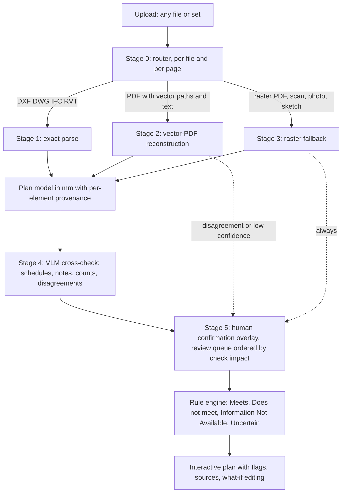

# B. Drawings to an interactive 2D plan with live code checks: technology, reliability, cost

Research child for Batatis (Alberta Building Codes Challenge, Built World Tech / Venture Pilots 2026).
Run date: 2026-10-20. Research only; nothing installed, no weights or datasets downloaded, no paid API called, no commits.
This file is checkpointed after each numbered section. A relaunch should resume at the first section marked `STATUS: TODO`.

## Claim labels

- VERIFIED: I read the primary source (the vendor/maintainer/paper/code text itself) in this session; URL and access date given.
- VENDOR CLAIM: the vendor or authors say it; I could not independently confirm it (marketing page, self-reported benchmark).
- ESTIMATE: my own arithmetic, with the arithmetic shown. Not a measurement.
- UNVERIFIED: could not be confirmed from a primary source in this session.

All web sources below were accessed 2026-10-20 unless a different date is shown.

## Code-citation rule used in this file

Alberta requirements are cited only to NBC(AE) 2023 2nd printing (and NFC(AE) 2023 2nd printing) from the local text
`reference/text/NBC-AE-2023-2nd-printing-FULL-Vol1+Vol2.jsonl`, and only after I saw the text on that PDF page.
Form: `NBC(AE) 2023, Div B, Article 9.10.15.4. [PDF p.N]`. No 2019, 2025 or 1st-printing number is presented as current. No NBC 2020 intent statements were used in this file.

## Progress ledger

| Section | Status |
| --- | --- |
| 0. Prior research digest (what is updated, not repeated) | STATUS: DONE |
| 1. Input formats and exact parsing | STATUS: DONE |
| 2. Floor-plan recognition state of the art (2024-2026) | STATUS: DONE |
| 3. Commercial plan-digitization / takeoff / plan-reading products | STATUS: DONE |
| 4. Automated code-compliance checking (academic + commercial + Canada) | STATUS: DONE |
| 5. Interactive 2D web editor stack and geometry engines | STATUS: DONE |
| 6. NBC(AE) 2023 checks computable from 2D plan + site plan | STATUS: DONE |
| 7. Recommended pipeline with reliability, cost, uncertainty display | STATUS: DONE |
| 8. (a) Pipeline and stack table; (b) 10 findings; (c) open questions; (d) Methods used | STATUS: DONE |

---

## 0. Prior research digest (updated here, not repeated)

STATUS: DONE

Read first: `/tmp/batatis-archive/research/product-vision-2026-10-18/06-document-ingestion.md` and `05-architecture-and-evaluation.md`.

What those two reports already settled, and this file keeps as given:

- 06-document-ingestion: immutable originals, native PDF text first, Docling layout/tables, selective OCR (Tesseract), GraniteDocling only on failed regions, then human review. Its "Drawings" paragraph is deliberately thin: keep sheets, revision blocks, legends and labelled dimensions; a detected region is a suggestion that needs confirmation; a rectangle round a door does not establish clear width, path length, scale or compliance; uncalibrated raster geometry, missing units/scale and hidden details stay unresolved; future measurement needs validated transforms and explicit dimensional inputs (CAD/BIM) or reviewed calibration; ColPali-style page retrieval finds pages, it does not validate measurement.
- 05-architecture-and-evaluation: deterministic core plus bounded model assistance plus explicit human decisions; rule outcomes are satisfied / unsatisfied / unknown / conflicting with applicability a separate sourced decision; no "approved by AI" state and no universal green percentage; every suggestion stored with inputs and status; per-project parsing is separate from amortized code-pack preparation.

What this file adds (new since 2026-10-18): the whole drawing path (format router, exact parsers, vector-PDF reconstruction, raster fallback, VLM cross-check), a verified catalogue of computable NBC(AE) 2023 checks with PDF pages, the ACC (automated code compliance) landscape including a July 2026 floor-plan-compliance preprint, commercial plan-reading products, the interactive editor and geometry-engine stack, and costs. Where I disagree with or tighten the earlier reports, I say so inline.

Tightening of one earlier point (ESTIMATE, judgment): Docling and similar document-layout tools are built for text, tables and forms. Nothing in the earlier report claims they reconstruct walls, but the report's single "Drawings" paragraph could be read as if the same stack extends to plans. It does not; plans need a separate geometry pipeline (this file, Sections 1, 2, 7).

---

## 1. Input formats and exact parsing

STATUS: DONE (vector-vs-raster share has no published number; see 1.6)

### 1.1 DWG / DXF

| Tool | What it gives | Licence and cost | Label and source |
|---|---|---|---|
| Open Design Alliance (ODA) Drawings SDK (reads/writes DWG, DXF, DGN) | Commercial DWG, DXF and DGN engine (SDK) | Annual membership. Commercial: $3,000 first year, $2,250 renewal, "for desktop/mobile application with less than 100 copies of the end-user product per year". Sustaining: $7,500 first year, $4,500 renewal, "for unlimited distribution of desktop/mobile apps or web/saas solutions distribution". Founding: $37,500 / $18,000 (adds source code). Licensing is annual; ending membership ends the right to distribute the ODA-based product | VERIFIED. https://www.opendesign.com/pricing.md ; https://www.opendesign.com/faq/question/how-can-i-join-open-design-alliance-and-use-your-sdks.md . The pricing page itself is undated; its linked agreements are dated "2025 Oct" and the ODA site shows "ODA Platform 27.9 Release - Oct 09, 2026" (https://www.opendesign.com/guestfiles/oda_file_converter) |
| ODA extensions | BimRv (read Revit RVT without Revit), BimNv (Navisworks), Civil, Map, Mechanical, Scan-to-BIM | 2025 brochure lists BimRv and BimNv at $6,250 each under Sustaining ($12,500 each under Founding); other extensions $10,000-$30,000 and Scan-to-BIM $20,000 (the brochure text order is ambiguous for the $10,000/$30,000 items, so treat those as indicative) | VERIFIED for BimRv/BimNv, brochure dated 2025: https://www.opendesign.com/files/2025-05/Open%20Design%20Alliance%202025.pdf . Prices may have changed since |
| ODA File Converter (downloadable app with a GUI and a command-line interface; Windows, macOS, Linux) | Converts between DWG and DXF versions in batch; ezdxf wraps it | Price and licence terms are not stated on the pages I read (ODA's page offers a 60-day trial of its software in general, and the ezdxf docs only say the converter "has to be installed by the user") | VERIFIED existence and function: https://www.opendesign.com/guestfiles/oda_file_converter ; https://ezdxf.readthedocs.io/en/stable/addons/odafc.html . UNVERIFIED: whether it is free, and whether its EULA allows commercial or server-side use. Read the EULA before building on it |
| LibreDWG (GNU, C library) | Reads DWG; ships converters | GPLv3-or-later. Version 0.13.4. "It can read all DWG formats from r1.2 to r2018 for 99%"; coverage "approximately 99%"; writing r2004+ is not enabled ("We write as default in the r2000 or older formats only"). Unhandled objects include DIMASSOC, ANNOTSCALEOBJECTCONTEXTDATA, MTEXTOBJECTCONTEXTDATA; TABLE "works only pre-2010" | VERIFIED. https://www.gnu.org/software/libredwg/manual/html_node/Overview.html |
| ezdxf (Python) | Reads and writes DXF R12-R2018 (R13/R14 read only, upgraded); drawing add-on renders via matplotlib/PyQt; DWG only through the ODA File Converter add-on | MIT licence; Python 3.11+ | VERIFIED. https://github.com/mozman/ezdxf (README, raw: https://raw.githubusercontent.com/mozman/ezdxf/master/README.md ) |

Reading: for DWG the realistic choices are (a) ODA SDK (Sustaining tier, about $7,500 then $4,500 a year, is the lowest tier whose wording covers web/SaaS distribution), (b) the ODA File Converter to DXF then ezdxf (cheap or free if its terms allow, but price and licence terms unverified), or (c) LibreDWG (GPLv3+, 99% self-reported coverage, notable unhandled objects). ESTIMATE: for a SaaS that parses DWG on its own servers, the ODA Sustaining fee is small next to engineering cost; the real cost is integrating a C++/.NET SDK. A DWG is rarely what an Alberta authority receives (see 1.6), so DWG is a convenience input for design-side users, not the core of the compliance path.

DXF/DWG gives exact geometry, true units, layers, blocks and dimension entities, so it is the best-case input. Caveat from LibreDWG's own list: dynamic blocks, annotation-scale contexts and associative dimensions are exactly the parts a compliance reader needs and are the least reliably decoded by open tools (VERIFIED, same source).

### 1.2 IFC

| Tool | Facts | Label and source |
|---|---|---|
| IfcOpenShell (C++ with Python bindings) | Licence "LGPL-3.0, GPL-3.0 licenses found" (Bonsai Blender add-on is GPL-3.0-or-later). "Complete parsing support is provided for IFC2x3 TC1, IFC4 Add2 TC1, IFC4x1, IFC4x2, and IFC4x3 Add2." "Extensive geometric support is implemented for the IFC releases IFC2x3 TC1 and IFC4 Add2 TC1" (IFC4x3 geometry not listed) | VERIFIED. https://github.com/IfcOpenShell/IfcOpenShell |
| web-ifc (That Open Engine; WebAssembly, browser or Node) | Licence file is the Mozilla Public License 2.0; WASM build, can also be built as a standalone C++ library | VERIFIED. https://github.com/ThatOpen/engine_web-ifc (README) and https://raw.githubusercontent.com/ThatOpen/engine_web-ifc/main/LICENSE.md |

Reading: IFC is the only open BIM exchange format, parseable with permissive-enough licences (LGPL/MPL; link dynamically or call as a service). IFC gives walls, spaces (IfcSpace with area/use), doors, windows, stairs, fire-rating property sets if the author filled them, which is exactly the data model the product wants. Its weakness is not parsing, it is that many IFC exports omit fire ratings, assembly layers or occupancy classification (ESTIMATE from the nature of authoring workflows; no measurement). Singapore's CORENET X is the one national system that mandates a checked IFC profile (see Section 4).

### 1.3 Revit (RVT)

| Route | Cost | Label and source |
|---|---|---|
| Autodesk Platform Services (APS) Model Derivative, translating RVT to SVF/SVF2/DWG/IFC and extracting properties | Autodesk's Flex buying page (snapshot dated 2026-10-16, copied from Wayback): "Model Derivative API 0.5 token per complex job / 1 token per simple job"; "Automation API 2 tokens per processing hour"; Viewer API and Data Management API "Free". Token price $3.00 each up to 4,999 tokens, falling to $2.40 at 250,000+. Page ordering of "complex" vs "simple" looks inverted relative to the older 2020 Forge pricing explainer (1.5 credits for a Revit/Navisworks model, 0.2 for other formats), so the complex/simple definition should be confirmed with Autodesk | VERIFIED (archived copy of the vendor page). https://web.archive.org/web/20261016141905/https://www.autodesk.com/buying/flex?term=1-YEAR&tab=flex ; older definition: https://aps.autodesk.com/blog/forge-pricing-explained-3-what-does-each-forge-api-cost (13 Apr 2020). Direct fetches of aps.autodesk.com/pricing and autodesk.com returned 403/redirect to scripted clients |
| APS Revit support range | "Revit 2023 through Revit 2026" are major versions; Revit 2016-2022 are maintenance mode but still translate | VERIFIED. https://aps.autodesk.com/node/3699 (19 Jun 2025) |
| ODA BimRv SDK (self-hosted RVT reader) | $6,250 extension on top of Sustaining ($7,500 first year) per the 2025 brochure | VERIFIED (2025 brochure). Same link as 1.1 |

ESTIMATE (arithmetic): one RVT translation at the top of the stated range is at most 1 token x $3.00 = $3.00 per file at list price (and 0.5 x $3.00 = $1.50 if it falls in the 0.5 bucket). Design Automation for Revit at 2 tokens per processing hour = 2 x $3.00 = $6.00 per hour; a 3-minute job = $6.00 x (3/60) = $0.30. Per page of a plan set these are cents. RVT is an unlikely permit-submission format in Alberta (see 1.6), so treat Revit as a "design-firm onboarding" input, and prefer the IFC export Revit can already produce.

### 1.4 Vector PDFs exported from CAD (the format the authorities read formally require for drawings)

What can be recovered, and from which library (all facts VERIFIED from the documentation cited):

- Paths: PyMuPDF `Page.get_drawings()` returns one dict per vector path with `items` (lines, rectangles, quads, curves), `color`, `fill`, `width`, `dashes`, `rect`, `closePath`, `type` ("f", "s", "fs"), `seqno` (draw order), and, new in v1.22.0, `layer`: "name of applicable Optional Content Group"; `extended=True` adds clip and group info and a `level` hierarchy. `get_cdrawings()` is the same data, "much faster", with tuples instead of Rect/Point objects. https://pymupdf.readthedocs.io/en/latest/page.html (fetched 2026-10-20).
- Text with coordinates: PyMuPDF `get_text("dict")`/`"rawdict"` give blocks, lines, spans (font, size, colour, bbox); `rawdict` goes down to each character. https://pymupdf.readthedocs.io/en/latest/textpage.html
- CAD layer names (the "A-WALL" idea): a PDF only carries layer names if the exporter wrote Optional Content Groups. ISO 32000-1 defines an OCG with a required `Name` "suitable for presentation in a reader's user interface" (Table 98). AutoCAD's EXPORTPDF has it as an option: "Include layer information: Adds layer information to the PDF file so that you can turn layers on or off when viewing or printing PDF files." It is a checkbox, not a guarantee, and it can be switched off in the PC3 plot config. Sources: https://opensource.adobe.com/dc-acrobat-sdk-docs/pdfstandards/PDF32000_2008.pdf (p.223 in the printed numbering; read via PDFKit text extraction), https://help.autodesk.com/cloudhelp/2026/ENU/AutoCAD-LT/files/GUID-36D8C81E-754F-4C7A-844E-3A5A131801D9.htm , https://resources.imaginit.com/support-blog/autocad-disabling-layer-information-in-pdfs (title seen in search; not read).
- Two practical limits on layers, both VERIFIED: (1) PyMuPDF text spans do not carry the OCG. A MuPDF forum thread (8 Oct 2025) confirms `get_text("dict")` exposes nothing about OCG and a PyMuPDF staff reply suggests toggling the layer off and diffing two extractions; the maintainers' other suggestion is `Page.get_bboxlog(layers=True)` plus containment matching. https://forum.mupdf.com/t/how-to-get-text-from-layers-ocg/179 . (2) Many permit authorities require layers to be flattened (next paragraph), which removes the thing you wanted.
- Authorities that ask for vector PDFs also ask for flattening, which erases layer names: Toronto: "Documents/Drawings containing multiple layers must be flattened to a single layer prior to submission... Submitted PDF files must be a single layer. Drawings and Specifications must be in black and white only" and "The scale and page size of the plans/drawings on the PDF must match the scale and page size of the full-sized plans/drawings on paper" (https://www.toronto.ca/services-payments/building-construction/apply-for-a-building-permit/electronic-submission-guidelines/). Markham (October 2021 edition of its ePLAN standards, so it may have been updated): "Only Vector PDF files will be accepted for drawings... All drawings must be flattened into a single layer. We do not need to see layers that clutter the drawings" and "Greyscale except for fire separations" (https://markhammuseum.ca/sites/default/files/ePLAN-Submission-Standards-2021-2.pdf ; read via PDFKit). So in Ontario's two largest examples the CAD layer names are gone by rule, and walls must be inferred geometrically (line weight, hatch, double parallel lines). Whether Alberta authorities require flattening is UNVERIFIED (Red Deer's standard says "Vector-based PDF" and says nothing about flattening in the text I read).
- Dimension strings and text become plain text if the exporter embeds TrueType fonts. AutoCAD's "Capture fonts used in the drawing: Embeds TrueType fonts in the PDF file" (same Autodesk help page). A Santa Cruz (California) requirement seen in a search excerpt says SHX fonts do not give searchable text; I could not open that PDF, so label that UNVERIFIED. Failure mode to plan for: text drawn as stroked geometry (SHX or "convert text to geometry"), which needs OCR.

Licence trap, VERIFIED: PyMuPDF/MuPDF are "GNU AGPL v3. Free for open-source projects" or "Commercial - separate commercial licences available from Artifex" (https://raw.githubusercontent.com/pymupdf/PyMuPDF/main/README.md). The commercial price was not published on that page. Permissive alternatives with partial equivalents (all licence lines VERIFIED from repository files): pdf.js (Apache-2.0; has `getOptionalContentConfig()` in `src/display/api.js`, plus operator-list access in the browser), pypdfium2 over PDFium (README: "liberal-licensed"; has `page.get_objects()`), pdfplumber (MIT), pikepdf (MPL-2.0, qpdf-based; that it lets you parse content streams yourself and read `/OC` marked-content is my general knowledge, not verified in this session). ESTIMATE (judgment): prototype with PyMuPDF because `get_drawings()` is the richest off-the-shelf path extractor; budget either an Artifex commercial licence or a rewrite on pdfium/pikepdf/pdf.js before shipping a closed SaaS. Get counsel to decide whether unmodified AGPL use on a server triggers obligations; I make no legal claim.

Scale from the PDF itself:

- ISO 32000-1:2008 defines a `Viewport` dictionary (`BBox` required, optional `Measure`) and a rectilinear `Measure` dictionary whose `R` entry is "a text string expressing the scale ratio of the drawing", with example "1/4 in = 1 ft", and `X`/`Y` number-format arrays giving the numeric conversion (Tables 260-262, printed pages 480-481). VERIFIED: https://opensource.adobe.com/dc-acrobat-sdk-docs/pdfstandards/PDF32000_2008.pdf
- Whether a given CAD exporter writes it: anecdotal only. An Autodesk forum thread reports AutoCAD PDFs measuring at real-world scale in Bluebeam while Revit PDFs did not (https://forums.autodesk.com/t5/revit-architecture-forum/embedded-scale-units-in-pdf-exports-missing-feature/td-p/13644739 , seen in search results, not opened). Treat as UNVERIFIED; the pipeline must test for `Viewport`/`Measure` first and fall back.
- Scale from drawing content, three independent cues (all are my design recommendation; ESTIMATE): (1) page size from the MediaBox (points / 72 = inches; compare to ARCH D 24x36 and so on) combined with the title-block scale text ("1/4" = 1'-0"", "1:100"); (2) the drawn graphic scale bar or a long dimension: match the dimension string's numeric value to the measured vector length; (3) a sanity check against objects of known size (door leaf 0.8-0.9 m, stair tread 0.25-0.28 m). Agreement of two of three is a candidate, disagreement is a flag. Prior art: a July 2026 arXiv preprint on residential floor-plan compliance maps pixels to metres from "the PDF's physical page size and the rasterization DPI" and OCRs the printed scale (arXiv:2607.00015, re-read in Section 4); a 2024 ASCE paper "Towards a Robust Deep Learning-Based Scale Inference Approach in Construction Drawings" exists (https://ascelibrary.com/doi/10.1061/9780784485248.087) but I could not open it (403), so its accuracy is UNVERIFIED. Toronto's rule that the PDF scale must match the paper scale means the "page size x printed scale" cue is only valid for plots at 100% (not "fit to page") - an authority-mandated invariant in Toronto but not necessarily elsewhere.

### 1.5 Raster scans and phone photos

Treated in Section 2 (recognition models) and Section 7 (pipeline). Format facts from authorities: Toronto accepts scans at "1-bit black and white 300 dpi" generally and "600 dpi resolution is required" for fine-line plans, un-skewed (VERIFIED, same Toronto page). Raster has no layers, no text, and no scale unless a human or OCR supplies one.

### 1.6 What share of permit drawing sets are vector PDFs vs raster?

No published share found (UNVERIFIED). I searched municipal portals, e-plan vendors and the scanning/digitization literature; the results were rules, not measurements. What exists is policy evidence, which points strongly toward vector for new construction in the target markets:

| Authority | Rule for drawings | Label and source |
|---|---|---|
| Red Deer, Alberta | Drawings/plans: "Vector-based PDF", each sheet a separate file. Documents (site photos, reports): "Vector or Raster based PDF" | VERIFIED. https://www.reddeer.ca/media/reddeerca/city-services/permits-and-licenses/eapply/BP-DP---Plan-and-Document-Submission-Standards.pdf |
| Markham, Ontario | "Only Vector PDF files will be accepted for drawings" | VERIFIED, URL above |
| Toronto, Ontario | Convert CAD to PDF; "Printing to paper and scanning it to create a PDF should be avoided"; scans allowed at 300/600 dpi | VERIFIED, URL above |
| Barrie, Ontario | Search excerpt: image-only PDFs and a hardcopy plotted set scanned to PDF "will not be accepted" | UNVERIFIED (page opened but the target phrases were not found in my text extraction; excerpt came from the search tool) |
| Calgary, Alberta | Search excerpt for civil "construction drawing" submissions: one multi-page vector PDF, monochrome. That PDF returned only bullet glyphs through macOS PDFKit text extraction (cause not determined), and it concerns infrastructure drawings, not building permits | UNVERIFIED for building permits. https://www-prd.calgary.ca/content/dam/www/pda/pd/documents/carls/development-permit/construction-drawing-application-requirements.pdf |
| Placer County CA, Livermore CA, Santa Cruz CA, Columbia MO, Westminster CO, Mesa AZ | Prefer or require vector; some accept scans | UNVERIFIED (search excerpts only) |

Interpretation (ESTIMATE, judgment, not a measurement): in Alberta, Ontario and BC the formal submission path for new construction is vector PDF produced from CAD or BIM, so raster is a minority of formal permit sets. Raster dominates three other places that matter for this product: (1) existing-building drawings and as-builts, (2) owner-builder and small residential jobs (hand sketches, marked-up prints, photos), (3) supporting documents. A product that targets "drag and drop anything" must still handle raster, but the economics argue for making vector PDF the primary path and raster the assisted fallback. Recommended action: sample the real corpus. A 20-line script that classifies each page as vector (many path ops, text characters present), hybrid (text layer over a raster), or pure raster (one full-page image, no text) over a few hundred real submitted PDFs would replace this guess with a number in one afternoon. Do that before sizing the raster-ML investment.

---

## 2. Floor-plan recognition: state of the art 2024-2026

STATUS: DONE

Scope note. Every number below is what the authors report on their own benchmark, read in this session from the paper or repository named. None of these benchmarks is a set of Canadian permit drawings; they are residential apartment plans (CubiCasa5K, RPLAN, ResPlan, MSD), synthetic 3D-derived plans (Structured3D) or CAD drawings of mixed buildings (FloorPlanCAD). No public benchmark of real permit-set sheets with measured accuracy was found (UNVERIFIED that none exists; I searched arXiv, GitHub and Hugging Face).

### 2.1 Datasets: size, format, licence (commercial use?)

| Dataset | What it is | Licence (read from the owner's page/repo) | Commercial use? | Label and source |
|---|---|---|---|---|
| CubiCasa5K | 5,000 raster floor plans (Finland), over 80 object classes, polygon annotations | "Creative Commons Attribution-NonCommercial 4.0 International" (repo LICENSE) | No | VERIFIED. https://raw.githubusercontent.com/CubiCasa/CubiCasa5k/master/LICENSE ; paper https://arxiv.org/abs/1904.01920 |
| RPLAN | over 80,000 raster residential plans (China) | Terms not found (access by request) | Unknown | UNVERIFIED (could not locate the terms) |
| ResPlan (arXiv 2508.14006, Aug 2025) | 17,000 residential plans as vector geometry plus room-connectivity graphs, metric-scale, 17 classes | Data: CC BY 4.0; code: MIT. The LICENSE says the data are "derived geometric representations ... recovered by computer vision from publicly accessible real-estate listing renderings", asserts no copyright over the spatial arrangements as "a matter of fact", and offers takedown on request | Yes with attribution; residual provenance risk because the source images were listing renderings | VERIFIED. https://raw.githubusercontent.com/m-agour/ResPlan/main/LICENSE ; https://arxiv.org/abs/2508.14006 |
| Modified Swiss Dwellings (MSD, ECCV 2024) | over 5.3K plans of medium/large building complexes, 18.9K apartments; the 4TU record's public train split has 4,167 plans | CC BY 4.0 | Yes with attribution | VERIFIED. https://arxiv.org/abs/2407.10121 ; https://data.4tu.nl/export/cff/datasets/e1d89cb5-6872-48fc-be63-aadd687ee6f9 |
| Structured3D | 3.5K synthetic house designs with structure annotations; the floor-plan benchmark is built from them | Data: "Structured3D Terms of Use" via an agreement form; code MIT. A mirror's excerpt limits use to non-commercial research and education (not confirmed on the official terms file) | Treat as No | VERIFIED for the click-through terms: https://structured3d-dataset.org/ and https://raw.githubusercontent.com/bertjiazheng/Structured3D/master/README.md ; the NC wording is UNVERIFIED |
| FloorPlanCAD (ICCV 2021) | 15,663 vector CAD drawings (SVG), residential to commercial, 30 thing + 5 stuff classes | "annotations ... licensed under a Creative Commons Attribution-NonCommercial 4.0 License. We do not own the copyright of the drawings." Project "was shutdown in early 2022" | No (and the authors do not own the drawings). Several Hugging Face mirrors are tagged CC-BY-SA-4.0, which contradicts the owners' licence; do not rely on the mirror tag | VERIFIED. https://floorplancad.github.io/ ; mirror tags from https://huggingface.co/api/datasets?search=FloorPlanCAD |
| ArchCAD-400K (NeurIPS 2025) | 413,062 chunks from 5,538 standardized CAD drawings | Hugging Face dataset card tag: CC BY-NC 4.0 | No | VERIFIED for the tag: https://huggingface.co/api/datasets?search=ArchCAD ; paper https://arxiv.org/abs/2503.22346 |
| WAFFLE (WACV 2025) | about 20K floor-plan images scraped from the web, noisy metadata | Licence not found; images are scraped | Unknown | UNVERIFIED. https://arxiv.org/abs/2412.00955 |

Takeaway (ESTIMATE, judgment): the only large datasets with clear commercial-use terms are ResPlan and MSD (both CC BY 4.0, both residential/apartment, ResPlan with a provenance caveat). Everything on CAD symbols (FloorPlanCAD, ArchCAD-400K) and on the best-known raster benchmark (CubiCasa5K) is non-commercial. A company must therefore plan to build its own labelled corpus of permit sheets (with the right to train on them) or negotiate rights; models trained on NC data are a legal question for counsel, not something these licences answer (UNVERIFIED either way).

### 2.2 Raster floor plan to vector: models, metrics, licences, weights

All "reported" numbers are F1 (%) unless stated. Source for the cross-model rows: Table 1 of Raster2Seq (arXiv 2602.09016, SIGGRAPH 2026, read via PDF text), which re-reports baselines on a common footing.

| Model | Reported results | Code licence | Weights | Label and source |
|---|---|---|---|---|
| CubiCasa5K baseline (multi-task CNN, 2019) | Test: rooms overall pixel accuracy 82.7%, mean IoU 57.5; after polygonization 77.3% / 49.3 IoU. Icons mean IoU 55.7 (41.6 after polygonization). The authors state polygons "can not be created regardless of the quality of the segmentation" if wall/icon junctions are missed | Repo is CC BY-NC 4.0 | Google Drive link in README | VERIFIED. https://arxiv.org/abs/1904.01920 (Tables 3, text), https://raw.githubusercontent.com/CubiCasa/CubiCasa5k/master/README.md |
| RoomFormer (CVPR 2023) | Structured3D-B: Room 95.1, Corner 91.7, Angle 83.2, semantic-room 74.2, window/door 94.1. CubiCasa5K: 83.5 / 55.5 / 34.1 / 63.0 / 78.5 | MIT | Checkpoints provided (ETH polybox links in README) | VERIFIED. Raster2Seq Table 1; https://github.com/ywyue/RoomFormer ; licence via GitHub API |
| PolyRoom (ECCV 2024) | Structured3D-B Room 98.9, Corner 96.0, Angle 91.9; but CubiCasa5K Room 54.1, Raster2Graph 56.9 | No licence file (GitHub reports none; default is all rights reserved) | Not checked | VERIFIED metrics (Raster2Seq Table 1); licence absence VERIFIED via https://api.github.com/search/repositories |
| FRI-Net (ECCV 2024) | Structured3D-B Room 96.5; CubiCasa5K Room 77.1, Angle 38.0 | No licence file | Not checked | same |
| Raster-to-Graph (Hu et al., 2024) | Raster2Graph dataset: Room 95.0, Corner 78.3, Angle 67.3, semantic-room 83.4 | GPL-3.0 | Not checked | VERIFIED metrics (Raster2Seq Table 1); licence via GitHub API (SizheHu/Raster-to-Graph) |
| Raster2Seq (arXiv 2602.09016, v3 Aug 2026) | Structured3D-B: 99.6 / 98.3 / 92.7 / semantic 76.9 / door-window 98.5. CubiCasa5K: Room 88.7, Corner 59.4, Angle 37.4, semantic-room 63.8, door-window 77.8. Zero-shot on WAFFLE interior segmentation: IoU 73.9 vs RoomFormer 60.5, FRI-Net 56.7, a CubiCasa5K-pretrained model 46.1 | MIT (Cornell-VAILab/Raster2Seq) | Not checked | VERIFIED. https://arxiv.org/abs/2602.09016 ; https://github.com/Cornell-VAILab/Raster2Seq |
| CAGE (arXiv 2509.15459) | Structured3D/SceneCAD: rooms 99.1, corners 91.7, angles 89.3. Input is point-cloud density maps, not drawings | Not checked | "pretrained models available on project page" | VERIFIED abstract only |
| FloorplanVLM (Beike, arXiv 2602.06507, Feb 2026) | Qwen2.5-VL-3B fine-tuned (SFT then GRPO) to emit JSON walls/rooms. On its own FPBench-2K: structural validity 96.10%, external-wall IoU 0.9252, room IoU 0.8920, room F1 0.8249, opening F1 0.7333 (non-Manhattan subset: ext-IoU 0.9027, opening F1 0.6894). Limits stated: about 3,000 output tokens per plan (latency) and coordinates quantized to a [0,1024] integer grid | No official repo or licence found (only community replications with 0 downloads) | FPBench-2K to be open-sourced; official weights not found | VERIFIED paper, https://arxiv.org/abs/2602.06507 ; availability UNVERIFIED |

What this says about reliability (ESTIMATE, reading the VERIFIED tables):

1. On synthetic Structured3D, room-level F1 is 95-99%. On the real-world-style CubiCasa5K it falls to 83-89% for rooms, and corner F1 is only 55-59% and angle F1 34-37% even for the newest model. Corner and angle accuracy are what you need for wall positions, so a raster-only pipeline cannot be trusted for dimension-sensitive code checks without human or CAD/dimension-string anchoring (VERIFIED numbers; the inference is mine).
2. Doors and windows are the weak symbols everywhere: window/door F1 77.8 (Raster2Seq, CubiCasa5K), opening F1 73.3 (FloorplanVLM).
3. Generalization is the bigger risk than the leaderboard: PolyRoom drops from 98.9 to 54.1 room F1 moving from Structured3D to CubiCasa5K (VERIFIED, same table).

### 2.3 Vector-native symbol spotting (CAD/vector input)

Task: given the vector primitives of a drawing (lines, arcs, polylines), label each as door, window, wall, stair, etc. (panoptic symbol spotting). Numbers are PQ (panoptic quality) on FloorPlanCAD; "prior" means the model is given CAD layer ids.

| Method | With layer prior (PQ; Stuff-PQ) | Without prior (PQ; Stuff-PQ) | Code licence | Label and source |
|---|---|---|---|---|
| CADTransformer (CVPR 2022) | not reported | 68.9; Stuff-PQ 58.6 | MIT | VERIFIED (tables in VecFormer/SymPoint papers; licence via GitHub API VITA-Group/CADTransformer) |
| SymPoint (ICLR 2024) | not reported | 83.3 (SQ 91.4, RQ 91.1); Stuff-PQ 48.2 | IDEA licence for "non-commercial scientific research purposes"; "any use for commercial ... purposes is prohibited" | VERIFIED. https://arxiv.org/abs/2401.10556 ; licence text via https://api.github.com/repos/nicehuster/SymPoint/license |
| SymPoint-V2 (2024) | 90.1; Stuff 80.8 | 83.2; Stuff 49.3 | No licence file in repo | VERIFIED. https://arxiv.org/abs/2407.01928 (Table 3) and VecFormer Table 1a. The V2 paper's own selling point is a "Layer Feature-Enhanced module (LFE) to encode the graphical layer information" |
| DPSS (ArchCAD-400K baseline) | 89.5; Stuff 79.7 | 86.2; Stuff 64.7 | Not checked | VERIFIED via VecFormer Table 1a |
| VecFormer (NeurIPS 2025) | 91.1; Stuff 90.4 | 88.4; Stuff 85.9 | Apache-2.0 (WesKwong/VecFormer) | VERIFIED. https://arxiv.org/abs/2505.23395 (Table 1a). Training data is FloorPlanCAD (non-commercial annotations) |

Key finding (VERIFIED, VecFormer Table 1a and text): "existing state-of-the-art methods exhibit strong reliance on prior, particularly for Stuff categories. SymPoint-V2 and DPSS suffer significant performance drops in Stuff-PQ when evaluated without prior, decreasing by 31.5 and 15 points." Walls are a "stuff" class. In other words, CAD layer names are worth tens of points of wall-recognition quality for older models, and a model that does not need them (VecFormer) still loses 2.7 PQ without them. This is the quantitative reason to preserve DWG/DXF/IFC layers when they exist and to try for OCG layers in PDFs (Section 1.4).

### 2.4 SAM 2 / SAM 3 and general segmentation

- SAM 2: Apache-2.0 (GitHub API, facebookresearch/sam2).
- SAM 3 ("SAM 3: Segment Anything with Concepts", arXiv 2511.16719, ICLR 2026): detects and segments all instances of a text or exemplar concept; 848M parameters; needs a CUDA GPU (Python 3.12, PyTorch 2.7, CUDA 12.6+); checkpoints are gated on Hugging Face (request access); SAM 3.1 checkpoints released 2026-03-27 (README). Licence: Meta "SAM License" (last updated Nov 19, 2025): a "non-exclusive, worldwide, non-transferable and royalty-free limited license ... to use, reproduce, distribute, copy, create derivative works of, and make modifications", with no non-commercial restriction in the grant, but with trade-control, ITAR and military/nuclear/weapons exclusions and a no-reverse-engineering clause. VERIFIED: https://raw.githubusercontent.com/facebookresearch/sam3/main/LICENSE , https://raw.githubusercontent.com/facebookresearch/sam3/main/README.md
- Floor-plan performance of SAM 3: UNVERIFIED. I found no floor-plan or CAD-drawing evaluation. Whether concept-prompted segmentation of natural images transfers to thin-line drawings is untested here; treat it as unproven (ESTIMATE, judgment: thin strokes and symbolic conventions are far from its training distribution, so expect it to need fine-tuning, which the SAM 3 model card itself suggests for niche domains per a search-result excerpt, UNVERIFIED). A sensible use is a "click a region" aid on photos and scans for human-guided correction, not primary extraction.

### 2.5 Vision-language models on drawings (what they can and cannot do)

| Benchmark | What it tests | Result (VERIFIED from the paper text) | Source |
|---|---|---|---|
| AECV-Bench (arXiv 2601.04819, Jan 2026) | 120 floor plans (from CubiCasa5K, CVC-FP, and public internet drawings; rasterized PNG) for counting doors/windows/bedrooms/toilets, plus 192 drawing QA items | Exact-match accuracy, door / window: Gemini 3 Pro 0.39 / 0.34; GPT-5.2 0.28 / 0.27; Claude Opus 4.5 0.16 / 0.16; open-weight models 0.03 to 0.18. Bedroom 0.89-0.91 and toilet 0.76-0.82 for the three leaders. Mean absolute percentage error on doors: Gemini 15.0%, GPT-5.2 20.0%, Claude Opus 4.5 30.7%. Text/OCR QA up to 0.95; "symbol-centric drawing understanding - especially reliable counting of doors and windows - remains unsolved". Limitations stated: only 120 plans, raster-only, no vector input | https://arxiv.org/abs/2601.04819 (tables read from the PDF) |
| DrawingVQA (arXiv 2607.15418, Jul 2026) | 33 real "Issued for Construction" drawings, 92 expert questions at three reasoning depths | Overall score: Gemini-2.5-pro 71.7 ("Only one model ... surpassing the average human score (68.4) and the undergraduate student cohort (62.8)"), Gemini-2.5-flash 66.3, o3 58.7, Claude-4.5-Sonnet 57.6, GPT-4o 48.9, versus 94.9 for experienced professionals (values quoted from the paper's results text; a per-model table in the PDF extracted ambiguously, so Claude-4.5-Haiku's value is not stated here). "Substantial gap between model and expert performance". Compliance-check questions are only 3.91% of the set | https://arxiv.org/abs/2607.15418 |
| Blueprint-Bench (Andon Labs) | Turn about 20 apartment photos into a 2D plan; similarity score | Human 0.547 (12 apartments only); GPT-5 0.431; Gemini 2.5 Pro 0.421; Claude Opus 4 0.286; random baseline 0.279; GPT-4o 0.129. "most models perform at or below our random baseline" | https://andonlabs.com/evals/blueprint-bench |

Reading (ESTIMATE, judgment): general VLMs are strong at OCR, schedule/note reading and "what does this sheet say" questions, mediocre at spatial reasoning, and unreliable at counting symbols or reconstructing geometry. These scores are for models released before about Jan 2026; newer models may do better, and every number should be re-measured on permit-style sheets before it is used to set a threshold. The right job for a VLM is a cross-check and a reader of text-like content (title block, door/window schedules, notes, fire-rating legends), with geometry always coming from parsers and detectors.

### 2.6 Conclusions for the product

1. Prefer vector-native extraction whenever the input has vectors (DWG/DXF/IFC/vector PDF): exact coordinates, exact dimension text, optional layers, and symbol-spotting models that reach 88-91 PQ on a CAD benchmark.
2. For raster, expect usable room polygons but unreliable corners/angles (CubiCasa5K corner F1 about 59), unreliable doors/windows (F1 about 73-78), and domain shift risk. The raster path should output a draft with per-element uncertainty and demand human confirmation of anything that a code check depends on.
3. Open weights are plentiful but mostly non-commercial in effect (NC datasets, NC code licences, no-licence repos). Commercially clean building blocks I could verify: RoomFormer (MIT code), Raster2Seq (MIT), VecFormer (Apache-2.0), CADTransformer (MIT), SAM 2 (Apache-2.0), SAM 3 (Meta SAM License). The training-data licence problem remains for all of them.
4. The scarce asset is a licensed, labelled corpus of real permit sheets (Canadian conventions, imperial/metric mixes, wall hatches, fire-separation symbols). That corpus, not model architecture, is the moat, and no public dataset provides it.

---

## 3. Commercial plan-digitization, takeoff and plan-reading products

STATUS: DONE

Method: vendor pricing/feature pages read directly where they were reachable (togal.ai, kreo.net, archilogic.com, bluebeam.com, cubi.casa, stackct.com, a 2026 Attentive.ai press release, an archived Autodesk page); where a page was JavaScript-only or blocked I say so and fall back to search excerpts, which are labelled UNVERIFIED. All accuracy numbers below are vendor claims. I found no independent, published error-rate study of any of these products on door/window/room detection (searched for Togal, Kreo, Beam, STACK specifically; the only comparisons found are vendor-published rankings, e.g. BuzzBID discloses it is vendor-published).

| Product | What it actually does | API? | Price (as read) | Accuracy claim | Label and source |
|---|---|---|---|---|---|
| Togal.AI | Upload PDF/JPEG/PNG/TIFF plans; automatic area/room takeoff, "talk to your plans" chat prompts, symbol/image search | "Please contact us or book a demo for more info about our API" (no public API) | Growth: "$299 / mo per user, billed yearly", unlimited automated takeoffs; enterprise on request. A third-party listing shows other tiers ($1,999-$2,999 a year) that the vendor page did not show, treat as stale | "Togal can automate project takeoffs with 98% accuracy"; "eliminate as much as 80% of the manual takeoff process" | VENDOR CLAIM for accuracy. Price and API statement VERIFIED: https://togal.ai/pricing , https://togal.ai/faq |
| Kreo | AI takeoff on PDF/CAD/image; Pro tier: "AI takeoff: rooms, walls, doors, windows", "AI scale detection & drawing naming", batch AI takeoff across sheets, "Caddie AI assistant"; Business adds IFC export | "API access for projects & AI" on Business; separate "API" and "AI Agentic Workflow" product pages exist | Essential $100/user/month (no AI), Pro $175/user/month, Business $250/user/month billed annually (listed as $15,000 for 5 seats), Enterprise custom ("AI fine-tuning & custom dev") | None stated on the pricing page | VERIFIED. https://www.kreo.net/pricing |
| Beam AI (Attentive.ai) | Two modes: self-serve AI takeoff and "done-for-you" QA-reviewed takeoffs. Press release (20 Apr 2026): 10-minute AI takeoffs live for HVAC/mechanical, plumbing and steel rolling out; 24-72 hour QA-reviewed takeoffs; over 1,200 contractors and suppliers in the US and Canada, over 500,000 takeoffs | Not stated | Not published; aggregator figures ($499/month, $8,000/month) conflict | Vendor-materials claim of "within 1% of in-house takeoffs" (expert-reviewed mode, a hybrid human+AI result) and "90% feature capture" for self-serve, both from listings that repeat vendor text | VENDOR CLAIM. Press release VERIFIED: https://www.constructiondive.com/press-release/20260417-attentiveai-expands-beam-ai-platform-delivering-completed-takeoffs-up-to-1/ ; the 1% and 90% figures are UNVERIFIED (search excerpts of datadrivenaec.com / G2) |
| STACK | Takeoff and preconstruction suite with an "AI Takeoff" module, auto plan organization and plan search | Not found | Not on the vendor site text I could read; third-party listing $249-$299 per user per month annual | "10X faster bids" style claims only | Features VERIFIED as nav items on https://www.stackct.com/ ; price UNVERIFIED |
| Bluebeam (Nemetschek) | PDF markup/measure standard in AEC. Bluebeam Max (global launch reported May 2026): Claude integration over MCP, AI-Review and AI-Match (from the Firmus AI acquisition) to flag design issues, scope gaps and compare drawings, sheet stitching | Revu scripting; Max uses MCP | Basics $260, Core $330, Complete $440, Max $590 "Introductory price", all per user billed annually | "compare drawings with 'unprecedented accuracy'" (AEC Magazine paraphrasing the announcement); no independent test found | Prices VERIFIED: https://www.bluebeam.com/pricing ; features VERIFIED as announced: https://aecmag.com/news/bluebeam-max-to-boost-revu-with-ai/ ; the May 2026 "global commercial launch" detail is UNVERIFIED (search excerpt) |
| CubiCasa | Smartphone-scan to floor plan service for real estate (photographer or agent scans a home; 24 h delivery, 6 h optional). Outputs PNG/JPG/SVG; CAD (dwg, dae, obj, fbx) as a paid add-on; "first 2D floor plan is free" | Site links to "API Documentation"; terms and price not retrievable | Package prices are not in the page text; third-party figures conflict | None stated | VERIFIED existence of products and outputs: https://www.cubi.casa/pricing/ ; API price UNVERIFIED. This is capture of existing homes, not recognition of a permit drawing set |
| Archilogic | Converts uploaded JPG/PNG/PDF/DWG/DXF floor plans into a structured digital twin (rooms, walls, doors) for workplace/property management; exports JPG, PNG, SVG, DXF, GeoJSON, IFC, GLTF, IMDF | API access and webhooks on Professional and above; "Floor Plan SDK" on Enterprise | Plus $24.90 per floor plan per month (annual packages from 10 plans); Professional $59 per floor plan per month; Starter free for up to 5 plans with "$329 per floor plan conversion". "White-glove means there are real people ensuring top-notch quality" | None stated | VERIFIED. https://archilogic.com/pricing . Note the human quality step, and the unit price: a conversion is a per-plan fee in the hundreds of dollars, not cents |
| Planner 5D | Consumer interior-design app with an "upload a plan" AI recognition feature (user sets scale by entering one wall dimension; 10 minutes to 24 hours processing; Premium/PRO only) | Not found | Consumer subscription; figures conflict across sources | None | UNVERIFIED (support article is JS-only; content from search excerpts) |
| RasterScan | Floor-plan recognition returning vector and JSON; cloud or on-prem | RapidAPI or Docker on-prem per a 2026 comparison blog | Not retrieved | None verified | UNVERIFIED (vendor site is JS-only). https://www.rasterscan.com/ |
| Autodesk (AutoCAD, Revit, Forma, APS) | AU 2026 (15-17 Sep 2026) centrepiece is Autodesk Assistant, "our context-aware AI companion that understands models, project data, and decisions"; Forma "advancing a more connected future for AEC"; "Drawing Automation for Fusion" (AI makes 2D drawings from 3D), with plans to extend it to Revit reported by AEC Magazine from unnamed sources. Direction of travel is model-to-drawing generation, not drawing-to-model recognition | APS (pricing in Section 1.3) | Flex tokens | n/a | VERIFIED archived page: https://web.archive.org/web/2026/https://www.autodesk.com/solutions/autodesk-university-2026-product-announcements ; AEC Magazine: https://aecmag.com/ai/autodesk-charts-its-ai-future/ (article date not confirmed; it may cover AU 2025 rather than AU 2026). The Revit plans are from unnamed sources, UNVERIFIED |

What these products tell the parent:

1. The takeoff vendors sell measured quantities (area, length, count). None positions itself on code compliance, and none offers an interactive plan whose elements are linked to code clauses. The gap is real (ESTIMATE, judgment from the nav and feature lists above; I could not test the products).
2. Prices on the vendor pages I could read are $100-$300 per user per month for SaaS takeoff (Kreo $100-$250, Togal $299; third-party listings for STACK and Beam are higher) and $260-$590 per user per year for PDF-markup suites. A per-plan conversion service (Archilogic) is $24.90-$329 per plan, and it keeps humans in the loop. That sets a reference for willingness to pay: an authority-facing or consultant-facing product that saves hours of review per project can credibly price per-project in the tens to low hundreds of dollars (ESTIMATE; not a market study).
3. Human-in-the-loop is the norm among the vendors that disclose their process (Archilogic "white-glove", Beam "done-for-you QA-reviewed", CubiCasa 24 h turnaround). A "drag anything and get an interactive plan" promise at zero marginal human cost is therefore an unproven bar, even for well-funded players.
4. API availability is thin: only Kreo (Business tier), Archilogic (Professional+), and CubiCasa (undocumented here) expose APIs; Togal is by request. There is no public, priced "permit drawing to structured plan" API from a third party to buy instead of building (ESTIMATE; absence of evidence in my searches).
5. 2025-2026 movement: Bluebeam put Claude into Revu over MCP (Max) and bought Firmus AI for drawing comparison and issue review; Beam moved from human-reviewed to 10-minute automated takeoffs for mechanical trades; Kreo added AI scale detection and an agentic workflow API. All of these are takeoff or review of PDFs, i.e., they confirm demand for plan reading and show the incumbents are adding it fast.

---

## 4. Automated code-compliance checking (ACC)

STATUS: DONE

### 4.1 Canada: what the National Research Council and the market are doing (2026)

NRC Innovative Solutions Canada challenge, "Deterministic artificial intelligence-assisted compliance checking for building permit applications" (opened 2026-07-07, closed 2026-08-05, Phase 2 prototype grants of up to $500,000 CAD each over up to 18 months, about 2 grants). VERIFIED, primary page: https://ised-isde.canada.ca/site/innovative-solutions-canada/en/deterministic-artificial-intelligence-assisted-compliance-checking-building-permit-applications . It is the most direct statement of where the national regulator wants this category to go, and it reads like a requirements document for the parent's product:

- Input: "2D drawing files (PDF and/or CAD) and BIM/IFC models" plus "additional structured or unstructured data included in a typical Canadian building permit application". Q&A: "PDF and/or CAD is acceptable (i.e. one or both), and BIM"; proposals "should specify how data will be extracted and pre-processed ... from each format". The challenge does not mandate raster or OCR support.
- Scope: "a range of building typologies as defined in Part 3 and Part 9 of the National Building Code of Canada", including distinguishing the applicable provisions by "NBC Subsection 3.2.2" building classification and Part 9 house types ("one vs. multiple dwellings, house with or without secondary suite"). BCBC may be used in place of NBC where provisions are identical (Q&A).
- Method: "deterministic or neuro-symbolic AI" with "a deterministic component(s) that utilizes machine-readable construction codes, machine-executable compliance rules and/or an ontology"; "human-in-the-loop workflows" and "traceability and auditability of AI-generated compliance checks with reference to applicable code provisions". A hybrid of deterministic and probabilistic AI is allowed.
- Output: itemized results in at least four categories: Meets (Pass); Does not Meet (Fail); Information Not Available ("missing information in drawing/permit data or the building code ruleset"); Uncertain ("model is unable to make a determination, not due to missing information but rather uncertainties such as rules subject to different interpretations, site specific considerations, critical health & safety requirements needing case-by-case human assessment"). This lines up with the earlier report's satisfied / unsatisfied / unknown / conflicting states (05-architecture-and-evaluation.md) and should be adopted as the external vocabulary.
- Accuracy targets: "at least 90% accuracy of compliance verification with simple digitalized code rules, and at least 80% with complex rules". Simple = prescriptive provisions "with no more than one cross-reference ... and no lookup tables or equations"; complex = "multiple cross-references, lookup tables or equations". The percentages "assume corresponding data or drawing / BIM model is available". NRC will "determine and provision a suitable representative ruleset" with grantees; the reference ruleset does not exist yet.
- Other requirements: Canadian data residency, French and English codes, export to PDF/Excel/BCF, open APIs, version tracking with identity and digital seals, French/English including the Quebec Construction Code.
- State of the national machine-readable code: "NRC is working towards digitalizing the National Model Construction Codes, though variations in Code provisions across AHJs increase the level of effort." NRC works "with a DITA/XML format for managing changes to the codes, and creating multiple output formats, including the existing PDF, new HTML, JSON and RDF/TTL/JSON-LD". Candidate semantic markup named: RASE (Requirements-Application-Selection-Exception), encoded logical expressions, classification mappings (Masterformat/Uniformat, OmniClass, Uniclass), IFC mappings; alignment with the EU/buildingSMART ACCORD outputs (AEC3PO ontology, BCRL rule format) is referenced. Critically for a product plan: "The new digitalized formats / sample data is not available during proposal preparation", and "The licensing and distribution model for new digitalized Code format(s) is under development" / "NRC is in the process of updating licensing and distribution approach for commercial use of machine-readable codes". NRC also "anticipates development of a National Model Information Delivery Specification (IDS)".
- Background claims: "Early adopters of ACC include Finland, Singapore, and Australia"; "few provincial and municipal-level initiatives are underway in Canada"; "most e-permitting solutions implemented by AHJs are limited to PDF or form-based permit tracking and workflows, without ACC"; BC "has also implemented a central permitting hub".

Reading (ESTIMATE, judgment): (1) the regulator is explicitly asking for deterministic rules plus human review, not an LLM that decides compliance; (2) it validates the idea of rule outcomes with an explicit "Information Not Available" state; (3) a company that builds its own provenance-linked rule layer today should expect to map to NRC's formats (JSON-LD/RDF with RASE) later, and must not assume it can redistribute NRC's machine-readable text until the licensing model is published; (4) the 90%/80% targets are aspirations stated by NRC, not demonstrated performance by anyone.

What is deployed in Canada now (VERIFIED from city pages; all are narrow, PDF-based pre-checks):

| Where | Product | Scope | Notes | Source |
|---|---|---|---|---|
| Toronto, ON (pilot; the city page was last modified 2026-08-31 and cites Planning and Housing Committee item 2026.PH30.12) | Building Permit Application Pre-Check on CivCheck (Clariti) | Residential with two dwelling units or fewer, additions/alterations, accessory structures; "limited, advisory pre-check of some Ontario Building Code requirements" plus zoning | Voluntary; "does not ... approve permits or replace staff review"; looks for "missing plans, forms or supporting documents", "incomplete or inconsistent information", "compliance with electronic submission guidelines" | https://www.toronto.ca/services-payments/building-construction/building-permit/before-you-apply-for-a-building-permit/building-permit-application-pre-check/ |
| Kingston, ON (announced 2026-07-30, starts 2026-08-31) | Archistar AI PreCheck at intake | Zoning bylaw and Ontario Building Code, low-density residential first, mid-rise phase later | "Staff will continue to review every application"; the city says Archistar is used in Ottawa, Burlington, Markham, Cambridge, Surrey and Burnaby (vendor-sourced statement) | https://www.cityofkingston.ca/news/posts/city-to-launch-innovative-platform-to-enhance-review-processes-for-building-permit-applications/ |
| Surrey, BC (city page lists a corporate report "Digital Compliance Program Status Update and Formal Launch" dated 2026-03-09; Archistar's blog says public use from 2026-03-10; the city also lists a 2024 contract award for an "Automated Rule-Based Zoning By-law Compliance Tool") | Archistar AI PreCheck (formerly eCheck) | Zoning bylaw compliance for new residential in zones RA-R6, free to applicants | Asks for PDFs "(preferred format) or vector-based PDFs", "Avoid scanned, low-resolution images", "Avoid flattened or raster-only drawings where possible"; owner keeps IP. Archistar's own blog quotes Surrey: "roughly 80% of residential permit applications contained significant zoning deficiencies, requiring an average of 1.6 resubmissions"; and "Reports generated by AI PreCheck are also reviewed by Archistar's trained architects, based in Vancouver" | https://www.surrey.ca/renovating-building-development/building/digital-compliance-tool-building-plans ; https://www.archistar.ai/blog/city-of-surrey/ |

I found no AI plan-review deployment in Alberta, Calgary or Edmonton (searches returned only Austin, Toronto, Surrey, Kingston and similar). Absence of evidence in a few searches, not proof. If true, Alberta is an open market and the national regulator's formats are not yet available.

### 4.2 Singapore CORENET X: lessons for a national-scale rollout

VERIFIED from Singapore agency pages (URA circular APPBCA-2025-02 / URA/PB/2025/01-DCG dated 23 January 2025, https://www.ura.gov.sg/Corporate/Guidelines/Circulars/dc25-01 ; BCA overview https://www1.bca.gov.sg/regulatory-info/building-control/corenet-x/more-information/technological-enablers ):

- The approval process went from "over 20 approval stages across 7 regulatory agencies" to "3 key submission milestones" (Design, Construction, Completion Gateways).
- BIM submission in IFC-SG is mandatory only for new erections or major A&A with new GFA of 5,000 m2 or more; smaller projects use a "streamlined Direct Submission Process". All new submissions comply with the CORENET X Code of Practice.
- Timeline slipped: the 2023 plan was revised in January 2025 to: mandatory for new projects of 30,000 m2 and above from 1 October 2025, all new projects regardless of size from 1 October 2026, ongoing projects onboarded from 1 October 2027. The circular's reasons: CORENET X "entails significant changes to existing workflows" and "smaller consultancy firms may not have had sufficient projects to try out the new processes during the voluntary submissions phase". (The original 2023 date of 1 April 2025 is from a search-result excerpt: UNVERIFIED.)
- BCA lists "Automated Model Checker" among the technological enablers: it "Improves the efficiency of code checking and enables self-checking by consultants prior to submission." (The BCA overview text I could read is undated; a search excerpt says the checker is limited to straightforward geometric/spatial requirements, UNVERIFIED.) Today, 2026-10-20, the "all new projects" milestone has just taken effect (2026-10-01); I found no outcome report.

Lessons (ESTIMATE, judgment from the above): (1) an upload-and-self-check tool for applicants is the same idea the parent wants, and the national regulator in the most advanced digital-permitting country built one first; (2) it is limited to machine-checkable geometric/spatial rules; (3) adoption was phased by project size and slipped when small firms were not ready, so a product for smaller offices must work with the files they actually have (PDFs), not require BIM; (4) even Singapore needed a Code of Practice for how to model, because model quality is the bottleneck.

### 4.3 Academic work 2023-2026: LLMs and rules

Honest summary first (ESTIMATE, judgment): published accuracy numbers are high but come from small clause sets, single case studies, BIM/IFC inputs and author-built datasets; none is a head-to-head on permit-drawing PDFs, none uses the NBC, and none is standardized. The reliable engineering pattern across them is "LLM proposes, deterministic code disposes".

| Work | What it does | Reported result | Label and source |
|---|---|---|---|
| LLM-FuncMapper (Engineering Applications of Artificial Intelligence; Crossref issue date 2026-01, Semantic Scholar lists 2023) | Defines 66 atomic functions; an LLM with rule-based adaptive prompts matches clauses to functions and composes executable code | "outperforms fine-tuning methods by 19% in function matching" | VERIFIED abstract via Semantic Scholar API, DOI 10.1016/j.engappai.2025.112823 |
| Highway-bridge BIM checking with LLMs (Buildings, 2025-09) | LLM parses design specs into structured rules in a knowledge graph; IFC attributes compared against rules | Rule extraction "79.5% accuracy"; compliance checking "84.4% precision" | VERIFIED abstract via Crossref, DOI 10.3390/buildings15193465 |
| BIM-to-text paradigm (J. Computing in Civil Eng., 2027-01 issue) | Instead of rules, convert BIM fragments to text and let the LLM infer compliance with the regulatory text | F1 95.70% (building BIM set) and 96.13% (bridge BIM set), end-to-end | VERIFIED abstract via Crossref, DOI 10.1061/jccee5.cpeng-7613 (author-built datasets) |
| LLM-driven code checking in Revit (arXiv 2506.20551, Jun 2025) | GPT/Claude/Gemini/Llama interpret codes and generate Python for Revit; two case studies (single-family house, office) | Qualitative: "reduce the time and effort ... while improving accuracy"; no accuracy figure in the abstract | VERIFIED abstract |
| Automatic Building Code Review: A Case Study (arXiv 2510.02634, Oct 2025) | Agent framework: LLM agents extract geometry/schedules from files; checks by (1) direct API calls to the US DOE COMcheck engine (deterministic, "audit-ready") and (2) RAG reasoning | "GPT-4o achieved the best balance of efficiency and stability, while smaller models exhibited inconsistencies or failures"; "MCP agent pipelines outperform RAG reasoning pipelines in rigor and reliability" | VERIFIED abstract |
| Automated facility enumeration (arXiv 2509.17283, Sep 2025) | Door detection on floor plans plus LLM chain-of-thought to count facilities against statutory minimums | Claims good generalization across real and synthetic plans; no numbers in the abstract | VERIFIED abstract only |
| NBCC question answering (arXiv 2505.04666, May 2025) | Retrieval evaluation and fine-tuning for Q&A on the National Building Code of Canada | "Elasticsearch proved to be the most robust retriever"; fine-tuning on an NBCC dataset "can enhance their ability to generate contextually relevant responses"; no hallucination rate reported | VERIFIED abstract. Which NBC edition the corpus used is not stated in the abstract |
| Floor-plan compliance framework (arXiv 2607.00015, 2026) | Conceptual framework: LLM in a rule engine plus a floor-plan data extraction engine for apartment-design policy in Australia; maps pixels to metres from "the PDF's physical page size and the rasterization DPI" | A conceptual framework; no measured accuracy | VERIFIED abstract and method text |
| "Leveraging LLMs for BIM-based automated compliance checking" (Automation in Construction, 2026-02) | LLM rule interpretation and execution on BIM | A search-engine excerpt reports 97% F1 for rule interpretation and 98% F1 for execution; I could not open the paper | UNVERIFIED. DOI 10.1016/j.autcon.2025.106707 (existence VERIFIED via Crossref) |

Implications (ESTIMATE): numbers in the 80-98% range on clause-to-rule translation and BIM-based checks are plausible for well-posed quantitative rules but are not evidence about drawings from PDFs; the extraction step (Sections 1-2) dominates the error budget on real permit sets. The one study that separates deterministic engines from RAG (2510.02634) found the deterministic path more rigorous, which matches NRC's challenge wording.

### 4.4 Commercial ACC systems

Everything in the "claimed results" column is vendor-reported unless stated; none was independently audited as far as I could find.

| System | What it checks and how | Claimed results and customers | Price | Label and source |
|---|---|---|---|---|
| Solibri (Nemetschek) | Rule-based checking of IFC/BIM models: predefined rule templates (clash, spatial, accessibility, information completeness); custom rule creation and IDS workflows in higher tiers; outcome-based "tokens" for AI-assisted features. Not a 2D-drawing reader | Long-standing BIM QA tool; no accuracy figure applies (deterministic rules) | Starter EUR 99, Essential EUR 1,428, Advanced EUR 2,109, Premium EUR 2,772 per licence per year; tokens EUR 0.03-0.05 each. Solibri Office is listed under "Legacy products" | VERIFIED. https://www.solibri.com/pricing |
| UpCodes Copilot | Code Q&A over a maintained code library with cited sections; project-aware (jurisdiction, code year); document upload (AHJ comments, specs); automated project-specific QA/QC checklists "tied directly to the code"; "agentic workflows" listed as coming soon. Does not read drawings | UpCodes-run practice-exam scores (2026): ARE 5.0 PDD textual questions 96.4%, Building Plans Examiner practice exam 90%, Commercial Building Inspector practice exam 97%, Commercial Mechanical (M2) practice exam 88%; "significantly outperformed" generic AI (no numbers on the page). These are exam-question scores, not plan-review accuracy | Third-party listing: about $39-$59 per user per month (UNVERIFIED) | VERIFIED page content: https://cms-v2.up.codes/features/copilot |
| Archistar AI PreCheck (formerly eCheck) | Upload PDF, CAD or BIM ("drag-and-drop"); computer vision plus generative AI plus ML check zoning and building code against local rules; report also reviewed by trained architects (Vancouver) | "Trusted by 30-plus cities"; "up to a 55% reduction in permit review cycles"; "boosting first submission quality to 90%"; LA County principal planner quoted "54% reduction in the time it would take to process a plan"; Austin zoning supervisor quoted "roughly 50% time-savings from the zoning perspective"; Surrey's own baseline: 80% of residential applications had significant zoning deficiencies with 1.6 resubmissions on average | Free to applicants in Surrey; government pricing not published | VENDOR CLAIM for outcomes; city statements VERIFIED in 4.1. https://archistar.ai/ |
| CivCheck (Clariti, acquired Oct 2025 per search excerpt) | "Guided AI Plan Review": applicant-side guidance plus reviewer tools; Toronto pre-check (4.1). Honolulu adoption after a pilot, with a secondary write-up claiming review time fell from 60-90 minutes to 20-30 minutes | Vendor and secondary claims only | Not published | Toronto page VERIFIED; vendor home https://civcheck.ai/ ; Honolulu and acquisition details UNVERIFIED (search excerpts) |
| CodeComply.ai | "AI Precheck" and "AI Plan Review" for cities; "AI Compliance & Design" for architects; analyses plans against "ICC, NFPA, ADA, FHA, and local code"; offers "suggested fixes" | No numbers on the page | Not published | VERIFIED page content: https://codecomply.ai/ |
| Symbium | Real-time compliance checks "against applicable building, zoning, and energy codes as a permit applicant is scoping out a project"; "Permits in seconds" for defined project types (e.g., solar, ADUs); built on a Stanford-led legal-analysis effort | Marketing claims only | Not published | VERIFIED page content: https://symbium.com/ . A Revit plugin mentioned in a search excerpt: UNVERIFIED |
| GreenLite, Blitz | Search excerpts describe AI plan-review products; the domains I tried (greenlite.ai is a financial-compliance company, blitz.ai returned nothing) did not confirm them | None verified | n/a | UNVERIFIED |
| Hexagon, Procore, others | Not researched in depth | n/a | n/a | UNVERIFIED |

Pattern across vendors (ESTIMATE, judgment from the table): (1) pre-check at intake, narrow scope (residential, zoning-heavy), PDF input; (2) a human behind the AI (Archistar's architects, CivCheck's guided review); (3) outcomes reported as time savings quoted by city staff, never as precision/recall against a labelled set; (4) none handles NBC Part 3 commercial/multi-storey fire-safety logic in public material; (5) the cheapest, most robust products are deterministic (Solibri) and need a structured model.

### 4.5 What this implies

- The credible, defensible position is the NRC's: deterministic rules plus provenance plus human confirmation, four-state results, explicit "information not available". Everything claiming "AI decides compliance" will meet the same trust wall the earlier architecture report predicted.
- The measurable gap is the extraction layer (what is in the drawing) and the rule layer (machine-executable NBC/NFC(AE) provisions with provenance). Vendors with city logos have the former for low-rise residential PDFs and the latter for zoning; I found no public evidence of either for Part 3.
- A public, labelled benchmark does not exist; the parent should create one (Section 7), using NRC's own accuracy definitions (simple vs complex rules) so that results can be quoted to NRC and to Alberta authorities.

---

## 5. Interactive 2D web editor stack and geometry engines

STATUS: DONE

### 5.1 Editor and renderer candidates

Licences and activity read from each repository's licence file and the GitHub API on 2026-10-20. "Pushed" is the last push date.

| Option | Licence (verified) | Activity | Model | Fit for a code-linked plan editor |
|---|---|---|---|---|
| tldraw SDK | Custom "tldraw license": allowed in Development Environments only; "Not to use the Software in Production Environments" without a licence key; trial or commercial licence needed; hobby licence exists. Pricing page: "100-day free trial", "Commercial license for production use", "Value-based pricing" (no public price), startup discounts | 51k stars, pushed 2026-10-19 | Infinite-canvas whiteboard SDK (React) | Good for a fast prototype of drawing/annotation UX; a whiteboard interaction model and an undisclosed production price. VERIFIED. https://raw.githubusercontent.com/tldraw/tldraw/main/LICENSE.md , https://tldraw.dev/pricing |
| Konva (+ react-konva) | MIT | 14.9k stars, pushed 2026-10-15 | Canvas2D scene graph; "each Konva layer is a separate HTML5 canvas"; docs advise few layers and `listening(false)` on layers that need no events | Solid canvas option with hit-testing, drag and transformer built in; needs layer discipline at scale (see 5.2). VERIFIED. https://konvajs.org/docs/performance/All_Performance_Tips.html |
| Fabric.js | MIT | 31.5k stars, pushed 2026-10-20 | Canvas object model with serialization | Strong for image/object manipulation; no features specific to plans. Performance at large object counts not tested here (UNVERIFIED) |
| PixiJS | MIT | 48.4k stars, pushed 2026-10-17 | WebGL/WebGPU renderer, "Versatile Primitive and SVG Drawing" | The upgrade path if a sheet needs tens of thousands of primitives and the target GPUs allow it; you build all editing UI yourself. VERIFIED licence/features: https://raw.githubusercontent.com/pixijs/pixijs/dev/README.md |
| Paper.js | MIT | 15.1k stars, pushed 2026-10-20 | Vector scene graph on canvas | Path-oriented; not evaluated in depth (UNVERIFIED for booleans/offset claims) |
| react-planner | MIT | 1.5k stars, last push 2024-04-20 | React + Immutable + Redux floor-plan builder with 3D | A generic catalog-based planner, effectively dormant; wrong data model for permit drawings. VERIFIED (README). https://github.com/cvdlab/react-planner |
| Excalidraw | MIT | 134k stars, pushed 2026-10-20 | Hand-drawn-style whiteboard | Wrong interaction model for dimensioned plans |
| PDF.js (underlay, not an editor) | Apache-2.0 | 54k stars, pushed 2026-10-19 | Renders PDF pages to canvas; API exposes `getViewport`, `getTextContent`, `getOperatorList`, `getOptionalContentConfig` | The right way to show the original sheet beneath a semantic overlay in the same coordinate system. VERIFIED (api.js) |
| Three.js | MIT | n/a | WebGL 3D | Optional 3D view |
| That Open Engine (`engine_components`) and web-ifc | components MIT; web-ifc MPL-2.0 | components pushed 2026-10-19 | Three.js-based BIM tools incl. "floorplan navigation, DXF export, dimensions" | The ready-made route for an optional IFC 3D viewer. VERIFIED (README, licences) |

### 5.2 My measurement (micro-benchmark), what it does and does not show

Checked against pstack's benchmark checklist (`~/.agents/skill-libraries/pstack/skills/benchmark-checklist/SKILL.md`).

Claim in the words I would ship: on HeadlessChrome 154 (macOS, 15 logical cores, devicePixelRatio 1, 900x600 surface, background load average about 2.4), editing one element of a 20,000-polygon SVG scene costs under 0.5 ms of script plus style plus layout; redrawing 20,000 polygons on a raw Canvas2D including the raster flush takes about 5 ms; a naive single-layer Konva 9.3.22 scene takes about 60 ms per full redraw with its hit graph on and about 26 ms with it off.

Setup: a self-contained page run in T3's headless browser with N random filled rectangles as 4-point polygons. The harness captures console output right after load, so everything ran synchronously. 5 passes per configuration at N = 5,000 and 20,000 (median and range below); the N = 2,000 and 10,000 columns are single runs from an earlier pass of the same script. No page errors; hit-test calls returned hits.

| Elements | SVG DOM: edit one element + force layout | SVG DOM: `elementFromPoint` | Canvas2D: redraw all + raster flush | Konva, one layer, hit graph on: redraw all | Konva, layer not listening: redraw all | Konva: edit one node + redraw all |
|---|---|---|---|---|---|---|
| 2,000 (single run) | 0.06 ms | 0.04 ms | 0.8 ms | 7.3 ms | 2.5 ms | 4.7 ms |
| 5,000 (median of 5, range) | 0.113 ms (0.113-0.123) | 0.086 ms (0.084-0.090) | 1.41 ms (1.38-1.87) | 14.5 ms (13.4-16.0) | 6.05 ms (5.89-6.68) | 10.6 ms (9.9-11.7) |
| 10,000 (single run) | 0.26 ms | 0.11 ms | 2.6 ms | 30.4 ms | 12.9 ms | 21.9 ms |
| 20,000 (median of 5, range) | 0.463 ms (0.460-0.470) | 0.147 ms (0.138-0.161) | 5.33 ms (5.09-5.43) | 60.2 ms (58.5-62.8) | 26.2 ms (24.9-29.5) | 48.8 ms (47.1-50.7) |

Checklist answers:

1. Limiter: for Konva the hit graph accounts for about half the cost (14.5 vs 6.05 ms at 5,000; 60.2 vs 26.2 ms at 20,000) and the rest is per-node scene-graph overhead over raw Path2D drawing (6.05 vs 1.41 ms at 5,000). For SVG, script, style and layout are negligible at these sizes, so any limit is paint, which this harness cannot trigger synchronously.
2. Tuned? No. These are naive implementations (no Konva layer caching or static/dynamic splitting, no culling for SVG). They say how much headroom the simple version has, not how fast a tuned one can be.
3. Limits: 20,000 polygons in about 5 ms is plausible for CPU rasterization of a small surface; nothing here exceeds a hardware limit.
4. Errors: none observed.
5. Reproducible: mostly. Within about 10% of the median across 5 passes in nearly every cell (one Canvas2D pass at N = 5,000 was 33% above the median). Sides were run in a fixed order within each pass, not alternated, on a lightly loaded machine.
6. Does it matter: these are micro results. The end-to-end path a user waits on also includes PDF.js rendering the underlay, text layers and browser paint, none of which were measured.
7. Did the work happen: Canvas2D and Konva draws were forced to complete with a `getImageData` readback; SVG layout was forced with `getBoundingClientRect`; hit-test queries returned hits.

Verdict: inconclusive for SVG frame rate (paint unmeasured), conclusive for two points: script/layout cost is not a limiter up to 20,000 SVG elements, and a naive single-layer Konva scene leaves the 16.7 ms frame budget somewhere between 5,000 and 10,000 nodes, which matches Konva's own advice to minimize layers, use `listening(false)` and cache (https://konvajs.org/docs/performance/All_Performance_Tips.html). Re-run on target devices (a mid-range laptop and an iPad-class device) before fixing the renderer.

ESTIMATE (judgment): a semantic reconstruction of one plan sheet is likely hundreds to a few thousand elements (walls, openings, rooms, dimensions, labels), far fewer than the raw vector primitives in the PDF (tens of thousands from hatches), because the original page is drawn by PDF.js as one canvas and only the semantic model is interactive. That puts the product comfortably inside the measured range.

### 5.3 Geometry engines for live re-checks

| Engine | Licence (verified) | Relevant capabilities (verified where noted) | Use in this product |
|---|---|---|---|
| Shapely 2.2.0 (2026-10-07) over GEOS | Shapely BSD-3-Clause; GEOS LGPL-2.1 | Doc pages exist for `polygonize`, `build_area`, `maximum_inscribed_circle`, `minimum_rotated_rectangle`, `shortest_line`, `set_precision` (grid snapping), `constrained_delaunay_triangles` | Server-side batch checks, the ML/labelling pipeline, offline analysis. Python only, so not the client |
| JSTS (JavaScript port of JTS) | dual EDL-1.0 (BSD-style) / EPL-1.0 (licence files in repo) | Source tree includes `algorithm/construct/MaximumInscribedCircle`, `LargestEmptyCircle`, `MinimumDiameter`, `MinimumBoundingCircle`, `operation/polygonize/Polygonizer`, robust line intersection, `PointLocation`; "preserving the JTS API" | The browser and Node geometry core. Last push 2025-01-02, so budget for a vendored fork. Same algorithm family as GEOS, so server/client parity tests are meaningful |
| Turf | MIT | "A modular geospatial engine"; `@turf/buffer` depends on `@turf/jsts` and `d3-geo` (geographic projection) | Not for mm-precision planar CAD geometry; use for the site plan/lot lines only if coordinates are geographic |
| Clipper2 | Boost Software License 1.0 | "intersection, union, difference and XOR" boolean ops on simple and complex polygons plus offsetting; C++, C# and Delphi sources; callable from other languages through its exported DLL functions. The README carries a note titled "Why there haven't been any updates in the last 6 months" | Robust polygon offsets (setbacks, clearances) if JSTS buffers prove too slow or fragile. A browser build means compiling to WASM yourself or using a third-party port (UNVERIFIED) |
| CGAL | Open source: kernel under LGPL, most algorithms under GPL, "otherwise they have to buy a commercial license" (GeometryFactory) | Rich 2D and 3D geometry | Avoid for a closed SaaS unless you buy the commercial licence; GPL parts are the useful ones |
| OpenCascade (OCCT) | LGPL-2.1 with a special exception | 3D solid/surface modelling kernel and CAD exchange | Only for a future 3D/BREP need; unnecessary for 2D plan rules |

### 5.4 Recommendation: one stack, and why

Recommended editor and rules stack:

- **Underlay**: PDF.js renders the source sheet (vector PDF) or an image (raster input) to canvas in a calibrated coordinate system.
- **Overlay**: a thin custom SVG scene in React + TypeScript for the semantic elements (walls, openings, rooms, flags, uncertainty marks). Keep Konva (MIT) as the pre-approved fallback renderer, with the static/dynamic layer split, if profiling on the lowest-end target device fails; keep PixiJS as the last resort.
- **State**: one normalized, versioned plan model in integer millimetres (JSON schema), with immutable updates (structural sharing) for undo/redo and for diffing "what-if" branches against the base.
- **Rules engine**: TypeScript, running in a Web Worker for live what-if and in Node on the server for the authoritative run, so the same code and the same inputs give the same flags in both places. Geometry through JSTS with a fixed precision model (millimetres), Clipper2 only if offset/clearance operations demand it, Shapely only server-side for batch and ML tasks, with a nightly parity test of a few thousand geometry cases between JSTS and Shapely.
- **3D (optional, later)**: Three.js plus That Open components and web-ifc for an IFC viewer.

Why (ESTIMATE, judgment grounded in the verified facts above):

1. Licence cleanliness: MIT/Apache/EDL/Boost throughout, no vendor price negotiation (tldraw), no GPL (CGAL), no AGPL (PyMuPDF) in the interactive path.
2. A DOM overlay gives per-element accessibility, CSS state (hover, flagged, uncertain), and ordinary UI test tooling, which matters when every element must be clickable and linked to a code clause. The measured script/layout cost is negligible even at 20,000 elements; paint risk is bounded by the small semantic element count and by the fallback.
3. One language for the rules on client and server avoids the classic divergence between a live preview and the official check, and makes every flag reproducible from a stored plan version and rule version.
4. The geometry that code checks need (polygonize walls into rooms, point-in-polygon, distance to a boundary, maximum inscribed circle for minimum room dimension, minimum-diameter, buffer) is available in JSTS and in GEOS with the same lineage, so a parity test is possible.
5. Travel-distance and path computations are the part not covered by an off-the-shelf call: shortest path inside a room polygon with obstacles, through doors, to an exit. Plan on writing a visibility-graph shortest-path module (a few hundred lines) on top of the polygon predicates (ESTIMATE, no library verified for this).

Acceptance test for the choice (proposed): load three real sheet reconstructions of increasing density; require p95 frame time under 16.7 ms while panning and p95 under 50 ms from pointer-up to updated flags after a wall move, on a mid-range laptop and an iPad-class device. If SVG fails the paint budget, switch the overlay renderer to Konva with two layers (static, dynamic) without touching the model or rules.

---

## 6. NBC(AE) 2023 (2nd printing) checks computable from a 2D plan plus site plan

STATUS: DONE

### 6.1 Method and caveats

- Source: the local text `reference/text/NBC-AE-2023-2nd-printing-FULL-Vol1+Vol2.jsonl` (one JSON object per PDF page; the `page` field is the PDF page number used below). The page footers confirm "National Building Code - 2023 Alberta Edition", Volume 1 (Division A and Part 3) and Volume 2 (Part 9). Every "Rule" cell below summarizes text I read on the cited PDF page (VERIFIED); numbers are copied from that text. Nothing here uses a 2019, 2020, 2025 or first-printing number. Where I cite a Table I give the example rows I read, not the whole table.
- Article numbers differ from older editions. Examples I checked against the text: travel distance limits for exits are in 3.4.2.5 (not 3.4.2.4, which defines travel distance); public-corridor width and dead ends are in 3.3.1.9; the barrier-free doorway rule is 3.8.3.6; spatial separation for houses is 9.10.15 and for other small buildings 9.10.14.
- The "Inputs", "Sheets" and "On permit drawings?" columns are my judgment (ESTIMATE), not data. Sheet codes: P floor plans, S site plan, E elevations, X sections/details/stair details, K schedules (doors, windows), N code summary or sheet notes. "H/M/L" means high/medium/low likelihood that a normal permit set already contains the input. Evidence base for the likelihood column is limited to Calgary's published requirements (floor plans and site plan at preferred scale 1:100 or 1/4 in = 1 ft; "Include labels and dimensions for all spaces, buildings and openings"; Alberta homeowner path accepts hand drawings: https://www.calgary.ca/content/dam/www/pda/pd/documents/permit-checklists/new-and-additions.pdf and https://www.calgary.ca/drawingstandards, read 2026-10-20) and general practice.
- The requested "room minimum areas" check: I string-searched Parts 3 and 9 (pages 160-1120) for "minimum room area", "natural light", "natural lighting", "glazing area ... floor area" and found none; "glass area" appears only in glass-thickness and safety-glazing tables (9.6, e.g., PDF p.843, 846). The closest room-size rules are the area-over-which-ceiling-height-applies in Table 9.5.3.1 (row P9-01) and hallway and doorway sizes (P9-02, P9-03). Minimum room sizes or daylight rules, if an Alberta authority enforces them, are not in the NBC(AE) pages searched (UNVERIFIED where else they might live, e.g., land-use or secondary-suite bylaws).
- Outcome vocabulary for every check should be the NRC's four states: Meets, Does not meet, Information Not Available, Uncertain (Section 4.1).

### 6.2 The 25 checks

| ID | Requirement and exact article [PDF page] | What the text requires (VERIFIED) | Inputs needed from the drawings | Sheets | On permit drawings? (ESTIMATE) | Computation notes |
|---|---|---|---|---|---|---|
| P3-01 | NBC(AE) 2023, Div B, 3.1.17.1 Occupant Load Determination [PDF p.171-172] | Occupant load = fixed seats, or 2 persons per sleeping room in a dwelling unit, or the number the area is designed for but not less than area divided by Table 3.1.17.1 (examples: offices 9.30 m2 per person; classrooms 1.85; dining and beverage 1.20; mercantile basements and first storeys 3.70; storage garages 46.00). | Room and floor areas; use of each room; sleeping-room count | P N | H for areas and room names; M for a stated design occupant load | Feeds the exit-count, exit-width and egress-doorway rules (P3-06 to P3-11). A stated design load can exceed the table value. |
| P3-02 | NBC(AE) 2023, Div B, 3.2.2.5, 3.2.2.10 and the size/construction articles 3.2.2.20 to 3.2.2.91, example 3.2.2.64 [PDF p.176, 194]; mezzanine and height exceptions 3.2.1.1 [p.173] | Use the whole building's height and area for each major occupancy (3.2.2.5); every building shall face a street or access route (3.2.2.10). Example 3.2.2.64, Group D up to 2 storeys: maximum building area 1 000 / 1 250 / 1 500 m2 for 1 storey facing 1 / 2 / 3 streets and 800 / 1 000 / 1 200 m2 for 2 storeys; combustible construction permitted; floor assemblies are fire separations, with a rating of at least 45 min if of combustible construction. | Major occupancy of each room use; storeys (building height with mezzanine exceptions); building area; number of streets faced (site plan); sprinklered or not | P S N | M to H on Part 3 projects (code summary table); area and storeys are derivable from plans | A decision table over occupancy x storeys x sprinklered selects the article. Output is the required construction type and ratings (what the assemblies must achieve); whether the drawn assemblies achieve them needs specifications (see Section 6.4). |
| P3-03 | NBC(AE) 2023, Div B, 3.2.3.1 and 3.2.3.2 [PDF p.204-211]; definitions of exposing building face and limiting distance, Div A 1.4.1.2 [p.44, 47] | Aggregate unprotected-opening area in an exposing building face, as a percentage of the face area, shall not exceed Table 3.2.3.1.-B or -C (not sprinklered) or -D or -E (sprinklered) for the limiting distance (LD); Tables B and C [p.207-210] are indexed by LD, the face's maximum area and its length-to-height ratio (L/H or H/L). Where LD is 2 m or less and the building is not sprinklered, individual openings are also limited by Table 3.2.3.1.-A (LD 1.2 m: 0.35 m2; 1.5 m: 0.78 m2; 2.0 m: 1.88 m2) or a formula for LD of at least 1.2 m (3.2.3.1(5)). LD is halved if fire department response exceeds 10 min in 10% or more of calls and any storey is not sprinklered (3.2.3.1(8)). Exposing face area = exterior wall facing one direction, finished ground to uppermost ceiling (3.2.3.2(1)). LD = distance from the face to a property line, street or lane centre line, or an imaginary line between buildings, measured at right angles. | Building outline and lot lines (site plan); wall height and length per face (elevations); window and door areas per face (elevations or schedule); sprinklered status; fire department response data | S E K N | H for setbacks and building position; M to H for opening areas; L for response-time data | Perpendicular distance from each exterior wall segment to the nearest boundary gives LD; skewed walls use the vertical-plane rule in 3.2.3.1(3)-(4). Response time is an external fact: Information Not Available unless supplied. |
| P3-04 | NBC(AE) 2023, Div B, 3.2.3.1(6)-(7) [PDF p.205] | Where LD is 2 m or less (not sprinklered) and individual openings are limited by Table 3.2.3.1.-A, openings serving a single room or space shall be at least 2 m apart horizontally on the same face and at least 2 m apart vertically ('single room or space' defined in 3.2.3.1(7)). | Opening positions on each face; which room each serves; separating walls | P E | M to H (elevations dimension openings; room association from plan) | Pairwise distance test among openings of one face; needs the opening-to-room link from the plan. |
| P3-05 | NBC(AE) 2023, Div B, 3.2.5.4, 3.2.5.5, 3.2.5.6 [PDF p.228-229] | Buildings over 3 storeys or over 600 m2 in building area need fire department access routes to the face with the principal entrance. The principal entrance and firefighting access openings shall be not less than 3 m and not more than 15 m from the closest portion of the access route, measured horizontally from the face; vehicle-to-building path not more than 45 m; hydrant-to-vehicle route plus firefighter path not more than 90 m where there is no fire department connection. Route: clear width at least 6 m (unless a lesser width is shown satisfactory), centre-line radius at least 12 m, overhead clearance at least 5 m, change of gradient not more than 1 in 12.5 over 15 m, turnaround for dead ends over 90 m, connected to a public thoroughfare. | Site plan geometry: route centrelines, widths, radii, entrance and access-opening positions, hydrant locations; gradients and clearances (civil sheet or sections) | S X | M (fire-route widths and radii often noted; hydrants and gradients often only on civil sheets) | Planar geometry on the site plan; gradient and overhead clearance need civil or section data. |
| P3-06 | NBC(AE) 2023, Div B, 3.3.1.5 [PDF p.246-247]; 3.3.1.6 [p.248] | Except for dwelling units, at least 2 egress doorways are required for a room or suite if its occupant load exceeds 60, or (not sprinklered throughout) its area or travel distance to the nearest egress doorway exceeds Table 3.3.1.5.-A (e.g., Group D 200 m2 / 25 m; Group C 100 m2 / 15 m; Group A 150 m2 / 15 m), or (sprinklered throughout) travel distance exceeds 25 m or area exceeds Table 3.3.1.5.-B (e.g., Group D 300 m2; Group C 150 m2). The two doorways shall be at least one third of the maximum overall diagonal apart, measured as the shortest distance smoke would travel (3.3.1.5(2)). | Room and suite polygons; door positions and widths; use; sprinklered status; occupant load | P N | H for room polygons and doors; M for use classification and sprinkler notes | Room-level check: area, farthest point to door by path distance, door-to-door spacing against the diagonal. |
| P3-07 | NBC(AE) 2023, Div B, 3.4.2.1 [PDF p.269-270] | Every floor area intended for occupancy shall be served by at least 2 exits. One exit is permitted in a building up to 2 storeys if the occupant load served is not more than 60 and, not sprinklered, floor area and travel distance are within Table 3.4.2.1.-A (Group C 100 m2 / 15 m; Group D 200 m2 / 25 m; Group B 75 m2 / 10 m), or, sprinklered throughout, travel distance is not more than 25 m and floor area is within Table 3.4.2.1.-B (e.g., Group C 150 m2; Group D 300 m2). | Exits per floor (exterior doors, exit stairs); storeys; occupant load; floor area; travel distance; sprinklered status | P N | H for exit count; M for the occupant-load statement | Classify doors and stairs as exits, count them, then apply the table logic. |
| P3-08 | NBC(AE) 2023, Div B, 3.4.2.3 [PDF p.271] | The least distance between 2 exits from a floor area is one half the maximum diagonal dimension of the floor area (not more than 9 m required where a public corridor serves the floor area; not less than 9 m for other floor areas), measured as the shortest distance smoke would travel assuming it does not penetrate a fire separation. Exterior discharges of two exit stairs serving the same floor area are at least 9 m apart (6 m if sprinklered throughout and within 15 m of a street). | Floor-area outline; exit door and stair positions; fire separation lines (site plan for exterior discharges) | P | H | Maximum diagonal of the floor polygon; shortest in-building path between exits that does not cross rated separations. |
| P3-09 | NBC(AE) 2023, Div B, 3.4.2.4 and 3.4.2.5 [PDF p.271-272]; 3.3.1.6 [p.248] | Travel distance is measured from any point in the floor area to an exit along the path of travel. Where more than one exit is required, travel distance to at least one exit shall not exceed 25 m (high-hazard industrial), 40 m (business and personal services), 45 m (other occupancies, sprinklered throughout), 105 m (special wide public-corridor conditions), 60 m (storage garage per 3.2.2.92) and 30 m for any other floor area. A suite's travel distance may start at its egress door where qualifying fire separations exist (3.4.2.4(2)). Within rooms and suites the limits of 3.4.2.5(1)(a),(b),(c),(f) apply to the nearest egress doorway (3.3.1.6). | Walls; doors with swing and open widths; exits; occupancy; sprinklered status; fire separation ratings | P N | H for geometry; L for dimensioned travel distances | Shortest-path computation (visibility graph) from candidate points to the nearest exit, maximized over the floor area. Furniture and equipment are usually not drawn, so the result is a lower bound on real travel distance. |
| P3-10 | NBC(AE) 2023, Div B, 3.3.1.9 [PDF p.249] | A public corridor is at least 1 100 mm wide; corridors used by the public, or serving classrooms or patients' sleeping rooms, at least 1 100 mm unobstructed; occupancies in corridors shall not reduce the required width; a dead-end corridor is not more than 6 m long (unless entirely within a suite, or as permitted by 3.3.3.3(1) and 3.3.4.4(6)). | Corridor centrelines and clear widths; corridor classification; dead-end topology | P | H | Graph analysis finds dead ends; width from the inscribed-circle diameter along the corridor skeleton. |
| P3-11 | NBC(AE) 2023, Div B, 3.4.3.2 [PDF p.272-273] | Aggregate exit width = occupant load x 6.1 mm (doorways, corridors, passageways, ramps up to 1 in 8), x 8 mm (stairs with rise at most 180 mm and run at least 280 mm), x 9.2 mm (other stairs and steeper ramps), for assembly, residential, business, mercantile and industrial areas; x 18.4 mm for care, treatment or detention. Minimum widths (Table 3.4.3.2.-A): exit corridors 1 100 mm; ramps 1 100 mm; stairs 900 mm (serving not more than 2 storeys above or 1 below the lowest exit level) or 1 100 mm; doorways 850 mm. If more than one exit is required each counts for at most half of the required width (3.4.3.2(7)). | Occupant loads; clear widths of exit doors, corridors and stairs; storeys served | P K N | M (nominal widths yes; clear width with the door open often not stated) | Clear door width differs from leaf size; flag Information Not Available when only a nominal size is given. |
| P3-12 | NBC(AE) 2023, Div B, 3.4.6.8 [PDF p.279] | Exit stair steps: run at least 280 mm; rise 125 to 180 mm; risers uniform within 5 mm between adjacent treads and 10 mm between tallest and shortest; treads uniform within 5 mm and 10 mm (dwelling units excepted, see 3.3.4.7). | Stair plan (run); floor-to-floor height and number of risers (section or notes) | P X | M to H (stair notes such as 'N risers @ x') | Rise = floor-to-floor height / number of risers; run from the plan. |
| P3-13 | NBC(AE) 2023, Div B, 3.8.3.2 [PDF p.306]; 3.8.3.6 [p.308] | Clear width of a barrier-free path of travel at least 1 000 mm (reducible to 850 mm for at most 600 mm of length if a level 1 000 x 1 500 mm clear floor space exists at each end); on paths over 24 m long, at least 1 700 mm wide for 1 700 mm at intervals not exceeding 24 m; doorways in the path at least 850 mm clear width with the door open; thresholds not more than 13 mm high. | Accessible-route polylines through the plan; clear widths; door clear widths and hardware; thresholds | P K X | M (accessible route often diagrammed; thresholds only in details) | Route widths as skeleton clearance; open-position clear width needs hinge and hardware offsets. |
| P3-14 | NBC(AE) 2023, Div B, 3.8.3.12 [PDF p.311-312]; 3.8.3.13 [p.312] | Accessible water-closet stall: 1 500 mm turning diameter; transfer space at least 1 500 mm long (from the wall behind the water closet) x 900 mm wide; clear floor space 1 700 x 1 700 mm in front of the stall; door clear opening at least 850 mm; water-closet centre line 460 to 480 mm from the side wall. | Enlarged washroom plan with fixtures, dimensions and door swing | P | M to H on commercial and institutional sets (enlarged washroom plans); L on houses | Maximum-inscribed-circle and clear-rectangle tests. |
| P9-01 | NBC(AE) 2023, Div B, 9.5.3.1 [PDF p.841] | Ceiling height at least 2.1 m over the area stated in Table 9.5.3.1 (living: lesser of the space or 10.0 m2; dining 5.2 m2; kitchen 3.2 m2; master bedroom 4.9 m2; other bedroom 3.5 m2), contiguous with the entry; secondary suites at least 1.95 m (1.85 m under beams and ducts). | Room polygons and uses (plan); ceiling heights (sections, notes); bulkhead and beam extents | P X | M (ceiling-height notes common; sections for sloped or basement spaces) | The area over which the height applies needs ceiling-height zones; many sets give one height per level. |
| P9-02 | NBC(AE) 2023, Div B, 9.5.4.1 [PDF p.841]; method of measurement 9.5.1.1 [p.840] | Unobstructed hallway width within a dwelling unit at least 860 mm (710 mm permitted if only bedrooms and bathrooms are at the far end and a second exit is provided). Room dimensions are measured between finished wall surfaces (9.5.1.1). | Hallway clear width, finished surface to finished surface | P | H, but drawings often dimension to stud faces | Needs a finish-thickness assumption; flag Uncertain near the limit. |
| P9-03 | NBC(AE) 2023, Div B, 9.5.5.1 and 9.5.5.3 [PDF p.842] | Doorway openings in dwelling units accommodate at least the sizes in Table 9.5.5.1 (entrance 810 x 1 980 mm; utility rooms 810; other rooms and balconies 760; bathrooms and water-closet rooms 610; walk-in closets 610); where an 860 mm hallway serves bathtub, shower or water-closet rooms, at least one doorway giving access to each fixture type accommodates a door at least 760 mm wide. | Door schedule or plan labels (width x height); room each door serves | P K | H | Table lookup by room type; door size versus rough-opening size must be distinguished. |
| P9-04 | NBC(AE) 2023, Div B, 9.8.2.1, 9.8.2.2, 9.8.3.3 [PDF p.851-852] | Required exit stairs and public stairs in residential buildings at least 900 mm wide (860 mm serving a single dwelling unit); at least one stair between floor levels within a dwelling unit 860 mm; clear height over stairs at least 2 050 mm (1 950 mm for a single dwelling unit); vertical height of a flight not more than 3.7 m. | Stair width (plan); headroom (section); flight heights (sections, elevations) | P X | M | Headroom needs a section through the stair. |
| P9-05 | NBC(AE) 2023, Div B, 9.8.4.1 and 9.8.4.2 [PDF p.852-853] | Private stairs: rise 125 to 200 mm and run 255 to 355 mm; public stairs: rise 125 to 180 mm and run at least 280 mm; rectangular tread depth not less than the run and not more than the run plus 25 mm. | Stair plan and section: riser count, total rise, tread run, nosing | P X | M to H | Private versus public classification depends on what the stair serves (notes to Table 9.8.4.1). |
| P9-06 | NBC(AE) 2023, Div B, 9.8.7.4 [PDF p.858]; 9.8.8.1 [p.859]; 9.8.8.3 [p.860] | Required handrails 865 to 1 070 mm high; a guard is required on each open side where the elevation difference exceeds 600 mm within 1.2 m; guards at least 1 070 mm high, or 900 mm within dwelling units and for exterior guards serving not more than one dwelling unit where the walking surface is not more than 1 800 mm above finished ground. | Sections, details and elevations with guard and handrail heights; floor and grade elevations | X E | M for heights (details); drop heights derivable from elevations | Where shown only; otherwise Information Not Available. |
| P9-07 | NBC(AE) 2023, Div B, 9.9.3.2 and 9.9.3.3 [PDF p.864]; 9.9.6.3 [p.868] | Exit facility width at least 900 mm (except doors and corridors); public corridors, corridors used by the public and exit corridors at least 1 100 mm; exit doors and doors in public corridors have at least 800 mm clear opening (single leaf) or 1 210 mm for two active leaves; exits serving a single dwelling unit are excepted. | Corridor clear widths; door clear widths | P K | M to H | Applicability depends on classifying corridors and exits (public versus within a dwelling unit). |
| P9-08 | NBC(AE) 2023, Div B, 9.9.7.3 and 9.9.7.4 [PDF p.870]; 9.9.8.2 and 9.9.8.4 [p.871]; 9.9.8.3 [p.871] | Dead-end corridor not more than 6 m; at least 2 egress doors for a room or suite exceeding Table 9.9.7.4 (Group C except dwelling units 100 m2 / 15 m; Group D 200 m2 / 25 m; Group E 150 m2 / 15 m); at least 2 exits per floor area with travel distance to the nearest exit not more than 40 m (business and personal services), 45 m (sprinklered) or 30 m (all others); at least 2 exits independent and remote from each other; each exit contributes at most half of the required width. | Room and suite areas; door and exit positions; occupancy; sprinklered status | P N | H for geometry | Same path-distance engine as P3-09. |
| P9-09 | NBC(AE) 2023, Div B, 9.9.10.1 [PDF p.873] | Unless the suite is sprinklered, each bedroom has an outside window or exterior door openable from the inside without keys, tools or special knowledge; the window's unobstructed opening is at least 0.35 m2 with no dimension less than 380 mm; a window well requires at least 760 mm clearance in front of the window. | Window schedule (size, operation type); bedroom identification; window-well dimensions; sprinklered status | P K S | M (size yes; net clear opening depends on operation type and hardware and is rarely stated) | Compute the net opening from type and size or require the manufacturer's clear-opening figure; otherwise Uncertain or Information Not Available. |
| P9-10 | NBC(AE) 2023, Div B, 9.10.14.2 to 9.10.14.4 [PDF p.894-896]; 9.10.15.2 to 9.10.15.5 [p.900-902] | Exposing building face area is measured from finished ground to the uppermost ceiling (or per fire compartment with separations rated at least 45 min); LD is halved where fire department response exceeds 10 min in 10% or more of calls and a storey is not sprinklered; maximum aggregate unprotected-opening area per Table 9.10.14.4.-A (percent of face area by LD, occupancy and total face area) or, where LD is at least 1.2 m, LD squared for residential, business and low-hazard industrial (half of LD squared for mercantile and medium-hazard industrial); for houses, maximum glazed area per Table 9.10.15.4 or LD squared where LD is at least 1.2 m; at LD of 2 m or less individual glazed openings or groups are not more than 50% of that maximum, with 2 m spacing between openings serving one room; exposing-face construction thresholds (e.g., LD under 0.6 m: 45 min rating and noncombustible cladding). | Site plan (LD per face); elevations (wall and opening areas); sprinklered status; occupancy; fire department response data | S E K N | H for LD and elevations on house permits; L for response time | Same engine as P3-03 with different tables; the LD-squared shortcut gives a quick screening flag. |
| P9-11 | NBC(AE) 2023, Div B, 9.10.19.1 and 9.10.19.3 [PDF p.909] | Smoke alarms in each dwelling unit; at least one on each storey including basements; on any storey with sleeping rooms, one in each sleeping room and one between the sleeping rooms and the remainder of the storey (in the hallway if a hallway serves them); installed on or near the ceiling. | Smoke-alarm symbols and locations on floor or electrical plans; sleeping-room identification; hallway topology | P | M (symbols on floor or electrical plans for houses; notes only on many sets) | Symbol spotting plus room and hallway classification; a missing symbol is Information Not Available, not a failure. |

Counts derived from the Sheets column (my classification): 13 of the 25 need only floor plans plus schedules or notes (P3-01, P3-06, P3-07, P3-08, P3-09, P3-10, P3-11, P3-14, P9-02, P9-03, P9-07, P9-08, P9-11); the other 12 need a site plan, elevations or sections/details. Part 3 contributes 14 rows and Part 9 contributes 11. (P3-08 also needs the site plan only for the exterior-discharge sub-rule.)

Further computable provisions not tabulated (all read on the cited page): 9.5.1.2 Combination Rooms, opening at least the larger of 3 m2 or 40% of the wall area on the dependent area's side [p.840]; 9.9.9.1 Travel Limit to Exits or Egress Doors, dwelling units of more than 1 storey [p.872]; 9.9.6.6 Nearness of Doors to Stairs, at least 300 mm [p.869]; 3.2.4.1 Determination of Requirement for a Fire Alarm System, partly computable from storeys, occupant loads and occupancy [p.218]; 9.10.9.16(3) dwelling units of 2 or more storeys including basements separated by a fire separation of at least 1 h [p.886] (the required rating is computable from geometry, the achieved rating is not).

### 6.3 What the computable checks reduce to (design consequence)

ESTIMATE (judgment from the table): a small set of geometric primitives covers all 25 rows: (1) clear widths of openings, corridors, stairs (skeleton clearance and inscribed circles); (2) shortest path through the room-door graph and its maximum over a floor area (travel distance, dead ends, door spacing against the diagonal); (3) polygon areas (rooms, building area, exposing building face, opening areas) and percentages; (4) perpendicular distances from wall segments to lot lines (limiting distance); (5) counts and positions of devices and openings (exits, smoke alarms, windows, egress doors); (6) stair geometry (rise from floor-to-floor height / risers, run from plan); plus (7) four classification inputs that gate almost every rule: major occupancy, number of storeys, building area, sprinklered or not. The classification inputs are the real risk: they usually come from notes or a code summary, not geometry, and a wrong one flips many results. They deserve the first human-confirmation prompts in the interface.

### 6.4 Important checks that are NOT computable from 2D drawings

These need specifications, test reports, product data, municipal data or engineering. Each row names the article and the page where the requirement text was read.

| Check | Article [PDF page] | Why a floor plan or site plan cannot decide it | What is needed |
|---|---|---|---|
| Fire-resistance and fire-protection ratings of the actual assemblies | 9.10.3.1 [p.878] ("determined in conformance with the test methods described in Part 3, the calculation method presented in Appendix D, or the construction specifications presented in Tables 9.10.3.1.-A and 9.10.3.1.-B"); Part 3: 3.1.7.1 Determination of Ratings [p.151] | A drawing can only claim a rating (a legend or label); the assembly's composition decides it | Assembly specification, listed design or test report, Appendix D calculation |
| Flame-spread ratings and interior finishes | 9.10.3.2 [p.878]; 9.10.17.1 [p.906] | Property of the product | Product data or test report |
| Thermal and airtightness performance | 9.36.2.6 [p.1073]; 9.36.2.9 [p.1077] (a continuous air barrier system, or that system plus a building assembly tested at not more than 0.20 L/(s x m2), Type A4) | Depends on materials, details and testing. Only the area calculation (9.36.2.3 [p.1070]: gross wall, fenestration and door areas) is geometric | Specifications, product data, blower-door or assembly test |
| Ventilation capacity | 9.32.3.1 [p.1043] | A design calculation and equipment selection | Ventilation design, equipment schedule |
| Sound transmission between dwelling units | 9.11.1.1 [p.912] (apparent STC at least 47, or STC at least 50 with conforming adjoining construction) | Depends on assembly and flanking details | Assembly STC test data, construction details |
| Structural adequacy, including guard loads | 9.8.8.2 [p.859]; Part 4 | Engineering calculation | Stamped structural drawings and calculations |
| Sprinkler and fire-alarm system design | 3.2.5.12 [p.233] (design per NFPA 13 or 13R); fire alarm design 3.2.4.x (requirement determination 3.2.4.1 [p.218] is partly computable) | Hydraulic and device design | Engineer's system design |
| Water supply capacity | 3.2.5.7 [p.229] (municipal supply of at least 3 800 L/min at 140 kPa residual, or a private supply by formula) | Municipal data, not drawings | Hydrant flow test or municipal confirmation |
| Door hardware and operating forces | 9.9.6.8 [p.869] (not more than 90 N); 3.8.3.6(8) [p.308] | Product property | Hardware schedule, test data |
| Slip resistance | 3.4.6.1 [p.277] | Surface product property | Product data |
| Window and door performance, and the true clear opening of an egress window | 9.7.4.3 [p.849] (performance grades, Performance Class R); 9.9.10.1 [p.873] | Net opening depends on the manufacturer's operating hardware | Manufacturer data, certification |
| Fire department response time used to halve limiting distance | 3.2.3.1(8) [p.205]; 9.10.14.3 [p.895]; 9.10.15.3 [p.900] | Municipal statistics | Fire department data |
| Alternative solutions (variances) | Div A 1.2.1.1(1)(b) [p.38]: alternative solutions that "achieve at least the minimum level of performance required by Division B in the areas defined by the objectives and functional statements attributed to the applicable acceptable solutions" | Equivalence is argued by analysis or test against objectives and functional statements, not computed from geometry. A failed acceptable-solution geometry check is the trigger for an alternative solution, not its proof | Engineering analysis, intent/objective mapping, authority acceptance |
| Existing, concealed or as-built conditions | n/a | Not on the drawings | Site survey, destructive investigation |

Reading (ESTIMATE): the computable set is large for the geometric acceptable-solution rules (this is where a fast, consistent first-pass reviewer adds value and where the NRC's 90%/80% targets could plausibly be tested), and the non-computable set is exactly where Safety Codes Officers rely on professional seals, test reports and judgment. The product should therefore present geometric results as pass/fail/unknown with sources, and present the non-computable items as "evidence required" checklists linked to the assembly or product, never as a green tick.

---

## 7. Recommended pipeline: format router, exact parse, vector-PDF reconstruction, raster fallback, VLM cross-check, human confirmation

STATUS: DONE

Note on evidence: web search budget for this session was exhausted before the last planned check (published accuracy of heuristic wall extraction from CAD-exported PDFs), so that item is UNVERIFIED and listed as an open question. Direct fetches of primary sources were unaffected; everything cited as evidence below was read in this session unless it is labelled otherwise.

### 7.1 Flow

### 7.2 Stage-by-stage

Cost model assumptions (ESTIMATE, all stated so they can be changed): CPU $0.05 per vCPU-hour; GPU $1.50 per GPU-hour; human reviewer $60 per hour; Claude prices from the claude-api skill's cached table dated 2026-10-06 (USD per million input / output tokens: Opus 5.5 $4 / $20; Sonnet 5.5 $2 / $10; Haiku 5.5 $0.10 / $0.50 for prompts up to 100K; Fable 5.1 $10 / $50). Image tokens from Anthropic's vision documentation (read 2026-10-20, https://platform.claude.com/docs/en/build-with-claude/vision): an image costs ceil(width/28) x ceil(height/28) tokens; high-resolution tier for Claude 4.7 and later: 2576 px long edge, at most 4,784 visual tokens (VERIFIED).

| Stage | What it does | Expected reliability and evidence | Failure modes | Cost per page (ESTIMATE, arithmetic shown) | How uncertainty is shown |
|---|---|---|---|---|---|
| 0. Router | Sniff type; for PDFs classify each page as vector (many path items and native text), hybrid (raster plus text layer), or raster; record OCG layers, `Viewport`/`Measure` presence, page size, rotation, producer; split multi-sheet sets (Red Deer wants one sheet per file; Calgary civil drawings are one multi-page PDF) | Deterministic; no published accuracy. The real-world share of each class is UNVERIFIED (Section 1.6); measure it on a few hundred real PDFs first | Raster underlay beneath vector linework; text converted to outlines; secured or damaged PDFs; page that mixes a plan and a detail; scans with a hidden OCR layer. Observed once in this session: a City of Calgary PDF returned only bullet glyphs through macOS PDFKit text extraction (cause not determined), a reminder that "has text" must be tested, not assumed | Under 10 ms CPU, so about $0.0000001 at $0.05/vCPU-hour | Per-page badge: "Vector: exact geometry", "Hybrid: exact text, estimated geometry", "Raster: estimated geometry" |
| 1. Exact parse (DXF, DWG, IFC, RVT) | ezdxf for DXF; ODA File Converter or ODA SDK for DWG; IfcOpenShell or web-ifc for IFC; APS or ODA BimRv for RVT. Resolve model space vs layout viewports and annotation scale; apply a per-firm layer map | Geometry exact by construction (VERIFIED nature of the formats). Semantics depend on layers, blocks and IFC classes: the layer prior is worth a lot to learned models (SymPoint-V2 Stuff-PQ 80.8 with layers vs 49.3 without; VecFormer 90.4 vs 85.9, Section 2.3). IfcOpenShell geometry is supported for IFC2x3 and IFC4 only | Unhandled entities (LibreDWG lists associative dimensions, annotation scale contexts); xrefs missing; exploded blocks; units; 3D vs 2D; IFC without fire ratings or occupancy; RVT version support | Software cost, not per page: ezdxf $0; ODA Sustaining $7,500 first year then $4,500 per year; APS at most 1 token x $3.00 = $3.00 per RVT file (Section 1.3). CPU under 2 s per file | Provenance chip on each element ("DXF layer A-WALL", "IFC IfcWall", "inferred"); a one-time editable layer map turns layer uncertainty into a reusable asset |
| 2. Vector-PDF reconstruction | PyMuPDF `get_drawings` (or pdfium/pikepdf/pdf.js when AGPL is a problem) for paths with line weight, fill, draw order, optional layer; text with coordinates; scale resolution; group primitives (merge collinear segments, hatch detection, double-line wall detection, repeated-path block clustering); symbol spotting (door swing arc plus leaf, window glazing lines, stair treads, fixtures); polygonize walls into rooms; attach labels, areas and dimension strings | Exact text and coordinates when fonts are embedded (VERIFIED capability). Learned vector-native symbol spotting reaches 88.4 PQ without layer info and 91.1 with it on FloorPlanCAD (VecFormer; VERIFIED, but a CAD-floor-plan benchmark with non-commercial data, not permit PDFs). No published accuracy for heuristic wall extraction from CAD-exported PDFs found (UNVERIFIED). Scale: `Measure` dictionary if present, else three agreeing cues (Section 1.4) | Flattened layers (required by Toronto and Markham); hatch exploded into thousands of segments; text as outlines; several plans on one sheet; markups and revision clouds; "NOT TO SCALE" or plot-to-fit; colour-coded fire separations in greyscale sets (Markham: "Greyscale except for fire separations") | CPU 2-10 s per page: 10 s x $0.05 / 3600 = $0.00014; GPU symbol spotter 1-5 s: 1 s x $1.50 / 3600 = $0.00042 up to 5 s = $0.0021. Total under $0.003 | Each element links to its source primitives; solid outline = exact and user-confirmed, dashed = inferred, amber = needs confirmation; a "why" popover lists the evidence (layer, line weight, geometry rule, model score) |
| 3. Raster fallback | Deskew and perspective-rectify photos; normalize DPI; OCR for text and dimension strings (Tesseract is Apache-2.0); raster-to-vector room and wall model (Raster2Seq or RoomFormer class, both MIT code) plus door and window detector; scale from a user-clicked known dimension or OCR | On CubiCasa5K the newest model scores Room F1 88.7, Corner F1 59.4, Angle F1 37.4, window/door F1 77.8 (VERIFIED); zero-shot to web floor plans (WAFFLE) IoU 73.9 (best) vs 46.1 for a CubiCasa5K-pretrained model; frontier VLMs count doors at 0.16-0.39 exact-match (AECV-Bench). So: usable room topology, unreliable corners, openings and dimensions | Skew, shadows, low DPI, hand drawing, stamps, curved or non-Manhattan walls, symbols outside the training style; scale unknown or wrong | OCR CPU 5-20 s: about $0.0003; raster model GPU 5 s: $0.0021; an autoregressive 3B VLM vectorizer emitting about 3,000 tokens at 50-100 tokens/s takes 30-60 s = $0.0125-$0.025 (FloorplanVLM states about 3,000 tokens per plan; the speeds are my assumption). Under $0.03, plus human tracing time | Everything is "estimated" (dashed, amber) until confirmed; scale gets its own explicit confirm step; any check that depends on an unconfirmed dimension returns Information Not Available instead of a value |
| 4. VLM cross-check | A frontier VLM reads what is text-like: title block, door and window schedules, general notes, code summary, legends, revision tags; compares schedule counts to extracted counts; proposes classification inputs (occupancy, sprinklered, storeys, streets) with the crop that supports each; never produces geometry and is never the sole source for door or window counts | OCR and text-centric Q&A up to 0.95; bedroom and toilet counts 0.76-0.91 for the top three models; door and window counts 0.16-0.39; best DrawingVQA model 71.7 vs experienced professionals 94.9 (all VERIFIED, Section 2.5; models from before about Jan-Jul 2026, so re-measure) | Misread digits and units; hallucinated schedule rows; small text in a downscaled sheet; cloud privacy and egress rules (prior privacy report) | One full-sheet look at 4,784 image tokens + 1,500 prompt + 1,000 output tokens: Opus 5.5 $0.045; Sonnet 5.5 $0.023; Haiku 5.5 $0.0011. A 24 x 36 in sheet at about 142 ppi (so 2.5 mm text is about 14 px) is 17.5 MP, 5 tiles of 4,784 tokens = 23,920 image tokens: Opus 5.5 $0.12; Sonnet 5.5 $0.061; Haiku 5.5 $0.0030. A 40-sheet set: 6 plan sheets tiled on Sonnet 5.5 plus 34 other sheets single on Haiku 5.5 = about $0.40; all 40 tiled on Opus 5.5 = about $4.87 | Output shown as "proposed" chips with the source crop beside them; disagreements raised as flags ("schedule lists 9 windows, extraction found 7"), never applied silently |
| 5. Human confirmation overlay | One-click "accept all high-confidence"; a review queue ordered by effect on code checks; the four gating inputs (occupancy, storeys, building area, sprinklered) and scale first; each flag opens rule, article and PDF page, inputs used with provenance, and what would change the result; what-if branch editing; audit trail | The reviewer is the final arbiter. The metric that matters is false reassurance: cases where the tool says Meets and a Safety Codes Officer would say Does not meet (to be measured) | Review fatigue; confirming too much at once; stale confirmations after a revision | 1 / 2 / 5 minutes per page at $60/hour = $1 / $2 / $5 per page, which dwarfs every compute line above (assumption; no time-and-motion data exist yet) | Four provenance states (exact, derived, inferred, confirmed); dimension-critical values shown with a tolerance, e.g., "clear width 1 087 mm, +/- 15 mm from scale uncertainty"; four rule outcomes (Section 4.1); never a single percentage or green tick |

### 7.3 Routing and escalation rules (proposed)

1. Any DXF, DWG, IFC or RVT in the upload: run Stage 1 and skip Stages 2-3 for the sheets it covers; still run Stage 4 on the PDF set for notes and schedules, because exports rarely carry them as structured data.
2. Vector PDF: Stage 2 first. If Stage 2 produces no closed room polygons or fewer than a threshold of recognized openings, treat that page as hybrid and add Stage 3 for the affected regions only.
3. Raster, scan, photo or sketch: Stage 3, plus a mandatory scale confirmation and a prompt for the four gating inputs. Say plainly in the interface that corner positions are estimates.
4. Escalate to the human queue when any of these hold: scale cues disagree by more than 2% (threshold is a proposal); extraction and schedule counts differ; two models disagree on an element class; a wall network fails to close; an element's confidence is below a threshold calibrated on the labelled benchmark; the check result would flip within the dimension tolerance.
5. Always show which stage produced each element; never let a lower stage overwrite a user confirmation.

### 7.4 What to measure before committing (proposed evaluation)

Build a labelled set of real Alberta permit sheets with the right to train and publish metrics on them (the public datasets cannot serve: licences and domain, Section 2.1). Measure per stage: routing accuracy; scale error (percent); wall-centreline and opening-position error (mm distribution, not just F1); door, window and room detection F1; room-polygon IoU; check-level accuracy using NRC's own definitions (simple rules at least 90%, complex rules at least 80%, Section 4.1) with the four outcomes; reviewer minutes and corrections per sheet; and false reassurance rate. Report per input class (CAD export, scan, photo) so the interface can state truthfully how much to trust each.

---

## 8. Closing sections

STATUS: DONE

### (a) Recommended pipeline and stack

| Layer | Recommendation | Why (evidence, section) | Cost | Fallback or avoid |
|---|---|---|---|---|
| Pipeline shape | Router, then exact parse (CAD/BIM) or vector-PDF reconstruction or raster fallback, then VLM cross-check, then human one-click confirmation overlay, then deterministic rules | Reliability differs sharply by input class (2.2, 2.3, 2.5); NRC wants deterministic plus human-in-the-loop (4.1) | See 7.2: compute cents per page; human review dominates | Do not let a VLM or a raster model be the sole source of geometry |
| Router | Custom per-page classifier (vector, hybrid, raster; layers; Measure; scale hints) | Formal permit submissions are vector PDFs in Alberta and Ontario authorities read (1.6) | About $0 | Measure the real mix on a few hundred files first |
| DXF/DWG | ezdxf (MIT) after ODA File Converter for DWG if its terms allow; ODA Sustaining ($7,500 then $4,500 a year) if DWG becomes core | 1.1 | ezdxf $0; converter terms unverified; ODA SDK $4,500 a year after year one | LibreDWG (GPLv3+, notable unhandled objects); read the ODA File Converter EULA first (UNVERIFIED terms) |
| IFC / RVT | IfcOpenShell (LGPL) as a service; web-ifc (MPL-2.0) in the browser; ask for IFC from Revit users | 1.2, 1.3 | $0; APS at most $3 per RVT file | ODA BimRv ($6,250 extra) if self-hosted RVT is required |
| Vector PDF | PyMuPDF `get_drawings` for the prototype; before shipping a closed SaaS use pdfium/pikepdf/pdf.js or buy Artifex's commercial licence; own grouping and symbol logic; optional vector-native model trained on a licensed corpus (VecFormer is Apache-2.0 code) | Richest off-the-shelf path extractor; AGPL otherwise (1.4); vector-native models 88-91 PQ on a CAD benchmark (2.3) | $0 now; Artifex price not published | Do not rely on OCG layers (flattening rules) |
| Raster fallback | Deskew/rectify, Tesseract OCR, Raster2Seq or RoomFormer class model (MIT) trained on licensed data, SAM 2 for click-assist; mandatory scale confirmation | Corner F1 59.4, window/door F1 77.8 at best (2.2) | Under $0.03 per page compute | Avoid NC datasets and no-licence repos (2.1); SAM 3 only after counsel reviews the SAM License |
| VLM cross-check | Sonnet 5.5 or Haiku 5.5 class on tiled sheets for text-like content; Opus 5.5 for hard pages; geometry never from the VLM | Text/OCR up to 0.95; door/window counting 0.16-0.39 (2.5) | $0.001-$0.12 per page (7.2) | Check Canadian data residency and the privacy report before sending drawings out |
| Human overlay | Custom React/SVG review queue ordered by effect on checks; four provenance states; four rule outcomes | NRC outcome vocabulary (4.1); human cost dominates (7.2) | $1-$5 per page at $60/hour (assumption) | Never a single green percentage |
| Rules engine | TypeScript in a Web Worker (live what-if) and Node (authoritative run), JSTS geometry with a millimetre precision model, custom visibility-graph path module, Shapely server-side for batch and parity tests | Same code client and server; clean licences (5.3, 5.4) | $0 | CGAL (GPL/commercial), Turf (geographic) for plan geometry |
| Editor | React + TypeScript, PDF.js underlay, SVG semantic overlay; Konva with static/dynamic layers as the pre-approved fallback; PixiJS last resort | Measured script/layout cost negligible at 20,000 SVG elements; naive Konva 60 ms at 20,000 (5.2) | $0 | tldraw SDK (production licence key, price undisclosed), react-planner (dormant since 2024-04) |
| 3D (optional) | Three.js + That Open components + web-ifc | Licences MIT / MPL-2.0 (5.1) | $0 | n/a |
| Code layer | Own provenance-linked rule pack for NBC(AE) 2023 2nd printing (25 computable checks first, Section 6); map to NRC's JSON-LD/RDF with RASE later | NRC formats and licensing still under development (4.1) | Rule authoring and expert review (not costed here) | Do not assume NRC's machine-readable text is redistributable |

### (b) The 10 most decision-relevant findings

1. Define the headline promise by input class. For CAD, BIM and vector PDF an interactive plan from exact geometry and text is realistic; for raster, photo and sketch it is assisted tracing. The best 2026 raster model reaches Corner F1 59.4, Angle F1 37.4 and window/door F1 77.8 on CubiCasa5K, and the frontier VLMs tested count doors at 0.16-0.39 exact-match (VERIFIED, 2.2 and 2.5).
2. Vector PDF is the formal submission format in the authorities I could read (Red Deer: "Vector-based PDF"; Markham: "Only Vector PDF files will be accepted for drawings"; Toronto: scanning "should be avoided"), yet Calgary's homeowner path accepts hand drawings. No published vector-versus-raster share exists. Go vector-first and measure the real mix on a few hundred files before sizing raster ML (VERIFIED policies, UNVERIFIED share, 1.6).
3. Do not rely on CAD layer names in PDFs: Toronto and Markham require layers flattened, AutoCAD's layer export is an option, and PyMuPDF text spans carry no layer. Layers matter (older symbol-spotting models drop from Stuff-PQ 80.8 to 49.3 without them) but VecFormer holds 85.9 without; build layer-free detection and treat layers as a bonus (VERIFIED, 1.4 and 2.3).
4. Open weights are plentiful but mostly non-commercial in effect (CubiCasa5K, FloorPlanCAD, ArchCAD-400K and SymPoint are NC; PolyRoom and FRI-Net carry no licence). Commercially clean building blocks: RoomFormer, Raster2Seq, CADTransformer (MIT), VecFormer (Apache-2.0), SAM 2 (Apache-2.0); clean data: ResPlan and MSD (CC BY 4.0, residential). A licensed, labelled corpus of real permit sheets is the moat and must be acquired from day one (VERIFIED, 2.1-2.4).
5. Twenty-five NBC(AE) 2023 2nd-printing checks are computable from plans and site plan; 13 of them from floor plans plus schedules or notes alone. They reduce to about six geometric primitives and four gating inputs (occupancy, storeys, building area, sprinklered). Ratings, specifications, test reports, hydrant flow and alternative solutions are not computable and must appear as "evidence required", never a green tick; Div A 1.2.1.1 [PDF p.38] makes alternative solutions performance-based, so a failed geometry check triggers a variance, it does not prove one (VERIFIED text; sheet classification is ESTIMATE, Section 6).
6. The national regulator has already written the product contract. NRC's July-August 2026 Innovative Solutions Canada challenge asks for deterministic plus human-in-the-loop checking of PDF/CAD/IFC for Parts 3 and 9, four outcomes (Meets, Does not meet, Information Not Available, Uncertain), at least 90% accuracy on simple rules and 80% on complex ones, with machine-readable code formats (DITA/XML to JSON-LD/RDF with RASE) and their commercial licensing still "under development". Build an own provenance-linked rule layer, adopt the four states now, and do not depend on NRC's digital code yet (VERIFIED, 4.1).
7. The lane is open but narrowing. Canadian 2026 deployments are narrow intake pre-checks (Toronto via CivCheck for some Ontario Building Code items in residential of two dwelling units or fewer; Kingston, Surrey, Ottawa and others via Archistar, zoning-heavy, with human architects behind), I found none in Alberta, takeoff vendors sell quantities at about $100-$300 per user per month on the pages I could read, with no code-linked interactive plan, and Bluebeam Max (Claude over MCP) and Autodesk Assistant show incumbents moving. Singapore's CORENET X mandated IFC-SG only from 5,000 m2 and slipped its dates because small firms were not ready, so design for the files small offices actually have (VERIFIED pages; Alberta absence UNVERIFIED; Sections 3, 4).
8. Compute is cheap and people are expensive: under $0.003 per vector page, under $0.03 per raster page, $0.001-$0.12 per page for a VLM look (a 40-sheet set costs about $0.40-$4.87), against $1-$5 per page of human confirmation at $60 per hour (ESTIMATE with stated assumptions, Section 7). Design for fewer review minutes, track false reassurance (tool says Meets, officer says Does not meet) as the safety metric, and price per project.
9. A clean-licence stack exists: React + TypeScript, PDF.js underlay, SVG overlay with Konva as fallback, a TypeScript rules engine on JSTS (Shapely for parity), all MIT, Apache, EDL or Boost. Avoid the tldraw SDK in production without a quoted licence, CGAL without a commercial licence, and PyMuPDF in a shipped closed SaaS without Artifex's licence. My micro-benchmark: SVG edit under 0.5 ms and Canvas2D 5.3 ms at 20,000 elements, naive Konva 60 ms (SVG paint cost not measured; re-run on target devices) (VERIFIED licences and own measurement, Section 5).
10. Scale is the silent failure. The PDF `Measure` dictionary is specified (ISO 32000-1 Tables 260-262) but I could not verify that common exporters write it; Toronto requires the PDF scale to match the paper scale and Calgary prefers 1:100 or 1/4 in = 1 ft. Triangulate scale from page size, title block and dimension strings, require an explicit confirmation, and return Information Not Available for any check that needs an unconfirmed scale (VERIFIED spec and rules, exporter behaviour UNVERIFIED, 1.4).

### (c) Open questions and risks

Evidence gaps
- Real mix of vector, hybrid and raster pages in Alberta permit sets; whether Alberta authorities require flattened PDFs; whether common exporters write `Viewport`/`Measure`. Sample a few hundred real files.
- Published accuracy of heuristic wall and opening extraction from CAD-exported PDFs: not found; my last planned search was blocked by the session's web-search budget.
- Frontier VLM numbers come from Jan-Jul 2026 papers on older models and clean plans (AECV-Bench plans are mostly CubiCasa5K, CVC-FP and public web drawings); re-measure the current models (including Opus 5.5 and Sonnet 5.5) on real permit sheets before setting thresholds.
- Time-and-motion for human confirmation is unknown; the $1-$5 per page range is an assumption.
- SVG paint cost and PDF.js underlay cost were not measured; JSTS versus GEOS parity is untested.

Legal and licensing
- Whether models trained on non-commercial datasets (CubiCasa5K, FloorPlanCAD, ArchCAD-400K) can be used commercially: not answered by the licences; counsel needed. The licence for training on customers' drawings needs its own consent design.
- ODA File Converter EULA for server use (not read); Artifex commercial price (not published); SAM License review; NRC's pending licensing for machine-readable codes; ResPlan's provenance (listing renderings, takedown policy).
- Canadian data residency for any cloud VLM call (an NRC requirement; see the earlier privacy report).

Technical and product risks
- Gating inputs (occupancy, storeys, area, sprinklered) usually come from notes; a wrong one flips many results. They need the first confirmation prompts.
- Furniture and obstructions are not drawn, so computed travel distances are lower bounds; "path of travel" measurement conventions need an expert-reviewed policy.
- Dimension tolerance policy: how close to a limit counts as Uncertain (for example the 860 mm hallway, 1 100 mm corridor, 800 mm door clear width).
- Rule packs are per jurisdiction and per printing: Alberta uses NBC(AE) 2023 2nd printing (this file); Ontario and BC need their own packs (NRC said BCBC may stand in for NBC where identical, 4.1). Rules must be versioned with provenance so a new edition does not silently change results.
- Authority acceptance, professional seals and liability (Alberta Safety Codes officer and quality management plan processes) were not researched here.
- Human-in-the-loop is the norm among vendors that disclose their process (Archistar's architects, Archilogic's "white-glove" conversion, Beam's QA-reviewed takeoffs); a zero-human "drag anything" promise is an unproven bar.

Process notes
- I briefly wrote then deleted a scratch file (`/tmp/batatis-research/.sec6rows.json`) while generating Section 6, which strictly deviated from "write only the output file". It was removed; nothing else was written outside this file. The WebFetch tool itself saved one PDF under the Claude project tool-results folder (a harness side effect).
- Autodesk's Flex pricing was read from an archived copy of the vendor page because the live site blocked scripted access (1.3); that was done before the web-search budget ran out.
- Items marked UNVERIFIED rest on search excerpts or unreadable pages and should be re-checked before anyone relies on them.

### (d) Methods used

Method files actually read and applied:
- `~/.codex/skills/t3-workflow/SKILL.md` (router and scope)
- `~/.codex/skills/t3-workflow/references/routes.md` (Research route)
- `~/.agents/skill-libraries/mattpocock/skills/engineering/research/SKILL.md` (primary sources, cite every claim, one Markdown file)
- `~/.agents/skill-libraries/pstack/skills/benchmark-checklist/SKILL.md` (applied to the Section 5.2 micro-benchmark after I decided to report measurements)
- `~/.codex/skills/jev-search/SKILL.md` (read; the optional `jev search` CLI was not run)
- The bundled `claude-api` skill (`/private/tmp/claude-501/bundled-skills/2.1.304/2e0f1a07113fc2115ab61f8112ac84bf/claude-api`, SKILL.md only), used solely for its cached Claude price table dated 2026-10-06 (the live pricing page was not re-fetched)

Prior research read first: `/tmp/batatis-archive/research/product-vision-2026-10-18/06-document-ingestion.md` and `05-architecture-and-evaluation.md`.

Not loaded: orchestration, ui-quality, visual-evidence and the other pstack and Matt Pocock methods; no subagents were spawned or delegated to.

Tooling notes: WebSearch and WebFetch for discovery; curl for direct primary-source reads; macOS PDFKit (via `osascript` JavaScript) to read PDFs from stdin without writing files; GitHub, Crossref and Semantic Scholar APIs for licences and abstracts; T3's headless browser preview for the micro-benchmark.
