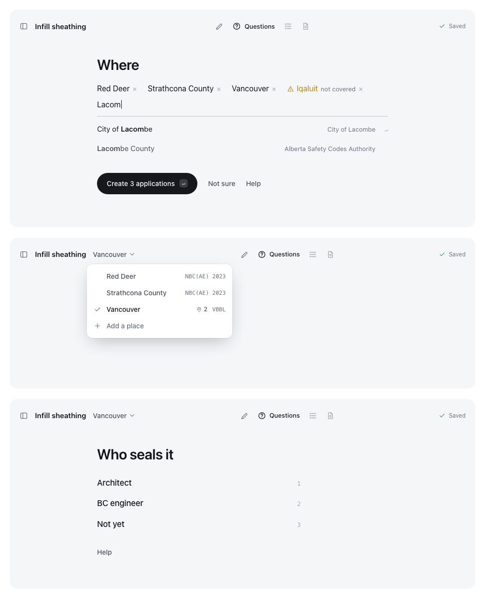

# Every jurisdiction: what Batatis needs to work across Alberta and Canada's major cities

Research of 2026-10-28. Target design, not built. Facts carry the status of the lane file they come from: VERIFIED (primary source read), UNVERIFIED (snippet or secondary), NOT FOUND (searched, nothing primary), ESTIMATE (inference or arithmetic).

| File | What it holds |
|---|---|
| [`alberta.md`](alberta.md) | Every kind of place in Alberta, who reviews there, every Alberta code, site data, address lookup |
| [`alberta-jurisdictions.csv`](alberta-jurisdictions.csv) | One row per Alberta place (390 rows): office, office kind, accreditation by discipline, climate-table match, sources |
| [`alberta_jurisdictions_build.py`](alberta_jurisdictions_build.py) | Rebuilds the CSV from the saved inputs (`alberta-*.json`) |
| [`ontario-quebec.md`](ontario-quebec.md) | Ontario and Quebec codes, 15 cities, traps |
| [`rest-of-canada.md`](rest-of-canada.md) | BC, Prairies, Atlantic, territories, 16 cities, national data (adoption, licensing, intent statements, climate) |
| [`ui-mock.html`](ui-mock.html) | The multi-place flow in the calm style (three screens) |
| [`evidence/evidence.md`](evidence/evidence.md) | Tests of today's app for other places against Calgary and Edmonton, with the scripts and their outputs |

## The short answer

1. **Alberta is one code with many offices.** The NBC(AE) 2023 and NFC(AE) 2023 apply province-wide, and so does the Safety Codes Council variance form. What changes from place to place is the office that reviews, its intake steps and local documents, and the site's climate and seismic values. So "every Alberta jurisdiction" is a data job on offices and sites. For building and fire, Batatis already has the code database it needs.
2. **The rest of Canada is many codes with many offices.** Each province adopts the national code with its own changes, and Vancouver and Quebec's municipalities add their own layers. Article numbers, the section that governs alternative solutions, the objective and function codes, the form, who may prepare it and even the language all change (details in "Traps").
3. **Nothing about a place may come from the model.** Every place, office, code edition, article, fee and climate value comes from a sourced record or from the applicant's own words. The model drafts prose around those records and asks when a record is missing. Batatis already follows this rule for code citations (`engine/codes.py`: "Every citation string comes from `codedb.lookup().citation`"). This plan extends it to every other kind of fact.
4. **Find the place from the map, not from the name.** The City of Lacombe is an accredited municipality. Lacombe County, next door, is reviewed by the Alberta Safety Codes Authority (`alberta-jurisdictions.csv`). Matching on names would send one of them to the wrong office.
5. **Free to read is not free to use.** The NRC requires written consent to reproduce code text commercially, and that includes the Alberta edition Batatis already shows. BC requires a licence agreement. Quebec requires prior authorization even to store its text. Ontario's free code PDF is marked non-commercial. VERIFIED in the lane files. The hackathon does not need these answers, but a public launch and every province pack do, so ask early.
6. **One project, one application per place.** The applicant describes the work once and picks places. Batatis creates one application per place. Each application pins its own office, code edition, form and site values, and shares the description and evidence.
7. **A site variance does not travel.** One variance can cover several sites inside one office's area, but it does not carry to another office, and from 2026-12-01 each location is registered separately (IB-2026-10-01). Only the province's own STANDATA variances apply everywhere. So a manufacturer needs one dossier, a STANDATA and CCMC check, and one application per office. VERIFIED.
8. **Tested today, not before.** In [`evidence/evidence.md`](evidence/evidence.md), one application run through the real engine for 18 places gives the same code references, Section C, warnings and PDF for every Alberta place as for Calgary and Edmonton. The office side is worse: 329 Alberta places get a generic "Rest of Alberta" office, with no local items and no in-app officer review. The app gives the wrong answer for 90 places: First Nations, national parks, airport lands, Lloydminster and every city outside Alberta.

**Fix in Batatis now.** Two things the work found in today's app:

- `Registry.resolve` (`engine/jurisdictions/__init__.py`) sends any place it does not recognize to the Alberta fallback pack. Vancouver, Toronto and Iqaluit therefore get an Alberta office and an Alberta application. It should answer "not covered" (`evidence/evidence.md`, test 1).
- `engine/data/jurisdictions/provinces/AB.json` (note `ab-who-requests`) says a variance may be issued by "a safety codes officer, a technical administrator or the Safety Codes Council". The Safety Codes Act s.38(1) says "An Administrator or a safety codes officer may issue a written variance", and the Council's page now says the same (VERIFIED, `alberta.md` trap 5).

## How many places there are

The challenge brief says "430+ Alberta jurisdictions". Two inventories could not find that number in an official source (A16 on 2026-10-25 and the Alberta lane on 2026-10-28). Alberta's 2025 population list has 387 rows. The table adds 3 airport rows, for 390. People are the list's 2025 counts.

| Kind of place | Rows | People | Who reviews building work | What Batatis does |
|---|---:|---:|---|---|
| Accredited municipality, including the Special Areas and Kananaskis | 255 | 4,136,665 | The municipality, through its own officers or an agency it contracts. 14 joint accreditations cover groups of municipalities | Office record from the table. A hand-written pack where the office publishes local rules (Calgary, Edmonton, then Lethbridge, Medicine Hat, Rocky View, Airdrie, Chestermere) |
| Not accredited for building: 68 municipal rows and 5 Métis settlements | 73 | 156,188 | The Alberta Safety Codes Authority. The owner picks one of five contracted agencies; fees are the same | One authority pack for all 73. Never name an agency for an address |
| Accredited Métis settlement | 3 | 1,771 | The settlement | Same as an accredited municipality |
| First Nation | 48 | 83,932 | The Nation, under its own by-law or land code. Tsuut'ina adopts the National Building Code | Not covered. Say "ask the Nation". Store a Nation's building law when it publishes one |
| National park district or the Jasper townsite | 6 | 6,998 | Parks Canada issues the permit. The Town of Banff is accredited and reviews its own | Not covered. Show the Parks Canada route |
| Airport lands (Calgary International, Springbank, Edmonton International) | 3 | n/a | The airport authority first, then the City of Calgary, Rocky View County or Leduc County | Route to the municipality once the airport authority has signed off |
| Lloydminster and Redwood Meadows | 2 | 20,819 | Lloydminster works under its own Charter and a by-law that could not be read. Redwood Meadows: not determined | Not covered until confirmed |
| **Total** | **390** | 4,406,373 | | |

Accredited municipalities hold about 94% of the people in the list (ESTIMATE from the list's counts). Outside the table: 17 accredited corporations review their own sites, Department of National Defence land was not researched, and farm buildings are exempt from the building and fire codes.

## What changes from place to place

Four layers. Each layer has its own source of truth, its own refresh schedule and its own owner in the code.

| Layer | Question it answers | Alberta | Rest of Canada |
|---|---|---|---|
| Place | Where is the building? | 387 rows in the 2025 population list (municipalities, Métis settlements, First Nations) plus airport lands, each with a map boundary | Census subdivisions (Statistics Canada) in each province |
| Office | Who reviews, how, and what else they publish? | Changes per place: accredited municipality, the Alberta Safety Codes Authority (owner picks a contracted agency), Parks Canada, an airport authority | Changes per place: the chief building official, the RBQ in Quebec, the City of Vancouver |
| Code | Which rules, which edition, which article numbers? | **One profile for the whole province**: NBC(AE) 2023 and NFC(AE) 2023, 2nd printing, plus NPC 2020 and NECB 2020 | One profile per province, plus Vancouver's by-law and Quebec municipal by-laws that pin older editions |
| Site | What local values feed the design? | Table C-2 (147 locations; an exact name for only 125 of 330 municipalities), the seismic tool (a web form with no API), energy zone (6, 7A, 7B or 8), fire-department response, water supply | Each province's table (Ontario SB-1, NBC Appendix C), values an office sets itself (Burnaby), Saskatchewan's province-wide zone 7A |

## Every code we need

Status columns and sources are in the lane files. "Core" means Batatis drafts against it; "next" means the next scope step; "list" means Batatis names it but does not draft against it.

### Alberta

| Code and regulation | Edition in force | Since | For Batatis |
|---|---|---|---|
| NBC(AE) 2023, Building Code Regulation AR 5/2024 | 2nd printing (NRC file dated 2026-08-17; record the hash, the imprint says April 2026) | 2024-05-01 | Core, already in the code database |
| NFC(AE) 2023, Fire Code Regulation AR 32/2015 | 2nd printing | 2024-05-01 | Core, already in the code database |
| NECB 2020, AR 5/2024 s.2 and s.3 | 2nd printing, Energy Tier 1 only: no office may ask for a higher tier | 2024-05-01 | Next |
| National Plumbing Code 2020, AR 119/2007 (no Alberta edition) | 2020; NPC 2025 scheduled for 2027-01-01 | 2023-04-01 | Next |
| STANDATA for the three codes above | Building: 16 variances, 34 interpretations (+1 on hold), 7 bulletins. Fire: 1 variance, 14 interpretations, 6 bulletins. Plumbing: 2 variances, 13 bulletins | Per item | Core: check before drafting a site variance |
| NRC intent statement supplements for NBC, NFC, NPC, NECB 2020 | First release | n/a | Core, labelled explanatory because they are "not a legal component of the Code"; NBC and NFC already loaded |
| Canadian Electrical Code, CSA C22.1-24, AR 209/2006 | 26th edition | 2025-04-01 | List only. Sold by CSA; no Division C alternative-solution framework |
| CSA B149.1:25 and related gas codes, AR 111/2010 | 2025 | 2026-03-01 | List only. Sold by CSA |
| Private Sewage Systems Standard of Practice, AR 229/97 | 2021 | 2022-11-01 | List only |
| Elevating devices, AR 192/2015 | Not researched | | List only |
| Safety Codes Act and its regulations | Consolidation current as of 2025-12-01 | | Legal basis (King's Printer allows reproduction with credit) |

Two traps sit in this table. First, the King's Printer consolidations still name the 2019 fire code, the 2015 plumbing code and the 2018 electrical code "as amended or replaced from time to time". Act s.65(4) makes a replacement law 12 months after publication unless the Minister orders otherwise, so take the edition from the alberta.ca code pages and never from the regulation text. Second, the national NBC 2025 was published on 2025-12-22, and no Alberta notice for it was found.

### Outside Alberta

| Place | Code profile | Alternative-solution rule | Free to read | Commercial reuse |
|---|---|---|---|---|
| British Columbia | BC Building Code 2024 (NBC 2020 plus BC changes), Revision 7 from 2026-09-21 | Div C 2.3.1.1 Application and 2.3.1.2 Documentation | PDF, "does not include all updates" | Licence agreement with the Province, plus NRC |
| Vancouver | Vancouver Building By-law 2025, not the BC code (by-law number 14343 UNVERIFIED) | City process, AL-1 form | City PDFs (blocked to scripts) | Unknown |
| Manitoba (Winnipeg) | M.R. 78/2023: NBC 2020 plus Manitoba Schedule, from 2024-01-01; deemed adoption of new editions after 18 months | Div C 2.3.1.1; Form 08 requires a Manitoba engineer or architect | HTML regulation, NRC PDF | NRC; Manitoba terms not read |
| Saskatchewan (Saskatoon, Regina) | SR 124/2021: NBC 2020 Tier 1 plus amendments, from 2024-01-01; 2025 codes proposed for 2027-01-01 | City forms; Saskatchewan architect or engineer | PDF through a JSON API | NRC; Publications Centre terms not read |
| Ontario (10 cities) | O. Reg. 163/24: NBC 2020 plus "Ontario Amendments" (dated 2026-10-01), SA-1 attributions, SB-1 climate, SB-10/SB-12 energy | **Div C 2.1.1.1**, to the chief building official; Fire Code is a separate route | e-Laws (one page); HTML Compendium lags one amendment; PDF stale | Regulations free with credit; Compendium not stated; PDF non-commercial; NRC |
| Quebec, buildings under Chapter I | Chapter I: NBC 2020 as modified for Quebec, from 2025-04-17; old chapter if work began before 2027-10-17 | RBQ under Building Act s.127 (équivalente) and s.128 (différente); French-only forms 1536 and 1536EE | LégisQuébec HTML, NRC PDF | Prior authorization from Quebec; NRC |
| Quebec, exempt buildings | Municipal by-laws: Montréal 11-018 pins **NBC 2010** (modified); Gatineau 534-2025 pins **NBC 2015** (modified) | The municipality (Montréal: free, about 4 weeks) | City PDFs | City terms not found |
| Nova Scotia (Halifax) | N.S. Reg. 198/2024: NBC 2020 with errata only up to 2023-04-01; Tier 2 energy from 2026-04-01 | Halifax process NOT FOUND | HTML | "personal use" only |
| New Brunswick | Reg. 2021-2 as amended by 2025-19: NBC 2020 Tier 2 from **2025-05-01** | Fredericton form | HTML | Not read |
| Newfoundland and Labrador | **NBC 2025** from 2026-07-12 per the CBHCC tracker; the regulation auto-adopts editions after 6 months | NOT FOUND | HTML | King's Printer |
| PEI, Yukon, NWT | NBC 2020 (PEI and NWT in full) | NOT FOUND | Not retrieved | Unknown |
| Nunavut | **NBC 2015** in full since 2018 | NOT FOUND | Blocked | Unknown |
| National model codes | NBC 2020 (free PDF), NBC 2025 (free PDF, Table C-2 now climate-adjusted, over 680 locations), 2020 intent statements (free PDF, 3,210 pages; none for 2025) | Not applicable | PDF only; no API or XML | Written NRC permission for commercial redistribution |

## Every piece of data we need

One row per data item. "Collect" says how it gets into Batatis: a script, an API, a person reading a page, or a question the office must answer. A script never makes a fact verified on its own: a person checks each new or changed record once, and the record keeps that check.

| Layer | Data item | Why Batatis needs it | Source | Format | Refresh | Collect |
|---|---|---|---|---|---|---|
| Place | Address to coordinates | Find the place without trusting names | Statistics Canada Open Database of Addresses (Alberta file, 2021): searched on the user's machine, so the address never leaves the device. It only holds addresses that municipalities published, and rural sites often have a legal land description instead (converting one was not researched) | Zipped CSV | No newer version found | Script, then the applicant confirms |
| Place | Boundaries of municipalities, Métis settlements, reserves, national parks | Coordinates to place | Government of Alberta map services (`geospatial.alberta.ca/titan/rest/services/boundaries/`), whose codes equal the population list's codes, with 728 reserve polygons; NRCan Aboriginal Lands (monthly); Statistics Canada 2021 census subdivisions for other provinces | ArcGIS REST, shapefile | Annexations by Order in Council; watch alberta.ca/annexations weekly | Script, point-in-polygon |
| Place | Place registry (code, legal name, type, population) | One stable id per place | Alberta MAPL 2025 (open.alberta.ca); Statistics Canada census subdivisions elsewhere | CSV | Yearly | Script |
| Office | Building office per place, and per discipline | Section A, routing, the officer's queue | Safety Codes Council accreditation search (one response holds all 1,251 municipal rows; drop the officer names and e-mails it includes); ASCA pages; city pages outside Alberta | HTML | Monthly | Script plus a person's check |
| Office | Who delivers the officer service (staff or contracted agency) | Contact and intake steps | Municipal pages; quality management plans when public | HTML, PDF | Quarterly | Person, or ask the office |
| Office | Intake: portal, local form, fee and its effective date, review time | Export and the "how to send" step | City pages and fee by-laws (Winnipeg has open data) | HTML, PDF, JSON | Each fee year (1 January or 1 February) | Person; script watches hashes |
| Office | Who may prepare or seal | A question only when the office requires it | City forms; Manitoba Form 08; BC appeal decision 1946 | PDF | Rare | Person |
| Office | Appeal route | Refusal notices | Safety Codes Act (Council, C$500, 30 days); BC Appeal Board; Saskatchewan board; Quebec tribunal | HTML | Rare | Person |
| Office | Local standing variances, guides, bulletins | Offer a pre-reviewed path; local notes | Calgary SPVs and advisories; Edmonton B23-01; others when published | PDF | Monthly | Script plus person |
| Code | Edition in force and the transition test | Pick the code profile for an application | Each instrument (lane files); the CBHCC tracker only as a pointer | HTML, PDF | Per amendment (Ontario changed its date eight times since 2024) | Script watches, person confirms |
| Code | Code text as provisions with ids | Section B citations, code-in-place, search | NRC PDFs (national and Alberta); BC PDF plus orders; Ontario Compendium HTML; LégisQuébec | PDF, HTML | Per edition, revision, errata | Script into the code database, after licence |
| Code | Objectives, functional statements, attributions | Section C lookup | Division A Parts 2-3 and Division B brackets; Ontario SA-1 | Text, HTML tables | Per edition | Script; one table per profile |
| Code | Intent statements | "Why this rule exists", always labelled explanatory | NRC 2020 supplements (NBC, NFC, NPC, NECB) | PDF | 2020 only | Already in Batatis for NBC and NFC |
| Code | The Division C alternative-solution article | Completeness rules and form wording | Each code (AB 2.3.1.1, ON 2.1.1.1, BC 2.3.1.1-2.3.1.2, QC 2.3.1.1 to RBQ) | Text | Per edition | Script plus person |
| Code | Province-wide interpretations and variances | Avoid a site variance when a province-wide one exists | Alberta STANDATA (open.alberta.ca CKAN API; `metadata_modified` shows changes); Ontario rulings; BC orders | JSON, PDF | Weekly | API |
| Code | Product evaluations | Suggest the product route | CCMC registry (already in `engine/data/ccmc`); BC accepts CCMC Technical Guides since 2026-09-21; Ontario's BMEC defers to CCMC | JSON | Weekly | API |
| Site | Climate values | Section D inputs and checks | NBC(AE) Table C-2 (147 places); unlisted Alberta places by email to ECCC, as the code says; Ontario SB-1; national Table C-2; values an office sets. The PCIC Design Value Explorer covers any location but only for screening (not checked against Table C-2) | PDF, HTML, CSV | Per edition | Script; ask when unlisted |
| Site | Seismic values | Part 4 and Part 9 inputs | NRCan 2020 NBC Seismic Hazard Tool (any latitude, longitude and site designation); Table C-3 for Part 9 (147 Alberta places) | Web form with CSV export, table | Per edition | Table by script. The tool has no API (a scripted request got HTTP 403), so a person runs it or the applicant attaches its output; never interpolated |
| Site | Energy climate zone | Section 9.36 and NECB paths | Heating degree-days from the climate table; Saskatchewan fixes zone 7A | Table | Per edition | Script |
| Site | Fire-department response time and firefighting water supply | Spatial separation and water-supply rules | The office or fire department only | None published | Per project | Ask the office |
| Site | Flood, wildfire, land use | Flags only, never modelled | Provincial flood maps, land use by-laws | Map | Yearly | Link out |
| Process | Form template and field mapping per office | Fill the office's own form | SCC template (all of Alberta), Calgary, Toronto 14-0074, Mississauga 2966, Manitoba Form 08, Regina, Fredericton, Burnaby, Surrey, Vancouver AL-1, RBQ 1536 | PDF, Word | Rare; hash watch | Person maps once |
| Process | Language | Quebec forms in French | RBQ linguistic policy | HTML | Rare | Person |
| Meta | Source hash and retrieval date for every record above | Know when a fact went stale | Every source | sha256 | Nightly | Script |
| Meta | Licence status per source | Know what may be shown, stored, exported | NRC, BC, Ontario, Quebec, Alberta King's Printer, cities | Letters | Per request | Ask |

## How Batatis stays honest everywhere

Ten rules. The first three already hold for code citations in Alberta. The rest are new.

1. **The model never states a place fact.** It reads the applicant's words, drafts prose and proposes candidates. Offices, editions, articles, fees, climate values and form fields come from records.
2. **Every record has a source and a status.** The existing `PackSource` (title, url, retrieved, sha256, status) becomes the rule for every record, plus a locator or quote. Only `verified` records are stated as fact. `unverified` and `ask the office` records become a question or a "confirm with the office" line.
3. **Citations resolve in the application's own code.** `codedb.lookup` already takes a `doc` argument; today callers default to `NBC-AE` and `Case.provisions` holds bare ids. Store `doc:division:id` instead, so an Ontario application cannot cite an NBC(AE) id. Export blocks on any id that does not resolve.
4. **The edition is a rule, not a guess.** A code profile is chosen from the place, the date and the building type, with each transition stored as data: Alberta's permit-application date (with the "substantially completed" plans exception), Ontario's permit-or-drawings test, Quebec's work-start test before 2027-10-17, Saskatchewan's permit-issue date, New Brunswick's plans drop-off date, Nova Scotia's errata cut-off, Quebec's exempt-building split.
5. **One lookup table per code.** Ontario's F101 means "to limit unwanted visual exposure"; in NBC(AE) it means "to minimize the risk of contamination of food". Objectives, functions and attributions are never merged across profiles.
6. **Site values come from tables and tools, never from the model.** An exact table match gives the value. A value the office publishes wins over the table, as Div B 1.1.3.1 says. Otherwise Batatis says what the code says: in Alberta, email Environment and Climate Change Canada for an unlisted place (NBC(AE) PDF p. 657). It never interpolates.
7. **Map first, name second.** Coordinates and boundaries decide the place. A typed town name goes through the same lookup and the applicant confirms the result.
8. **Coverage is computed, not declared.** A place counts as fully covered only when its office record is verified, its code profile is loaded and checked, its form is mapped and its test cases pass. Otherwise the place gets the honest lower level, and the screen says so.
9. **Sources are watched.** A nightly job re-fetches every source and compares hashes. A change marks the records that depend on it as stale until a person re-checks them. Watch lists: Ontario's e-Laws version list, the CBHCC tracker, Alberta's STANDATA API, the RBQ news page, BC ministerial orders, every office's fee page.
10. **Tests per jurisdiction, including leak tests.** Each place kind gets fixed test cases: address to office, edition, required local items, citation validity. Leak tests fail when a Calgary fact appears in a Red Deer application or an NBC(AE) id appears in an Ontario one. This extends `engine/tests/test_no_jurisdiction_literals.py`.

"Perfect" cannot be promised. What can be enforced: every sentence about a place traces to a record or to the applicant, every gap becomes a question, and Batatis refuses places it cannot support instead of drafting a generic application.

## One project, many applications

| Part of the variance form | Shared across places | Per place |
|---|---|---|
| A. Applicant, owner, site | Applicant and owner | Site address, office, local questions |
| B. Code references | Within one code profile (all of Alberta shares one) | Across profiles: different articles and numbering |
| C. Objectives, functions, intent | Within one code profile | Across profiles: different tables (Ontario SA-1) |
| D. Proposal and evidence | The description, the proposal, the evidence list | Climate and seismic values; who must seal; language |

Model changes, smallest first:

- Add a project that owns the shared facts. Each existing `Case` becomes one application with a place, an office record and a code profile.
- Give every fact a scope (`shared` or `local`). A shared answer changes every unsubmitted application in the project; a submitted one keeps its version.
- Run code identification once per code profile, not once per place. Three hundred Alberta places mean one identification and three hundred Section A variants.
- Replace the global `CODE_EDITION` string in `web/src/config.ts` with the application's profile, and derive reviewer offices from office records instead of `Authority = Literal['calgary', 'edmonton']` in `engine/account_models.py`.
- Generate office records for all Alberta places from `alberta-jurisdictions.csv`. Keep hand-written packs (`calgary.json`, `edmonton.json`) for offices that publish local rules. The `alberta-other` fallback then only covers a place the map cannot resolve.

A manufacturer who picks many places is often looking for a province-wide answer, not 300 site variances. Batatis should show the province-wide routes the sources support, without promising an outcome.

| Route | What it does | Status |
|---|---|---|
| STANDATA variance | Applies "throughout the Province of Alberta". 16 current for NBC(AE) 2023. Check first | VERIFIED |
| CCMC evaluation report | NBC(AE) Div A 1.2.2.1.(2): may be used in determining compliance. Batatis already holds the CCMC registry | VERIFIED |
| One variance, several sites | Allowed inside one office's area (2019 Municipal Affairs notice; Grande Prairie's plan). It does not carry to another office, and each location is registered separately from 2026-12-01 | VERIFIED |
| "Review for jurisdictional use" box on the Council form | Exists on the form. No public page explains who reviews, the cost, or whether offices must accept it | NOT FOUND |

So the honest output for a manufacturer is one dossier, a STANDATA and CCMC check, and one application per office.

## The screens

[`ui-mock.html`](ui-mock.html) draws three screens in the calm style. Rules from `minimal-ui` and `batatis-ui-minimalist`:

1. **Where** has nothing above the title and no box per item. The places and the typed text share one line, with one hairline under it, and each place has a ×. Suggestions are plain rows showing the office each place resolves to, so the Lacombe and Lacombe County difference is visible before the applicant chooses. A place Batatis cannot cover is the only coloured item ("not covered"). The one filled shape is the primary button, which states the outcome: "Create 3 applications".
2. **One application on screen at a time.** The place in the header is plain text with a ⌄ ("Vancouver ⌄"). Its menu is the screen's one extra surface while open. It lists the project's applications with their code edition, a pin and a count for questions only that place asks, and "Add a place". The current application has a check, not a fill. With one place, the picker is not shown.
3. **Local rules become ordinary questions.** Vancouver requires a BC architect or engineer, so the Vancouver application asks "Who seals it", with the choices as plain rows and number keys. It carries no tag: the header already says Vancouver. Office details stay one step away in the existing "Office details" disclosure.
4. **The officer's side does not change.** An officer sees only the applications sent to their office.

## Traps an AI falls into

The full lists are in the lane files. These are the ones that would put a wrong statement in an application.

| Trap | Correct fact | Status |
|---|---|---|
| "Alternative solutions are Div C 2.3.1.1 everywhere" | Ontario: 2.1.1.1 (Ontario's 2.3 is the BMEC fee). BC: 2.3.1.1 is Application, 2.3.1.2 Documentation. Quebec's 2.3.1.1 sends it to the RBQ | VERIFIED |
| "F101 is F101" | Ontario F101 and F130 differ from NBC(AE) F101 and F130; Ontario adds objectives (OH6, OH7, OR, OC) | VERIFIED |
| "Vancouver follows the BC code" | "BC Codes don't apply in the City of Vancouver" | VERIFIED |
| "Montréal uses NBC 2020" | Chapter I buildings do. Exempt buildings follow by-law 11-018, which pins NBC 2010 (modified) | VERIFIED |
| "The latest national code applies" | Nunavut is on NBC 2015; Newfoundland and Labrador lists NBC 2025 | VERIFIED (tracker) |
| "Quebec's transition ends 2026-10-17" | 2027-10-17, tested on the date work began (LégisQuébec still prints the old date) | VERIFIED |
| "Ontario's code is on e-Laws" | e-Laws holds a one-page adoption; the adopted amendments document is on request from the ministry | VERIFIED |
| "Use Table C-2 for every place" | Office-set values win (Burnaby); Saskatchewan fixes zone 7A; Alberta tells you to ask ECCC for unlisted places | VERIFIED |
| "A registered professional is always required" | BC's code does not require one; Vancouver, Burnaby, Surrey, Manitoba, Regina, Saskatoon do by local rule | VERIFIED |
| "New Brunswick moved on April 1, 2025" | Regulation 2025-19 took effect May 1, 2025 | VERIFIED |
| "All NBC 2020 errata apply in Nova Scotia" | Only those up to 2023-04-01 | VERIFIED |
| "CCMC-evaluated products need an alternative solution in BC" | Since 2026-09-21 a CCMC Technical Guide cited in an evaluation report is an acceptable solution | VERIFIED |
| "The RBQ form can be in English" | Quebec-domiciled firms must fill RBQ forms in French | VERIFIED |
| "Alberta has 430+ jurisdictions" | 387 rows in the 2025 population list: 330 municipal, 8 Métis settlements, 48 First Nations, 1 other | VERIFIED count; "430+" NOT FOUND |
| "The Fire Code Regulation adopts the 2019 fire code" | The text names 2019 "as amended or replaced"; NFC(AE) 2023 is in force since 2024-05-01. Plumbing and electrical have the same gap | VERIFIED |
| "A technical administrator or the Council may issue a variance" (Batatis's own `provinces/AB.json`) | Act s.38(1): "An Administrator or a safety codes officer" | VERIFIED |
| "The Council's Where to get a Permit tool finds the office for an address" | It searches organizations by type, discipline, city and name | VERIFIED |
| "The Authority assigns an agency by area" | The owner chooses one of five agencies; fees are the same | VERIFIED |
| "A town's variance form is a Safety Codes Act variance" | Wood Buffalo's "Variance Application Form" is a zoning form; Beaumont's and Parkland's variance fees look like zoning fees | VERIFIED; fees INFERENCE |
| "Every Table C-2 name is a municipality" | 22 of 147 are hamlets or former municipalities. "Lacombe" is the city's entry, not Lacombe County's. Only 125 of 330 municipalities match a name exactly | VERIFIED |
| "The National Parks Building Regulations apply in Banff and Jasper" | Repealed by SOR/2024-230 | VERIFIED |
| "An office can require a higher energy tier" | AR 5/2024 s.3: not above Tier 1 | VERIFIED |
| "The fire-response rule is one article" | NBC(AE) 3.2.3.1.(8) for spatial separation, 3.1.6.9.(3) for combustible cladding, 9.10.14.3.(1) and 9.10.15.3.(1) for houses. No municipality publishes whether it meets the test | VERIFIED in the code database; publication NOT FOUND |

## Build order

ESTIMATE throughout. Each step ends in something a person can test.

| Step | What ships | Why this order | Rough size |
|---|---|---|---|
| 0. Foundation | Address lookup from boundaries; office records for all 390 Alberta places; code profiles with namespaced ids; site tables (Table C-2 and C-3); computed coverage; nightly source watch; per-place tests | Everything else depends on it, and it needs no new code text | 3 to 5 weeks |
| 1. All of Alberta | Every Alberta place resolves; Authority flow for unaccredited places; clear "not covered" for reserves and federal land; local packs for the 20 largest offices; STANDATA index; the multi-application screens | Same code, same form: the cheapest large gain | 2 to 3 weeks after step 0 |
| 2. Saskatchewan and Manitoba | Regina, Saskatoon, Winnipeg | NBC 2020 with light changes; Winnipeg is fully sourced | 1 to 2 months each, after an NRC licence |
| 3. BC and Vancouver | BCBC profile plus Vancouver by-law profile; Surrey, Burnaby, Victoria | A licence process exists; CCMC rule already changed | 2 to 3 months, after BC and NRC licences |
| 4. Ontario | OBC profile with SA-1 and SB-1; 10 cities | Largest volume; the amendments document must come from the ministry | 3 months |
| 5. Quebec | Chapter I profile; RBQ route in French; Montréal and Gatineau by-law profiles | French, two regimes, strictest reuse terms | 4 to 6 months |
| 6. Atlantic and territories | NS, NB, PEI, NL (2025), YT, NT, NU (2015) | Small volumes; several processes not published | As demand appears |

Plan for two editions at once from step 0. Saskatchewan proposes the 2025 codes for 2027-01-01 (VERIFIED, provincial flyer). Manitoba's statute adopts them about 2027-06-22 (ESTIMATE). Other provinces committed to adopt within 18 months of publication (2025-12-22).

## Questions only people can answer

1. **NRC Codes Canada:** licence terms for storing, showing, indexing and exporting national and Alberta code text and the 2020 intent statements in a commercial product.
2. **BC, Ontario's King's Printer and MMAH, Quebec (Publications du Québec and the RBQ):** the same question for their codes, plus Ontario's amendments document and whether the RBQ accepts AI-drafted French text.
3. **Offices:** fees and forms that are not published (Ottawa tiers, Vancouver's fee, Halifax, Victoria, St. John's), and every Alberta office's intake steps beyond the Council form.
4. **Safety Codes Council and Municipal Affairs:** how the form's "review for jurisdictional use" route works; who signs variances in Authority areas and inside joint accreditations; who handles fire in the 36 municipal rows with no fire accreditation; whether a national NBC 2025 replaces the Alberta edition under Act s.65(4); reuse terms for the accreditation search data.
5. **Lloydminster, First Nations, National Defence, Parks Canada:** which code applies and which office reviews.
6. **Fire departments:** whether they meet the 10-minute response test, which changes spatial separation and cladding limits.

## Methods used

- Matt Pocock's research method (`~/.agents/skill-libraries/mattpocock/skills/engineering/research/SKILL.md`): primary sources, every claim cited, one research folder in the repo. Applied by the parent and all three research lanes.
- pstack unslop (`~/.agents/skill-libraries/pstack/skills/unslop/SKILL.md`): prose in this file and the lane files.
- The user's `minimal-ui` skill and `.cursor/skills/batatis-ui-minimalist/SKILL.md`: the screens and their verify pass.
- T3 workflow router (`~/.codex/skills/t3-workflow/SKILL.md`, research route): method selection and child briefs.
- Research lanes ran on Claude Sonnet 5.5 at max effort, per the user's research routing; GPT-6.1-Sol is out of quota until 2026-11-02. A server restart interrupted two lanes, and the Alberta lane later hit the account's usage limit. Each had already written its complete file, and its "Not researched" list stands.
- Parent checks: every NBC(AE) article number in this file was looked up in `codedb/build/codedb.sqlite`. One lane error was corrected: the cladding response-time rule is 3.1.6.9.(3), not 3.1.6.12.(3).
